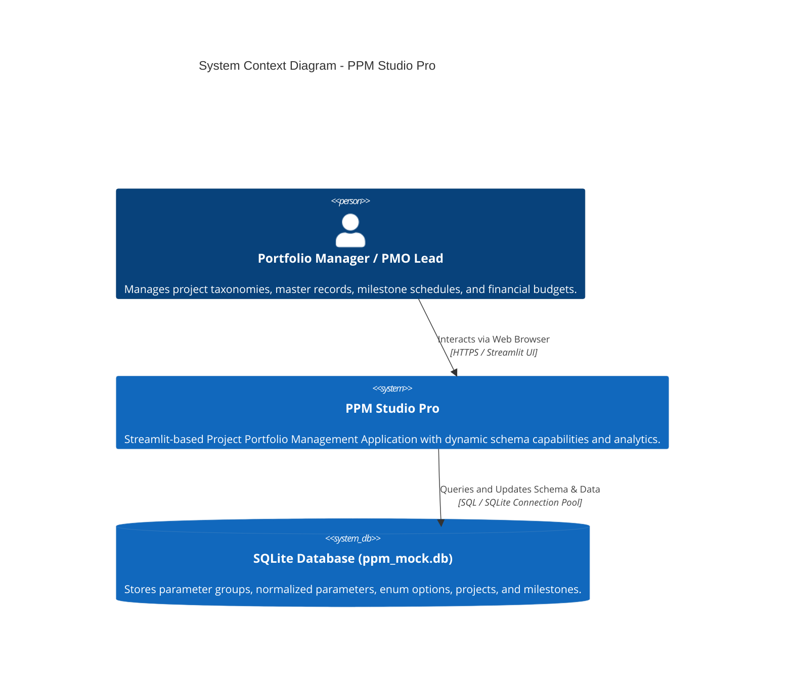

# PPM Studio Pro - Enterprise Project Portfolio Management

PPM Studio Pro is an enterprise-grade Project Portfolio Management (PPM) web application built with Streamlit, SQLite, and Plotly. It enables portfolio managers, architects, and PMO executives to manage project master data, configure flexible metadata schemas, schedule milestone roadmaps, and track budget analytics in real-time.

---

## 🏛️ System Architecture & C4 Model

### C4 Level 1: System Context Diagram


### C4 Level 2: Container & Layered Component Architecture

```mermaid
classDiagram
    direction TB

    namespace Presentation_Layer {
        class PortfolioView {
            +render() void
        }
        class ProjectMasterView {
            +render() void
        }
        class SchemaDefView {
            +render() void
        }
        class PlanningView {
            +render() void
        }
        class BudgetView {
            +render() void
        }
    }

    namespace Business_Services_Layer {
        class PortfolioService {
            +calculate_metrics(df_projects: DataFrame) PortfolioMetrics
            +flatten_dynamic_attributes(df_projects: DataFrame, params: DataFrame) DataFrame
        }
        class SchemaService {
            +generate_param_id(db_path: str) str
            +get_next_available_group_order(db_path: str) int
        }
        class MilestoneService {
            +parse_csv(uploaded_file, project_id: str) list~dict~
            +get_csv_template() str
        }
    }

    namespace Data_Access_Layer {
        class SchemaRepository {
            +get_all_groups() DataFrame
            +get_all_parameters() DataFrame
            +get_all_options() DataFrame
            +create_group(name: str, order: int) int
            +update_group(id: int, name: str, order: int) bool
            +delete_group(id: int) bool
            +create_parameter(param_id: str, group_id: Optional~int~, name: str, ptype: str) bool
            +delete_parameter(param_id: str) bool
            +add_option(param_id: str, value: str, order: int) int
            +delete_option(option_id: int) bool
        }
        class ProjectRepository {
            +get_all_projects() DataFrame
            +exists(project_id: str) bool
            +create_project(id: str, name: str, status: str, planned: float, actual: float, dyn_attrs: dict) bool
            +update_project(id: str, name: str, status: str, planned: float, actual: float, dyn_attrs: dict) bool
            +delete_project(id: str) bool
        }
        class MilestoneRepository {
            +get_milestones_by_project(project_id: str) DataFrame
            +create_milestone(project_id: str, task: str, phase: str, start: str, end: str, progress: int) int
            +bulk_create_milestones(rows: list~dict~) int
            +delete_milestone(milestone_id: int) bool
        }
    }

    namespace Core_Database_Config {
        class AppConfig {
            +db_path: str
            +log_level: str
            +app_env: str
        }
        class DatabaseManager {
            +get_db(db_path: str) Connection
            +init_db(db_path: str) void
            +seed_default_data_if_empty(db_path: str) void
        }
    }

    PortfolioView --> PortfolioService
    PortfolioView --> ProjectRepository
    PortfolioView --> SchemaRepository
    ProjectMasterView --> ProjectRepository
    ProjectMasterView --> SchemaRepository
    SchemaDefView --> SchemaService
    SchemaDefView --> SchemaRepository
    PlanningView --> MilestoneService
    PlanningView --> MilestoneRepository
    PlanningView --> ProjectRepository
    BudgetView --> PortfolioService
    BudgetView --> ProjectRepository

    SchemaRepository --> DatabaseManager
    ProjectRepository --> DatabaseManager
    MilestoneRepository --> DatabaseManager
    DatabaseManager --> AppConfig
```


---

## 📁 Project Directory Structure

```text
eppm_demo/
├── .env.example                # 12-Factor environment variable template
├── .gitignore                  # Git ignore rules including .env and secrets
├── app.py                      # Main Streamlit application entrypoint & router
├── README.md                   # System documentation & C4 architecture diagrams
├── ppm_mock.db                 # SQLite database
├── src/                        # Modular application source code
│   ├── __init__.py
│   ├── config.py               # Environment configuration (12-Factor)
│   ├── logging_config.py       # Structured logging setup
│   ├── models/                 # Domain dataclasses and constants
│   │   ├── __init__.py
│   │   ├── constants.py        # Statuses, page names, parameter types
│   │   ├── schema.py           # SchemaGroup, SchemaParameter, SchemaParamOption
│   │   ├── project.py          # Project, PortfolioMetrics
│   │   └── milestone.py        # Milestone
│   ├── database/               # SQLite connection & schema migrations
│   │   ├── __init__.py
│   │   ├── connection.py       # get_db context manager
│   │   ├── schema_init.py      # init_db and migration pipeline
│   │   └── seeder.py           # seed_default_data_if_empty
│   ├── repositories/           # Data access layer (CRUD queries)
│   │   ├── __init__.py
│   │   ├── schema_repo.py      # Schema groups, parameters, options CRUD
│   │   ├── project_repo.py     # Projects CRUD
│   │   └── milestone_repo.py   # Milestones CRUD & bulk operations
│   ├── services/               # Pure business logic & data transformations
│   │   ├── __init__.py
│   │   ├── schema_service.py   # Parameter ID generation, next order calculation
│   │   ├── portfolio_service.py # Financial KPI metrics & attribute flattening
│   │   └── milestone_service.py # CSV parsing & template export
│   └── views/                  # Streamlit UI Presentation Layer (Screens 1 to 5)
│       ├── __init__.py
│       ├── portfolio_view.py   # 1. Portfolio Overview
│       ├── project_master_view.py # 2. Project Master Data
│       ├── schema_def_view.py  # 3. Parameters Definition (Schema Builder)
│       ├── planning_view.py    # 4. Planning & Milestone Loader
│       └── budget_view.py      # 5. Budget Tracking
└── tests/                      # Automated test suite (AAA pattern)
    ├── __init__.py
    ├── test_database.py        # Table creation, migration, connection tests
    ├── test_repositories.py    # Repository CRUD tests
    ├── test_services.py        # Financial KPIs, attribute flattening, CSV parsing tests
    ├── test_app_integration.py # Full lifecycle integration tests
    └── test_app.py             # Regression test suite
```

---

## 🚀 Getting Started

### 1. Prerequisites
- Python 3.11+
- Virtual environment (`venv`)

### 2. Run the Application
```powershell
# Launch Streamlit web dashboard
streamlit run app.py
```
Open `http://localhost:8501` in your browser.

### 3. Run Automated Tests
```powershell
# Run the complete test suite
python -m unittest discover tests -v
```

---

## 📋 Features Overview

1. **📊 1. Portfolio Overview**: Executive KPI banner (Planned, Actual, Variance), dynamic column unpacking with `LinkColumn` and `ListColumn` (for `TAGS`/`MULTI_ENUM`), and search/status filtering.
2. **📋 2. Project Master Data**: Dynamic forms rendering grouped and ungrouped attributes based on the current schema taxonomy; complete Create, Edit, and Delete lifecycle.
3. **⚙️ 3. Parameters Definition (Schema Builder)**: Schema Group management with collision avoidance, ungrouped parameter support, discrete option configuration, and real-time hierarchy visualization.
4. **📅 4. Planning & Milestone Loader**: Interactive Plotly Gantt timeline chart, single milestone creation form, and CSV bulk import/export.
5. **💰 5. Budget Tracking**: Interactive financial analytics with planned vs actual grouped bar charts, variance distributions, status donut charts, and a financial health register.
