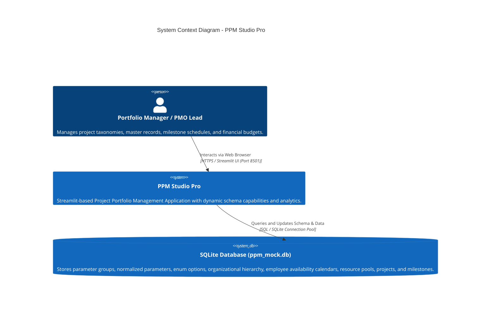

# PPM Studio Pro - Enterprise Project Portfolio Management

PPM Studio Pro is an enterprise-grade Project Portfolio Management (PPM) web application built with Streamlit, SQLite, and Plotly. It enables portfolio managers, architects, and PMO executives to manage project master data, configure flexible metadata schemas, schedule milestone roadmaps, manage organizational hierarchies and resource pools, and track portfolio analytics in real-time.
  
---

## 🏛️ System Architecture & C4 Model

### C4 Level 1: System Context Diagram


### C4 Level 2: Container & Layered Component Architecture

```mermaid
classDiagram
    direction TB

    namespace Presentation_Layer {
        class PortfolioView {
            +render() void
        }
        class ProjectMasterView {
            +render() void
        }
        class PlanningView {
            +render() void
        }
        class SettingsView {
            +render() void
        }
        class SchemaDefView {
            +render() void
        }
        class BudgetView {
            +render() void
        }
    }

    namespace Business_Services_Layer {
        class PortfolioService {
            +calculate_metrics(df_projects: DataFrame) PortfolioMetrics
            +flatten_dynamic_attributes(df_projects: DataFrame, params: DataFrame) DataFrame
        }
        class OrganizationService {
            +get_level_3_managing_function(function_id: int, df_functions: DataFrame) dict
            +enrich_projects_with_organization(df_projects: DataFrame, df_functions: DataFrame) DataFrame
            +enrich_functions(df_functions: DataFrame, df_types: DataFrame) DataFrame
            +enrich_employees(df_employees: DataFrame, df_functions: DataFrame) DataFrame
            +validate_employee_calendar_exception(start_date: date, end_date: date, percentage: float) void
        }
        class SchemaService {
            +generate_param_id(db_path: str) str
            +get_next_available_group_order(db_path: str) int
            +validate_project_dynamic_attributes(dyn_values: dict, params_df: DataFrame) list
        }
        class MilestoneService {
            +parse_csv(uploaded_file, project_id: str) list~dict~
            +evaluate_constraints(tasks: list, dependencies: list) tuple
            +get_csv_template() str
        }
        class ResourcePoolService {
            +calculate_project_pool_status(project_id: int, pool_id: int) dict
            +get_pool_capacity_detail(pool_id: int) PoolCapacityDetail
        }
    }

    namespace Data_Access_Layer {
        class SchemaRepository {
            +get_all_groups() DataFrame
            +get_all_parameters() DataFrame
            +get_all_options() DataFrame
            +create_group(name: str, order: int) int
            +create_parameter(param_id: str, group_id: int, name: str, ptype: str, mandatory: bool, alias: str) bool
            +update_parameter(param_id: str, group_id: int, name: str, ptype: str, mandatory: bool, alias: str) bool
        }
        class ProjectRepository {
            +get_all_projects() DataFrame
            +exists(project_id: str) bool
            +create_project(id: str, name: str, status: str, planned: float, actual: float, dyn_attrs: dict, function_id: int) bool
            +update_project(id: str, name: str, status: str, planned: float, actual: float, dyn_attrs: dict, function_id: int) bool
            +delete_project(id: str) bool
        }
        class MilestoneRepository {
            +get_milestones_by_project(project_id: str) DataFrame
            +create_milestone(project_id: str, task: str, phase: str, start: str, end: str, progress: int) int
            +bulk_create_milestones(rows: list~dict~) int
            +delete_milestone(milestone_id: int) bool
        }
        class OrganizationRepository {
            +get_all_functions() DataFrame
            +get_all_function_types() DataFrame
            +get_all_teams() DataFrame
            +get_all_employees() DataFrame
            +get_employee_calendar_exceptions(employee_id: int) DataFrame
            +get_effective_occupation_percentage(employee_id: int, on_date: date) float
        }
        class ResourcePoolRepository {
            +get_all_pools() DataFrame
            +get_mappings_by_pool(pool_id: int) DataFrame
            +get_assignments(project_id: int) DataFrame
        }
    }

    namespace Core_Database_Config {
        class AppConfig {
            +db_path: str
            +log_level: str
            +app_env: str
        }
        class DatabaseManager {
            +get_db(db_path: str) Connection
            +init_db(db_path: str) void
            +seed_default_data_if_empty(db_path: str) void
        }
    }

    PortfolioView --> PortfolioService
    PortfolioView --> OrganizationService
    PortfolioView --> ProjectRepository
    PortfolioView --> SchemaRepository
    ProjectMasterView --> ProjectRepository
    ProjectMasterView --> SchemaRepository
    ProjectMasterView --> OrganizationRepository
    PlanningView --> MilestoneService
    PlanningView --> MilestoneRepository
    PlanningView --> ProjectRepository
    SettingsView --> OrganizationRepository
    SettingsView --> SchemaRepository
    SettingsView --> SchemaDefView
    BudgetView --> PortfolioService
    BudgetView --> ProjectRepository

    SchemaRepository --> DatabaseManager
    ProjectRepository --> DatabaseManager
    MilestoneRepository --> DatabaseManager
    OrganizationRepository --> DatabaseManager
    ResourcePoolRepository --> DatabaseManager
    DatabaseManager --> AppConfig
```


---

## 📁 Project Directory Structure

```text
eppm_demo/
├── .env.example                # 12-Factor environment variable template
├── .gitignore                  # Git ignore rules including .env and secrets
├── .dockerignore               # Optimized Docker build context exclusions
├── Dockerfile                  # Production-ready multi-stage Docker build
├── docker-compose.yml          # Container orchestration with volume persistence
├── requirements.txt            # Application Python package dependencies
├── app.py                      # Main Streamlit application entrypoint & routing
├── README.md                   # System documentation, seeding & Docker guide
├── ppm_mock.db                 # SQLite database file
├── scripts/
│   └── seed_database.py        # CLI database generator & bulk seeder
├── src/                        # Modular application source code
│   ├── __init__.py
│   ├── config.py               # Environment configuration (12-Factor)
│   ├── logging_config.py       # Structured logging setup
│   ├── models/                 # Domain dataclasses and constants
│   │   ├── __init__.py
│   │   ├── constants.py        # Statuses, navigation keys, parameter types
│   │   ├── schema.py           # SchemaGroup, SchemaParameter, SchemaParamOption
│   │   ├── project.py          # Project (with function_id FK), PortfolioMetrics
│   │   ├── milestone.py        # Milestone & Task Dependency models
│   │   ├── organization.py     # OrgFunction, FunctionType, Team, Employee, calendar exceptions
│   │   ├── resource_pool.py    # ResourcePool, PoolMapping, PoolAssignment
│   │   └── tag.py              # TagGroup, TagDictionary, ProjectTag, TaskTag
│   ├── database/               # SQLite connection, DDL & migrations
│   │   ├── __init__.py
│   │   ├── connection.py       # get_db context manager
│   │   ├── schema_init.py      # init_db and automated DDL migration pipeline
│   │   └── seeder.py           # seed_default_data_if_empty (bootstrap data)
│   ├── i18n/                   # Multi-language localization (EN, FR, DE, LB, PT)
│   │   ├── __init__.py
│   │   ├── translator.py       # Translation lookup & locale switcher
│   │   └── locales/            # JSON translation catalogs (100% key parity)
│   ├── repositories/           # Data access layer (CRUD queries)
│   │   ├── __init__.py
│   │   ├── schema_repo.py      # Schema groups, parameters, options CRUD
│   │   ├── project_repo.py     # Projects CRUD & foreign key lookups
│   │   ├── milestone_repo.py   # Tasks, milestones & dependency links CRUD
│   │   ├── organization_repo.py# Functions, types, teams, employees & availability CRUD
│   │   ├── resource_pool_repo.py # Resource pools, mappings, allocations CRUD
│   │   └── tag_repo.py         # Tag dictionaries and entity tagging CRUD
│   ├── services/               # Pure business logic & transformations
│   │   ├── __init__.py
│   │   ├── schema_service.py   # Schema validation, parameter ID & ordering
│   │   ├── portfolio_service.py # Financial KPI metrics & attribute flattening
│   │   ├── organization_service.py # Level 3 managing function & reporting hierarchy
│   │   ├── milestone_service.py # Constraint evaluation & CSV parsing
│   │   ├── resource_pool_service.py # Dynamic pool capacity vs demand calculation
│   │   └── tag_service.py      # Tag grouping & deduplication
│   └── views/                  # Streamlit UI Presentation Layer (Screens 1 to 3)
│       ├── __init__.py
│       ├── portfolio_view.py   # 1. Portfolio Overview (Master List & Details)
│       ├── project_dialogs.py  # Project create/edit modal workflows
│       ├── planning_view.py    # 2. Planning & Milestones (Gantt, CSV loader)
│       ├── settings_view.py    # 3. Settings (Organization & Parameter Definition)
│       ├── schema_def_view.py  # Parameter Definition dynamic schema builder
│       └── budget_view.py      # Budget Analytics & Financial Tracking
└── tests/                      # Automated test suite (AAA pattern)
    ├── __init__.py
    ├── test_database.py        # DDL initialization, migrations, connection tests
    ├── test_repositories.py    # Repository CRUD & foreign key tests
    ├── test_services.py        # Hierarchy resolution, KPI, CSV, validation tests
    ├── test_i18n.py            # Strict 5-locale key parity & interpolation tests
    ├── test_app_integration.py # Full lifecycle integration tests
    └── test_app.py             # Regression test suite
```

---

## 🚀 Getting Started (Local Development)

### 1. Prerequisites
- Python 3.11+
- Virtual environment (`venv` or `conda`)

### 2. Environment Setup
```powershell
# Create virtual environment
python -m venv .venv

# Activate virtual environment
# On Windows PowerShell:
.venv\Scripts\Activate.ps1
# On Linux / macOS:
source .venv/bin/activate

# Install dependencies
pip install -r requirements.txt

# Copy environment template
cp .env.example .env
```

### 3. Run the Application
```powershell
streamlit run app.py
```
Open `http://localhost:8501` in your browser.

### 4. Run Automated Tests
```powershell
# Run the complete test suite with 102 passing tests
python -m unittest discover tests -v
```

---

## Project types and custom properties

Manage project types in **Parameters Definition → Project types**. Each template
includes built-in fields and applicable custom properties. Properties apply to all
current and future types by default, or to selected types. Each type can inherit
or override required flags and set typed defaults. Defaults apply only at project
creation. Changing type preserves inactive values and restores their visibility
if they become applicable again.

Values live in `project_property_value`, with ordered child rows for multi-select
and tag items. Template defaults use equivalent relational tables. The Python
`Project.dynamic_attributes` interface remains a dictionary keyed by property ID;
project DataFrames now return dictionaries instead of JSON strings.

Existing databases migrate automatically: projects receive the protected General
type, while existing properties continue applying to all types. The migration
creates `<database>.before-project-types.bak`, verifies converted values and
foreign keys, then removes the JSON column. Invalid or ambiguous legacy values
stop migration and roll back schema changes, identifying the project/property in
the error. Correct the original data and retry. To roll back a completed upgrade,
stop the app, restore the backup, and run the previous application version.
Unrelated foreign-key violations left by older seeders are preserved and logged;
the migration verifies it introduces no new violations.

## 🗄️ Database Seeding & Mock Data Generation

PPM Studio Pro supports two complementary database seeding workflows:

### A. Automatic Bootstrap Seeding (`src/database/seeder.py`)
On initial application launch, if the database is empty, the system automatically bootstraps:
- **5 Schema Groups**: `basic info`, `scoping`, `localization`, `useful links`, `classification`.
- **31 Custom Properties**: Cover all eight supported types, including `URL` and `MULTI_ENUM`, with aliases, applicability, and relational values.
- **5 Project Types**: General, Infrastructure, Digitalisation, Compliance, and Renovation. Localization applies to Infrastructure/Renovation; interfaces apply to Infrastructure/Digitalisation/Renovation. Scope is globally required but optional for General. Infrastructure requires code line; Compliance requires acceptance criteria. Three types provide distinct scope defaults.
- **Discrete Enumeration Sets**:
  - `phase`: `FAI`, `APS`, `APD1`, `APD2`, `EXE`, `CHA`, `DEF`, `N/A`
  - `code_line`: 19 railway lines (`1`, `1a`, `1b`, `2b`, `3`, `4`, `5`, `6`, `6a`–`6k`, `7`)
  - `code_station`: 136 unique railway stations
  - `complexity`: `High`, `Medium`, `Low`
  - `category`: `categ1`, `categ2`, `categ3`
  - `strategic_priority`: `Critical`, `High`, `Medium`, `Low`
- **Organizational Structure**: 5 hierarchy levels, 9 function types, 50 job functions with parent-child management chains, teams, and sample employees.
- **Sample Projects**: One curated project per type, with managers, schedules, dependencies, tags, and resource assignments. Ordinary startup preserves user changes. Install the revised demo catalog in a fresh database or with an explicit full reseed.

### Employee Occupation & Calendar Exceptions

Every employee has a normal **occupation percentage from 0% to 100%**. The default is 100%, and existing databases are migrated automatically without changing current employee records.

Temporary calendar exceptions override that normal percentage over an **inclusive** start/end date range. For example, maternity leave can be represented as 0% from date A through date B. The application prevents overlapping exceptions for the same employee so that the effective percentage on any date remains unambiguous. Outside an exception period, the employee's normal occupation percentage applies.

Manage these values in **Settings → Organization Structure → Employees**:

1. Add or edit an employee to set the normal occupation percentage.
2. Select an employee in the **Employee Calendar Exceptions** section.
3. Add an exception with start date, end date, temporary percentage, and an optional reason.
4. Edit or delete existing exceptions as needed.

### B. High-Volume Batch Generator CLI (`scripts/seed_database.py`)
For stress-testing, portfolio analytics demos, and UI verification, a dedicated command-line script generates hundreds or thousands of realistic projects with complex task schedules and dependencies:

```powershell
# Generate 50 mock projects with realistic tasks and dependencies
python scripts/seed_database.py --projects 50

# Generate 500 projects with 5 to 20 tasks per project
python scripts/seed_database.py --projects 500 --min-tasks 5 --max-tasks 20

# Seed against a custom database path without wiping existing records
python scripts/seed_database.py --projects 100 --db-path custom.db --no-clean

# Seed with a fixed random seed for reproducible demo datasets
python scripts/seed_database.py --projects 50 --seed 12345
```

#### Supported CLI Options:
| Flag | Type | Default | Description |
| :--- | :--- | :--- | :--- |
| `--projects` | `int` | `1000` | Total number of projects to generate. |
| `--min-tasks` | `int` | `0` | Minimum tasks / milestones per project. |
| `--max-tasks` | `int` | `15` | Maximum tasks / milestones per project. |
| `--db-path` | `str` | `ppm_mock.db` | Target SQLite database file path. |
| `--no-clean` | `flag` | `False` | Appends projects with fresh IDs, preserving existing records and templates. |
| `--seed` | `int` | `42` | Random seed for deterministic data generation. |

#### Generated Mock Data Characteristics:
- **Assigned Project Managers**: Selected from actual persisted organizational functions, with valid foreign keys.
- **Custom Properties**: Projects rotate across types deterministically and receive only applicable values. Values use persisted definitions/options and the same validation as interactive creation.
- **Counts and resets**: Clean generation creates exactly the requested count, including zero. Reference-only initialization creates no temporary projects. Project-only flushes retain templates; full flushes rebuild the catalog. Summaries include type and property-value counts.
- **Milestone Scheduling**:
  - **Single-phase schedules (~20%, when bounds allow)**: One N/A phase lasting 3 months to 3 years.
  - **Multi-phase schedules**: Sequential phases (`FAI` ➔ `APS` ➔ `APD1` ➔ `APD2` ➔ `EXE` ➔ `CHA` ➔ `DEF`), approval milestones, and additional work packages when needed for the requested minimum. Schedule shape is independent of project type.
- **Dependency Graph**: Generates Finish-to-Start (`FS`), Start-to-Start (`SS`), and Finish-to-Finish (`FF`) links internally between sequential phases and cross-project external dependencies.

---

## 🐳 Docker Container Management & Deployment

PPM Studio Pro is containerized following enterprise 12-factor standards using a lightweight, secure multi-stage Docker build.

### Multi-Stage Build Architecture
- **Builder Stage (`python:3.11-slim`)**: Compiles wheels and installs dependencies into a user space (`/root/.local`).
- **Runtime Stage (`python:3.11-slim`)**: Minimal image copying only the installed packages, running as an unprivileged non-root user (`appuser` with UID 1000), with built-in HTTP healthchecks on `/_stcore/health`.

---

### 1. Using Docker Compose (Recommended)

The included [`docker-compose.yml`](file:///c:/Users/cbogu/Documents/python/eppm_demo/docker-compose.yml) configures container execution with persistent named volume storage for the SQLite database:

```powershell
# Build image and launch container in background
docker compose up -d --build

# View real-time container logs
docker compose logs -f

# Check container status and healthcheck
docker compose ps

# Stop and tear down the container
docker compose down
```

The application will be accessible at `http://localhost:8501`.

---

### 2. Standalone Docker Commands

You can also build and run the container directly using the Docker CLI:

```powershell
# 1. Build the Docker image
docker build -t eppm-demo:latest .

# 2. Create a local data directory for persistent database storage
mkdir -p data

# 3. Run container with persistent volume mount and port mapping
# On Windows PowerShell:
docker run -d `
  --name eppm-app `
  -p 8501:8501 `
  -v ${PWD}/data:/app/data `
  -e DB_NAME=/app/data/ppm_mock.db `
  --restart unless-stopped `
  eppm-demo:latest

# On Linux / macOS:
docker run -d \
  --name eppm-app \
  -p 8501:8501 \
  -v $(pwd)/data:/app/data \
  -e DB_NAME=/app/data/ppm_mock.db \
  --restart unless-stopped \
  eppm-demo:latest
```

---

### 3. Managing Database Seeding Inside Docker

To populate or reset mock projects inside a running Docker container, execute the seeding script via `docker compose exec`:
#### Option A: Force Re-seeding Automatically on Docker Startup
When persistent named volumes (`ppm_data`) are mounted, the database file persists across container restarts. To wipe and cleanly re-seed the database automatically when starting Docker, set `FORCE_RESEED=true`:

```powershell
# Reseed 50 projects inside the active container
# Windows PowerShell: Force re-seed default demo dataset on startup
$env:FORCE_RESEED="true"; docker compose up -d

# Or force re-seed with 50 generated projects on startup
$env:FORCE_RESEED="true"; $env:SEED_PROJECTS_COUNT="50"; docker compose up -d
```

```bash
# Linux / macOS:
FORCE_RESEED=true docker compose up -d

# With 50 generated projects:
FORCE_RESEED=true SEED_PROJECTS_COUNT=50 docker compose up -d
```

> [!TIP]
> Database re-seeding is guarded by Streamlit's `@st.cache_resource`, ensuring it executes **strictly once** on container boot and never interrupts or wipes data during interactive web UI script reruns.

#### Option B: On-Demand Seeding via CLI
To populate or reset mock projects inside a running Docker container on-demand, execute the seeding commands via `docker compose exec`:

```powershell
# Force re-seed default taxonomy, schema, and sample projects
docker compose exec app python -m src.database.seeder --force

# Reseed 50 generated projects inside the active container
docker compose exec app python scripts/seed_database.py --projects 50

# Reseed 250 projects with custom task bounds
docker compose exec app python scripts/seed_database.py --projects 250 --min-tasks 3 --max-tasks 12

# Run the automated unit tests inside the container environment
docker compose exec app python -m unittest discover tests
```

---

### 4. Container Configuration & Environment Variables

PPM Studio Pro recognizes the following environment variables (defined via `.env`, `docker-compose.yml`, or `-e` flags):

| Variable | Default | Purpose |
| :--- | :--- | :--- |
| `DB_NAME` | `/app/data/ppm_mock.db` | Absolute path to the SQLite database file inside the container. |
| `LOG_LEVEL` | `INFO` | Logging threshold (`DEBUG`, `INFO`, `WARNING`, `ERROR`). |
| `APP_ENV` | `production` | Deployment mode (`development`, `staging`, `production`). |
| `FORCE_RESEED` | `false` | When `true`, wipes existing data and re-seeds database on startup. |
| `SEED_PROJECTS_COUNT` | `0` | Number of projects to generate when `FORCE_RESEED=true` (0 uses default seed). |
| `STREAMLIT_SERVER_PORT` | `8501` | In-container HTTP listening port. |
| `STREAMLIT_SERVER_ADDRESS` | `0.0.0.0` | In-container network bind address. |
| `STREAMLIT_SERVER_HEADLESS`| `true` | Runs Streamlit in headless mode without spawning local browser windows. |


---

## 📋 Features Overview

Pool capacity summaries and details are persisted as derived data in SQLite and
reused across page loads and application restarts. Source-data triggers invalidate
affected pools after assignment, mapping, calendar, task-date, and capacity changes.
Organization structure changes conservatively invalidate related team/function
pools. Daily minimum capacities and single-day overallocation checks are preserved.
Settings loads only the selected tab and fetches full details for the selected pool.
The first request after invalidation recalculates missing entries with shared inputs;
subsequent requests read the cache. Planning still renders its selected Gantt data,
so sub-100-ms pool reads do not imply a sub-100-ms complete page render.

Planning reuses cached capacity timelines when all assigned projects are selected,
indexes organization/project lookups, and avoids sending selected tasks twice to
the dependency editor. The Gantt reuses overscanned rows and batches scroll work
once per animation frame. Measure server-side preparation (excluding browser paint):

```powershell
docker compose exec -T app python -m scripts.benchmark_planning
node --test tests/test_gantt_scrolling.cjs
```

The sidebar seed control accepts up to **10,000 projects**. Large seeds and the
first capacity calculation afterward take longer; filtering the planning view to
the projects of interest also reduces its task payload.

Every actual seed operation backs up an existing database before changing it, using
SQLite's backup API (including WAL contents). With Docker, backups are stored in
`data/backups/` on the host. Append seeds, forced seeds, and the pool-scenario seeder
are covered. Nested seed calls produce one backup, ordinary no-op startup checks
produce none, and a backup failure aborts seeding. A brand-new database has no
previous file to back up. Backups are retained until manually removed.

Pool hierarchy scenarios can be previewed without modifying the database:

```powershell
docker compose run --rm --entrypoint python app -m scripts.seed_pool_scenarios --year 2026
```

Add `--apply` to apply the previewed seed without replacing projects or tasks.
Normal project seeds and the default demo seed now include this scenario step:
six base groups, 3–10 child groups per base group, and 1–5 pools per child group.
Service C pools receive 3–5 employees plus the overallocated, underassigned, and
year-long zero-capacity exception examples. Repeated additive calls are no-ops.
Project/task-free seeds still create the hierarchy without inventing tasks.
Append seeding into a user-defined catalog without the demo organization leaves
that organization's employees and pools untouched.

Settings → Task Tags loads 100 assignments per page. Search, column filters, and
sorting run against the entire database; paging never limits their scope.
Task and dictionary choices load only when an add/edit dialog opens, with task
search limited to 50 matches (an exact `#ID` finds any task). Browser regression
checks: `node --test tests/test_task_tag_table.cjs`.

1. **📊 1. Portfolio Overview**:
   - Executive financial KPI banner (Planned, Actual, Variance, Burn Rate).
   - Dynamic parameter table restricted strictly to 7 whitelisted parameters: `phase`, `code_station`, `code_line`, `strategic_priority`, `category`, `category_tags`, and `complexity`.
   - Project search plus Excel-style per-column filtering, sorting, and statistics.
   - Interactive Master List with single-row click selection rendering complete Project Details (financial cards, scoping, localization, links, classification) below the table.
   - Project creation, editing, and deletion through focused modal dialogs.
2. **📅 2. Planning & Milestones**:
   - Interactive Plotly Gantt timeline chart with 4 dependency link types (`FS`, `SS`, `FF`, `SF`) and lag offsets.
   - Expandable recursive resource-pool group hierarchy with collapsed assignment totals and direct navigation to pool details.
   - Real-time constraint violation diagnostics detecting scheduling breaks.
   - Bulk CSV milestone loader with validation and downloadable template.
3. **⚙️ 3. Settings**:
   - Consolidated single settings hub with a top-level section toggle:
     - **🏢 Organization Structure**: Manage 9 areas (Job Functions, Function Types, Teams, Employees with occupation percentages and calendar exceptions, Tag Groups, Tag Dictionary, Project Tags, Task Tags, and Resource Pools with dynamic capacity timelines).
     - **🧩 Parameter Definition**: Dynamic schema builder to manage schema groups, create/edit typed parameters (TEXT, DATE, NUMBER, ENUM, TAGS, HYPERLINK), configure discrete options, and inspect the real-time schema hierarchy tree.
4. **🌐 5-Language Internationalization (i18n)**:
   - Full live interface translation across English (`en`), French (`fr`), German (`de`), Luxembourgish (`lb`), and Portuguese (`pt`) with 100% key parity guaranteed by automated unit tests.
