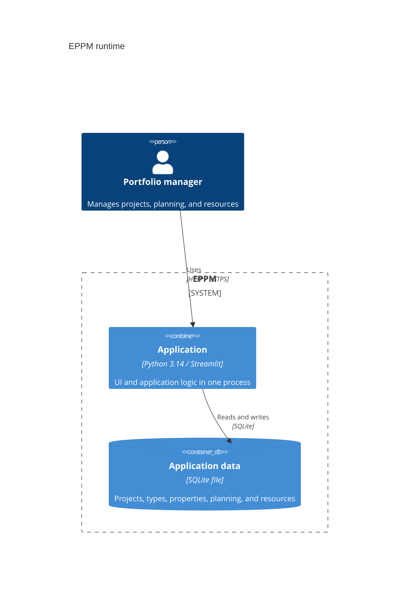

# PPM Studio Pro - Enterprise Project Portfolio Management

PPM Studio Pro is an enterprise-grade Project Portfolio Management (PPM) web application built with Streamlit, SQLite, and Plotly. It enables portfolio managers, architects, and PMO executives to manage project master data, configure flexible metadata schemas, schedule milestone roadmaps, manage organizational hierarchies and resource pools, and track portfolio analytics in real-time.
  
---

## Architecture and migration status

The layered migration now covers **project types, project creation/editing/deletion,
portfolio browsing, schema administration, organization management, resource pools,
capacity calculations, tag management, planning, project collaboration, and budget
reporting**. See
[ADR 0001](docs/decisions/0001-layered-project-types.md) for the initial dependency
rules, [ADR 0002](docs/decisions/0002-layered-projects-and-portfolio.md) for project
workflows, [ADR 0003](docs/decisions/0003-layered-schema-administration.md) for
schema transactions, and [ADR 0004](docs/decisions/0004-layered-organization.md) for
organization transactions. [ADR 0005](docs/decisions/0005-layered-resource-pools.md)
covers atomic pool/group editing, pure capacity rules, and revision-checked caching.
[ADR 0006](docs/decisions/0006-layered-tags.md) covers tag catalogs and assignments.
[ADR 0007](docs/decisions/0007-layered-planning-core.md) covers atomic task and
dependency operations, CSV import, and scheduling rules.
[ADR 0008](docs/decisions/0008-layered-planning-read-models.md) covers planning
summaries and portfolio overload indicators.
[ADR 0009](docs/decisions/0009-layered-planning-presentation.md) covers the Gantt
screen, dialogs, and cached display loaders.
[ADR 0010](docs/decisions/0010-layered-project-collaboration.md) covers project
contacts, roles, event types, and logs.
[ADR 0011](docs/decisions/0011-layered-budget-reporting.md) covers shared Decimal
budget calculations and reporting. Existing budget storage remains compatible.
[ADR 0012](docs/decisions/0012-presentation-resources-and-locale-state.md) moves
translations and component assets into presentation and isolates locale state.
Runtime/bootstrap code and the application shell remain to be migrated.

### C4 level 2: runtime containers



### Source locations

| Location | Purpose |
| --- | --- |
| `streamlit_app.py` | Preferred Streamlit launcher |
| `app.py` | Compatibility launcher for existing commands |
| `app/main.py` | Dependency construction and startup |
| `app/presentation/` | Migrated pages/components and the transitional legacy shell |
| `app/application/` | Project/type/schema/organization/pool use cases, capacity services, portfolio queries, ports, and boundary errors |
| `app/domain/projects/` | Project/schema records, validation, and effective property values |
| `app/domain/organization/` | Organization records, validation, and bounded hierarchy traversal |
| `app/domain/resources/` | Pool/group records, validation, deduplication, and daily capacity rules |
| `app/infrastructure/` | SQLite transactions, typed queries, capacity snapshots/cache, and paged reads |
| `app/shared/` | Configuration and logging |
| `src/` | Remaining features and compatibility adapters |
| `scripts/` | Seeding, database maintenance, and benchmarks |
| `tests/` | Existing regressions, layer checks, and migration tests |
| `docs/decisions/` | Architecture decisions and migration status |

## 🚀 Getting Started (Local Development)

### 1. Prerequisites
- Python 3.14.x
- Virtual environment (`venv` or `conda`)

### 2. Environment Setup
```powershell
# Create virtual environment
python -m venv .venv

# Activate virtual environment
# On Windows PowerShell:
.venv\Scripts\Activate.ps1
# On Linux / macOS:
source .venv/bin/activate

# Install dependencies
pip install -e ".[dev]"

# Copy environment template
cp .env.example .env
```

### 3. Run the Application
```powershell
streamlit run streamlit_app.py
```
Open `http://localhost:8501` in your browser. Existing `streamlit run app.py` and
`python app.py` seeding/help commands remain supported.

### 4. Run Automated Tests
```powershell
# Run the complete Python suite, including architecture checks
python -m pytest -q

# Run custom-component regressions
node --test tests/*.cjs
```

---

## Project types and custom properties

Manage project types in **Parameters Definition → Project types**. Each template
includes built-in fields and applicable custom properties. Properties apply to all
current and future types by default, or to selected types. Each type can inherit
or override required flags and set typed defaults. Defaults apply only at project
creation. Changing type preserves inactive values and restores their visibility
if they become applicable again.

Values live in `project_property_value`, with ordered child rows for multi-select
and tag items. Template defaults use equivalent relational tables. The Python
`Project.dynamic_attributes` interface remains a dictionary keyed by property ID;
project DataFrames now return dictionaries instead of JSON strings.

Existing databases migrate automatically: projects receive the protected General
type, while existing properties continue applying to all types. The migration
creates `<database>.before-project-types.bak`, verifies converted values and
foreign keys, then removes the JSON column. Invalid or ambiguous legacy values
stop migration and roll back schema changes, identifying the project/property in
the error. Correct the original data and retry. To roll back a completed upgrade,
stop the app, restore the backup, and run the previous application version.
Unrelated foreign-key violations left by older seeders are preserved and logged;
the migration verifies it introduces no new violations.

## 🗄️ Database Seeding & Mock Data Generation

PPM Studio Pro supports two complementary database seeding workflows:

### A. Automatic Bootstrap Seeding (`src/database/seeder.py`)
On initial application launch, if the database is empty, the system automatically bootstraps:
- **5 Schema Groups**: `basic info`, `scoping`, `localization`, `useful links`, `classification`.
- **31 Custom Properties**: Cover all eight supported types, including `URL` and `MULTI_ENUM`, with aliases, applicability, and relational values.
- **5 Project Types**: General, Infrastructure, Digitalisation, Compliance, and Renovation. Localization applies to Infrastructure/Renovation; interfaces apply to Infrastructure/Digitalisation/Renovation. Scope is globally required but optional for General. Infrastructure requires code line; Compliance requires acceptance criteria. Three types provide distinct scope defaults.
- **Discrete Enumeration Sets**:
  - `phase`: `FAI`, `APS`, `APD1`, `APD2`, `EXE`, `CHA`, `DEF`, `N/A`
  - `code_line`: 19 railway lines (`1`, `1a`, `1b`, `2b`, `3`, `4`, `5`, `6`, `6a`–`6k`, `7`)
  - `code_station`: 136 unique railway stations
  - `complexity`: `High`, `Medium`, `Low`
  - `category`: `categ1`, `categ2`, `categ3`
  - `strategic_priority`: `Critical`, `High`, `Medium`, `Low`
- **Organizational Structure**: 5 hierarchy levels, 9 function types, 50 job functions with parent-child management chains, teams, and sample employees.
- **Sample Projects**: One curated project per type, with managers, schedules, dependencies, tags, and resource assignments. Ordinary startup preserves user changes. Install the revised demo catalog in a fresh database or with an explicit full reseed.

### Employee Occupation & Calendar Exceptions

Every employee has a normal **occupation percentage from 0% to 100%**. The default is 100%, and existing databases are migrated automatically without changing current employee records.

Temporary calendar exceptions override that normal percentage over an **inclusive** start/end date range. For example, maternity leave can be represented as 0% from date A through date B. The application prevents overlapping exceptions for the same employee so that the effective percentage on any date remains unambiguous. Outside an exception period, the employee's normal occupation percentage applies.

Organization saves now run through application services. A team and its membership
save atomically, as do a new employee and an optional initial calendar exception.
Calendar writes reserve the SQLite writer before checking overlaps, preventing
concurrent saves from creating overlapping periods. Existing database files and
tables remain compatible; no database schema migration is required.

Manage these values in **Settings → Organization Structure → Employees**:

1. Add or edit an employee to set the normal occupation percentage.
2. Select an employee in the **Employee Calendar Exceptions** section.
3. Add an exception with start date, end date, temporary percentage, and an optional reason.
4. Edit or delete existing exceptions as needed.

### B. High-Volume Batch Generator CLI (`scripts/seed_database.py`)
For stress-testing, portfolio analytics demos, and UI verification, a dedicated command-line script generates hundreds or thousands of realistic projects with complex task schedules and dependencies:

```powershell
# Generate 50 mock projects with realistic tasks and dependencies
python scripts/seed_database.py --projects 50

# Generate 500 projects with 5 to 20 tasks per project
python scripts/seed_database.py --projects 500 --min-tasks 5 --max-tasks 20

# Seed against a custom database path without wiping existing records
python scripts/seed_database.py --projects 100 --db-path custom.db --no-clean

# Seed with a fixed random seed for reproducible demo datasets
python scripts/seed_database.py --projects 50 --seed 12345
```

#### Supported CLI Options:
| Flag | Type | Default | Description |
| :--- | :--- | :--- | :--- |
| `--projects` | `int` | `1000` | Total number of projects to generate. |
| `--min-tasks` | `int` | `0` | Minimum tasks / milestones per project. |
| `--max-tasks` | `int` | `15` | Maximum tasks / milestones per project. |
| `--db-path` | `str` | `ppm_mock.db` | Target SQLite database file path. |
| `--no-clean` | `flag` | `False` | Appends projects with fresh IDs, preserving existing records and templates. |
| `--seed` | `int` | `42` | Random seed for deterministic data generation. |

#### Generated Mock Data Characteristics:
- **Assigned Project Managers**: Selected from actual persisted organizational functions, with valid foreign keys.
- **Custom Properties**: Projects rotate across types deterministically and receive only applicable values. Values use persisted definitions/options and the same validation as interactive creation.
- **Counts and resets**: Clean generation creates exactly the requested count, including zero. Reference-only initialization creates no temporary projects. Project-only flushes retain templates; full flushes rebuild the catalog. Summaries include type and property-value counts.
- **Milestone Scheduling**:
  - **Single-phase schedules (~20%, when bounds allow)**: One N/A phase lasting 3 months to 3 years.
  - **Multi-phase schedules**: Sequential phases (`FAI` ➔ `APS` ➔ `APD1` ➔ `APD2` ➔ `EXE` ➔ `CHA` ➔ `DEF`), approval milestones, and additional work packages when needed for the requested minimum. Schedule shape is independent of project type.
- **Dependency Graph**: Generates Finish-to-Start (`FS`), Start-to-Start (`SS`), and Finish-to-Finish (`FF`) links internally between sequential phases and cross-project external dependencies.

---

## 🐳 Docker Container Management & Deployment

PPM Studio Pro is containerized following enterprise 12-factor standards using a lightweight, secure multi-stage Docker build.

### Multi-Stage Build Architecture
- **Builder Stage (`python:3.11-slim`)**: Compiles wheels and installs dependencies into a user space (`/root/.local`).
- **Runtime Stage (`python:3.11-slim`)**: Minimal image copying only the installed packages, running as an unprivileged non-root user (`appuser` with UID 1000), with built-in HTTP healthchecks on `/_stcore/health`.

---

### 1. Using Docker Compose (Recommended)

The included [`docker-compose.yml`](file:///c:/Users/cbogu/Documents/python/eppm_demo/docker-compose.yml) configures container execution with persistent named volume storage for the SQLite database:

```powershell
# Build image and launch container in background
docker compose up -d --build

# View real-time container logs
docker compose logs -f

# Check container status and healthcheck
docker compose ps

# Stop and tear down the container
docker compose down
```

The application will be accessible at `http://localhost:8501`.

---

### 2. Standalone Docker Commands

You can also build and run the container directly using the Docker CLI:

```powershell
# 1. Build the Docker image
docker build -t eppm-demo:latest .

# 2. Create a local data directory for persistent database storage
mkdir -p data

# 3. Run container with persistent volume mount and port mapping
# On Windows PowerShell:
docker run -d `
  --name eppm-app `
  -p 8501:8501 `
  -v ${PWD}/data:/app/data `
  -e DB_NAME=/app/data/ppm_mock.db `
  --restart unless-stopped `
  eppm-demo:latest

# On Linux / macOS:
docker run -d \
  --name eppm-app \
  -p 8501:8501 \
  -v $(pwd)/data:/app/data \
  -e DB_NAME=/app/data/ppm_mock.db \
  --restart unless-stopped \
  eppm-demo:latest
```

---

### 3. Managing Database Seeding Inside Docker

To populate or reset mock projects inside a running Docker container, execute the seeding script via `docker compose exec`:
#### Option A: Force Re-seeding Automatically on Docker Startup
When persistent named volumes (`ppm_data`) are mounted, the database file persists across container restarts. To wipe and cleanly re-seed the database automatically when starting Docker, set `FORCE_RESEED=true`:

```powershell
# Reseed 50 projects inside the active container
# Windows PowerShell: Force re-seed default demo dataset on startup
$env:FORCE_RESEED="true"; docker compose up -d

# Or force re-seed with 50 generated projects on startup
$env:FORCE_RESEED="true"; $env:SEED_PROJECTS_COUNT="50"; docker compose up -d
```

```bash
# Linux / macOS:
FORCE_RESEED=true docker compose up -d

# With 50 generated projects:
FORCE_RESEED=true SEED_PROJECTS_COUNT=50 docker compose up -d
```

> [!TIP]
> Database re-seeding is guarded by Streamlit's `@st.cache_resource`, ensuring it executes **strictly once** on container boot and never interrupts or wipes data during interactive web UI script reruns.

#### Option B: On-Demand Seeding via CLI
To populate or reset mock projects inside a running Docker container on-demand, execute the seeding commands via `docker compose exec`:

```powershell
# Force re-seed default taxonomy, schema, and sample projects
docker compose exec app python -m src.database.seeder --force

# Reseed 50 generated projects inside the active container
docker compose exec app python scripts/seed_database.py --projects 50

# Reseed 250 projects with custom task bounds
docker compose exec app python scripts/seed_database.py --projects 250 --min-tasks 3 --max-tasks 12

# Run the automated unit tests inside the container environment
docker compose exec app python -m unittest discover tests
```

---

### 4. Container Configuration & Environment Variables

PPM Studio Pro recognizes the following environment variables (defined via `.env`, `docker-compose.yml`, or `-e` flags):

| Variable | Default | Purpose |
| :--- | :--- | :--- |
| `DB_NAME` | `/app/data/ppm_mock.db` | Absolute path to the SQLite database file inside the container. |
| `LOG_LEVEL` | `INFO` | Logging threshold (`DEBUG`, `INFO`, `WARNING`, `ERROR`). |
| `APP_ENV` | `production` | Deployment mode (`development`, `staging`, `production`). |
| `FORCE_RESEED` | `false` | When `true`, wipes existing data and re-seeds database on startup. |
| `SEED_PROJECTS_COUNT` | `0` | Number of projects to generate when `FORCE_RESEED=true` (0 uses default seed). |
| `STREAMLIT_SERVER_PORT` | `8501` | In-container HTTP listening port. |
| `STREAMLIT_SERVER_ADDRESS` | `0.0.0.0` | In-container network bind address. |
| `STREAMLIT_SERVER_HEADLESS`| `true` | Runs Streamlit in headless mode without spawning local browser windows. |


---

## 📋 Features Overview

Pool capacity summaries and details are persisted as derived data in SQLite and
reused across page loads and application restarts. Source-data triggers invalidate
affected pools after assignment, mapping, calendar, task-date, and capacity changes.
Organization structure changes conservatively invalidate related team/function
pools. Daily minimum capacities and single-day overallocation checks are preserved.
Settings loads only the selected tab and fetches full details for the selected pool.
The Resource Pools settings tab retains capacity totals, overallocation alerts,
resource mappings and allocation details; the daily capacity-versus-demand chart
is no longer displayed. The Planning capacity grid is unchanged.
The first request after invalidation recalculates missing entries with shared inputs;
subsequent requests read the cache. Planning still renders its selected Gantt data,
so sub-100-ms pool reads do not imply a sub-100-ms complete page render.

Planning reuses cached capacity timelines when all assigned projects are selected,
indexes organization/project lookups, and avoids sending selected tasks twice to
the dependency editor. The Gantt reuses overscanned rows and batches scroll work
once per animation frame. Measure server-side preparation (excluding browser paint):

```powershell
docker compose exec -T app python -m scripts.benchmark_planning
node --test tests/test_gantt_scrolling.cjs
```

Planning now reads a lightweight project directory and loads template-property
values only when those flexible-filter fields are selected. Task/dependency
queries use project/task indexes; predecessor choices for other projects load
on demand without rebuilding the chart or losing an open task-editor draft.
Revision-aware caches reuse selected-scope capacity calculations. Gantt actions
run in a Streamlit fragment, while scrolling stays entirely in the browser.
The pool grid renders only nearby rows/columns and reuses indexed period
statistics (minimum capacity and any-day overallocation detection are preserved).
External dependency links start hidden; enable them with the chart toolbar toggle.
When enabled, their SVG layer is clipped to an overscanned viewport and reuses
unchanged paths. Identical projected links (including collapsed-project links)
are drawn once: click/right-click a shared line to select any underlying dependency
and inspect or edit it. Detail labels are prepared on demand, not while scrolling.

The initial chart sends **project summaries, not every task**. Tasks are requested
for visible expanded projects (and visible external-link endpoints), in batches
of at most 25 projects with a 100-project task cache. Expand All reserves row space
without fetching the entire portfolio. Task batches replace only those rows.
Date/progress edits return patches for the edited project, linked successors and
affected pools; shared-pool warnings update without refetching unrelated projects.
Project summaries persist in SQLite with dependency-aware invalidation triggers.
Pool demand uses interval boundaries instead of assignment-by-day nested loops,
and repeated daily values use lossless interval encoding during transport.
Planning totals are available in the navigation pane on every page.

The **Manage Task Resource Pools** dialog reads theoretical capacities directly
for its dropdown and loads cached capacity summaries only for pools assigned to
the task (plus legacy pools without a defined capacity). Changing FTE, dates or
selection no longer recalculates every pool. Assignment and calendar changes
still invalidate the relevant summaries, including single-day overallocation.
Measure the modal separately on a temporary database copy:

```powershell
docker compose exec -T app python -m scripts.benchmark_task_pool_dialog
```

Measure 100 selected projects separately from the database's total project count:

```powershell
docker compose exec -T app python -m scripts.benchmark_planning --projects 100 --no-profile
# Actual browser rendering with the current database's 100-project payload:
node scripts/benchmark_gantt.cjs --database
# Include external links; omit --expanded to measure collapsed project summaries:
node scripts/benchmark_gantt.cjs --database --external-links --expanded
# Full portfolio, including a safe task move on a temporary database copy:
node scripts/benchmark_gantt.cjs --database --all-projects --expanded --external-links --move-task
# Dense fixture: 100 projects, 1,000 tasks and 5,000 cross-project links:
node scripts/benchmark_gantt.cjs --external-links
```

The browser benchmark uses an isolated headless Edge profile on Windows and a
temporary SQLite copy for database-backed interactions; it never moves live tasks. An
alternative Chromium executable can be supplied as its first argument. Timings
are diagnostic measurements, not a guarantee for every device or date range.

The sidebar seed control accepts up to **10,000 projects**. Large seeds and the
first capacity calculation afterward take longer; filtering the planning view to
the projects of interest also reduces its task payload.

Every actual seed operation backs up an existing database before changing it, using
SQLite's backup API (including WAL contents). With Docker, backups are stored in
`data/backups/` on the host. Append seeds, forced seeds, and the pool-scenario seeder
are covered. Nested seed calls produce one backup, ordinary no-op startup checks
produce none, and a backup failure aborts seeding. A brand-new database has no
previous file to back up. Backups are retained until manually removed.

Pool hierarchy scenarios can be previewed without modifying the database:

```powershell
docker compose run --rm --entrypoint python app -m scripts.seed_pool_scenarios --year 2026
```

Add `--apply` to apply the previewed seed without replacing projects or tasks.
Normal project seeds and the default demo seed now include this scenario step:
six base groups, **five units under each Service group and four pools per unit**:
Unallocated (defined capacity, no mapped employees), Overassigned (employee capacity
above theoretical capacity), Underassigned (below theoretical capacity), and Fully
assigned (equal theoretical capacity). Project/task demand is seeded independently
of those employee-capacity scenarios. The default catalog has 100 scenario pools
plus the three original example pools, and 31 groups. Repeated v2 additive calls
are no-ops. Existing v1 generated hierarchies require a full backed-up seed rather
than silently mixing old and new layouts. The legacy annual exception scenario is
no longer generated by this new layout; user calendar exceptions are not removed.
Project/task-free seeds still create the hierarchy without inventing tasks.
Append seeding into a user-defined catalog without the demo organization leaves
that organization's employees and pools untouched.

Settings → Task Tags loads 100 assignments per page. Search, column filters, and
sorting run against the entire database; paging never limits their scope.
Task and dictionary choices load only when an add/edit dialog opens, with task
search limited to 50 matches (an exact `#ID` finds any task). Browser regression
checks: `node --test tests/test_task_tag_table.cjs`.

The Portfolio Overview master list uses seamless, scroll-driven pagination:
100 projects are fetched automatically for the visible scroll position, with
nearby batches prefetched. Only a small row window is rendered, and the browser
retains at most five batches (500 projects). No page selector is needed.
The viewport shows eight projects. Search, column filters, sorting, and header statistics cover
the full matching portfolio, not just loaded rows. Header choices/statistics load
only when opened; search finds values beyond the first 200 distinct choices.
Scroll requests rerun only the portfolio browser fragment. Bounded server caches
are invalidated by SQLite database/WAL file revisions.

The UI calls project types **project templates**; existing SQLite table/column
names remain unchanged for compatibility. Details and create/edit dialogs expose
every applicable template property, including unfilled, ungrouped, and custom
properties. Defaults apply only on creation, and effective required-field rules
remain enforced. Portfolio regression checks:
`python -m unittest tests.test_portfolio_paging tests.test_project_type_views`
and `node --test tests/test_portfolio_table.cjs`.

1. **📊 1. Portfolio Overview**:
   - Compact eight-row list without a page-title/KPI banner or standalone template filter; portfolio totals remain in navigation.
   - Compact master grid with six curated properties: `phase`, `code_line`, `strategic_priority`, `category`, `category_tags`, and `complexity`; complete template properties in details and dialogs.
   - Project search plus Excel-style per-column filtering, sorting, and statistics.
   - Interactive Master List with single-row click selection, compact same-size summary labels/values, and lazy detail tabs for all template property groups, Project Contacts, and Project log.
   - Resource-overallocation icons open the affected project's Gantt. A project is flagged when its positive allocation overlaps any overloaded pool day, using the shared assigned-capacity/calendar-exception calculation (defined capacity is the fallback only for unstaffed pools).
   - Project creation, editing, and deletion through focused modal dialogs.
2. **📅 2. Planning & Milestones**:
   - Interactive Plotly Gantt timeline chart with 4 dependency link types (`FS`, `SS`, `FF`, `SF`) and lag offsets.
   - Expandable recursive resource-pool group hierarchy with collapsed assignment totals and direct navigation to pool details.
   - Optional **Hide pools unused by selected projects** checkbox filters the resource grid immediately, retains ancestor groups, and removes empty groups. A used pool has a positive project/task allocation to a selected project; filtering does not alter the pool's global demand or its staffing capacity.
   - Real-time constraint violation diagnostics detecting scheduling breaks.
   - Bulk CSV milestone loader with validation and downloadable template.
3. **⚙️ 3. Settings**:
   - Consolidated single settings hub with a top-level section toggle:
     - **🏢 Organization Structure**: Manage 9 areas (Job Functions, Function Types, Teams, Employees with occupation percentages and calendar exceptions, Tag Groups, Tag Dictionary, Project Tags, Task Tags, and Resource Pools with dynamic capacity timelines).
     - **🧩 Parameter Definition**: Dynamic schema builder to manage schema groups, create/edit typed parameters (TEXT, DATE, NUMBER, ENUM, TAGS, HYPERLINK), configure discrete options, and inspect the real-time schema hierarchy tree.
     - **Project configuration**: Maintain project roles and event types. Entries in use cannot be deleted.
4. **🌐 5-Language Internationalization (i18n)**:
   - Full live interface translation across English (`en`), French (`fr`), German (`de`), Luxembourgish (`lb`), and Portuguese (`pt`) with 100% key parity guaranteed by automated unit tests.

### Project contacts and log persistence

The additive `project-collaboration-v1` migration creates `project_role`,
`project_contact`, `project_event_type`, and `project_log_event`. Catalog labels
support locale fallback through their `_translation` tables. Existing projects,
tasks, pools and assignments are preserved; no reseed is required.

Contacts reference a role and **function**, not an employee. Occupants' full names
are resolved live (all occupants if several share a function); vacant functions
fall back to their name. One role may be assigned to several functions in the
same project, but an identical project/role/function triple cannot be duplicated.

Log events contain title, description, optional deadline, scope, comment, type,
state and creation/update timestamps. States are New, Active, Completed,
Cancelled, Rejected and Closed. Internal/Global is a classification field, not
an access-control boundary; events are listed under their owning project.
History is loaded in bounded 50-event pages. Forms save through callbacks with
one automatic fragment refresh. Project deletion cascades to contacts and logs.

Initial event types are **General information**, **Blocking Point**, and
**Project update**. Startup does not re-create deliberately deleted catalog
entries. An explicit full demo reset restores these defaults; a projects-only
flush preserves the catalogs and removes project contacts/logs with projects.

Regression checks: `pytest tests/test_project_collaboration.py
tests/test_project_overallocation.py tests/test_project_type_views.py` and
`node --test tests/test_portfolio_table.cjs tests/test_gantt_scrolling.cjs`.
