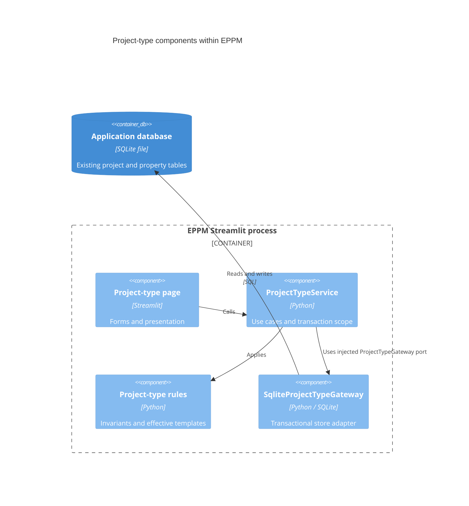

# ADR 0001: Begin the layered migration with project types

- Status: Accepted for the first migration increment
- Date: 2026-09-08
- Initial inspected baseline: `285e879f0ca9dcb3d219594b3d130933ba5d4232`
- Integrated upstream baseline: `3b64963cf732018bb72496c5dcc75e5ea0ef03c1`

## Context

Finance and further interface work need application operations that can be tested
independently of Streamlit and database access. The existing project-type repository
combined name/deletion guards, template rules, SQL, and dataframe construction.
The project-type screen called that repository directly.

While this increment was in progress, upstream added project contacts, event
logs, and overallocation indicators. Those changes were incorporated, including
their startup migration/version handling, before final validation.

The migration proceeds one feature at a time. SQLite, existing data, property IDs,
widget keys, draft behavior, CLI seeding flags, and the rest of the application
remain compatible. No database schema migration is introduced by this increment.

## Decision

The new package is `app`. `streamlit_app.py` is the preferred source launcher;
`app.py` remains a compatibility launcher. `app/main.py` is the composition root.
It builds the project-type service and delegates startup to the existing shell,
now explicitly named `app/presentation/legacy_shell.py`.

The first migrated capability covers listing, creating, renaming, deleting,
property applicability, and required/default rules for project types.

| Location | Responsibility |
| --- | --- |
| `app/presentation/pages/project_types.py` | Streamlit controls calling an injected application service |
| `app/presentation/components/` | Shared dynamic-property widgets and dataframe formatting |
| `app/application/services/project_types.py` | Use cases and transaction boundaries |
| `app/application/ports/project_types.py` | Typed store and transaction-provider protocols |
| `app/application/exceptions.py` | Safe errors crossing the persistence boundary |
| `app/domain/projects/` | Project types, applicability, effective templates, and value validation |
| `app/infrastructure/repositories/project_types.py` | SQLite store and transaction implementation |
| `app/infrastructure/database/connection.py` | Connection creation with foreign keys enabled |
| `app/shared/config/`, `app/shared/logging/` | Existing configuration and logging, with compatibility exports |

Domain and application APIs use dataclasses and typed records, not dataframes or
database connections. The default-value validator accepts `object` at its input
boundary and rejects values incompatible with the declared property type.

Command/query classes and unused finance, APS, messaging, authentication, and API
folders are deferred until an implementation needs them. Ordinary service methods
currently provide the required operations.

## C4 level 3: migrated components

All components run inside the existing Streamlit Python process. The gateway
relationship below is a runtime dependency supplied through the application port;
the application service does not import the concrete adapter.



## Dependency rules

1. Domain imports only domain modules and relevant standard-library modules.
2. Application imports only application/domain modules and the standard library.
3. Migrated presentation imports application/domain/presentation modules; it cannot
   import SQLite, repositories, shared configuration, or the composition root.
4. Infrastructure implements application ports and cannot import presentation.
5. Shared code cannot depend on application, domain, presentation, or infrastructure.
6. The composition root supplies concrete dependencies. Importing the core or the
   composition module alone must not load Streamlit, pandas, SQLite, or legacy code.

`tests/test_layer_boundaries.py` enforces these rules, including imports inside
functions and an isolated core-import check with third-party packages disabled.

## Temporary compatibility boundaries

These are deliberate migration dependencies, not the destination architecture:

- `app/presentation/legacy_shell.py` retains the existing routing, startup,
  seeding, and legacy module reloads. It is explicitly excluded from the new
  presentation import rules. New business features must use the new layers.
- `app/presentation/i18n.py` reuses `src.i18n` so both sets of screens share one
  locale state and the existing translation catalogs.
- The SQLite project-type adapter uses `src/database/property_store.py` for
  relational value reads/writes and schema definitions. The existing project and
  migration code uses that same store. Its value validation and template resolution
  now delegate to the domain, preventing two implementations of those rules.
- `src/repositories/project_type_repo.py` delegates to the application service,
  preserving dataframes, integer flags, and SQLite exception types for existing
  project dialogs, portfolio code, scripts, and tests.
- Its connection-owned applicability method joins existing schema transactions;
  it must neither commit nor close the caller's connection.
- `src/views/project_types_view.py`, `src/config.py`, `src/logging_config.py`, and
  `src/database/connection.py` remain compatibility adapters/exports.
- `app.__getattr__` lazily resolves the former documented `from app import ...`
  helpers. Ordinary imports of `app.domain` and `app.application` have no UI effects.

## Transactions and preserved behavior

Each application operation uses one connection that is closed on exit. Reads use
a consistent transaction. Writes acquire `BEGIN IMMEDIATE` before reading guards,
then commit once or roll back completely. This prevents a second SQLite writer
from changing references between validation and persistence.

The General type remains protected. Selected-only properties must retain an
applicable type. Invalid enum defaults and invalid type references roll back
earlier writes in the same operation. Absent, null, empty-text, and empty-list
defaults remain distinct. Existing project values and creation-only defaults keep
their previous behavior.

One baseline defect was corrected during integration: the schema screen now passes
its database path to `SchemaService.get_next_available_group_order`. Previously it
queried the default database, causing the existing isolated-screen test to fail.
The migrated dropdowns also capture translated labels during rendering so their
formatters remain consistent when evaluated outside that locale context.

## Runtime and validation

Python 3.14.x is declared in `pyproject.toml` and used by both Docker stages, matching
the repository's supported runtime. Dependencies continue to come from
`requirements.txt`. Docker and Compose include the new package and launcher.

Run validation from the repository root:

```bash
python -m pytest -q
python -m pytest -q tests/test_layer_boundaries.py tests/test_layered_project_type_domain.py tests/test_layered_project_types.py tests/test_layered_project_type_ui.py --cov=app.domain --cov=app.application --cov=app.infrastructure --cov-report=term-missing
node --test tests/*.cjs
```

The tests cover business rules without storage, real SQLite rollback and writer
reservation, connection cleanup, legacy contracts, Streamlit CRUD/default controls,
and both full-app launchers in isolated processes. The existing project creation,
editing, templates, seeding, and migration regressions remain part of the full suite.

Final verification on Python 3.14.6 after incorporating upstream:

- 236 Python tests passed, with 14 subtests also passing.
- 23 JavaScript component tests passed.
- Migrated domain/application/infrastructure: 228 of 228 statements covered (100%).
- Overall `app` and `src` statement coverage: approximately 71%.
- The suite still reports unclosed-connection warnings from legacy database usage.
  New gateway connections are explicitly closed, including on failure.
- Docker files were updated and reviewed; a Docker executable was unavailable in
  the validation environment, so the container image was not built here.

The repository-wide 99% statement-coverage target remains the overarching goal;
focused core coverage is measured separately and must not be described as coverage
of the entire application. The user authorized a Sonar read-scan exception for this
migration only; `AGENTS.md` is unchanged.

## Remaining migration work

- Migrate project creation/editing and portfolio operations so their screens can
  receive application services rather than constructing legacy repositories.
- Move schema administration and the relational property-store adapter fully into
  the new layers, then remove the related compatibility methods.
- Migrate planning and resource-capacity workflows while retaining pagination,
  lazy loading, component event contracts, and performance checks.
- Move remaining settings screens and shared translations/components, then remove
  the legacy shell and its module reloads.
- Implement finance in the new layers, using explicit financial models and tested
  domain calculations as its requirements are agreed.
- Remove each compatibility bridge only after its callers have migrated and their
  tests pass. Do not duplicate business rules in legacy and migrated code.
