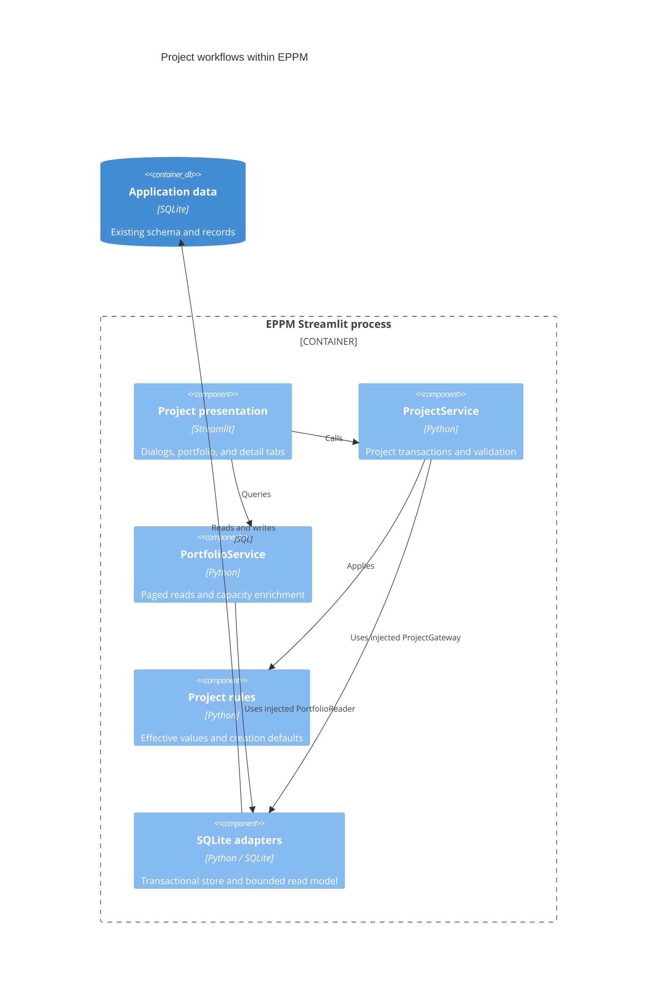

# ADR 0002: Migrate project workflows and portfolio browsing

- Status: Accepted for the second migration increment
- Date: 2026-09-08
- Parent increment: `ee08b7fd5d7877b461643c3ff988a18e43e50a66`
- Branch: `migration/layered-project-types`

## Context

Project creation and editing mixed effective-template rules with SQL. The
portfolio screen constructed project, schema, organization, and project-type
repositories. This made interface changes depend directly on storage details.
The existing portfolio query implementation already provided bounded scrolling,
global filters, and lazy column statistics, which must be retained.

## Decision

Migrate project create/read/update/delete operations and portfolio queries through
injected application services. Move the dialogs, portfolio page, and table into
presentation. Ordinary service methods remain the command/query interface; this
increment introduces no command bus, API server, dependencies, or schema changes.

| Location | Responsibility |
| --- | --- |
| `app/domain/projects/project.py` | Project record, name validation, applicability, creation defaults, required-value rules |
| `app/application/services/projects.py` | Project operations and transaction scope |
| `app/application/ports/projects.py` | Caller-owned store and transaction contracts |
| `app/application/services/portfolio.py` | Bounded queries, component-query normalization, page-only overload enrichment |
| `app/application/ports/portfolio.py` | Plain-data query results, editor catalog, and query/allocation ports |
| `app/infrastructure/repositories/projects.py` | SQLite project writes and compatibility bulk reads |
| `app/infrastructure/repositories/portfolio.py` | SQL pages, global facets, metrics, selected-project summary, editor metadata |
| `app/infrastructure/database/project_transactions.py` | Connection cleanup, commit/rollback, safe storage errors |
| `app/infrastructure/database/property_store.py` | Shared relational value adapter for projects, templates, migrations, and seeders |
| `app/presentation/components/project_dialogs.py` | Create/edit/delete controls using injected services |
| `app/presentation/pages/portfolio.py` | Portfolio browsing, detail tabs, and bounded Streamlit caches |
| `app/presentation/components/portfolio_table.py` | Existing table JavaScript and rendering |
| `app/presentation/components/project_workspace.py` | Dependencies supplied to screens, including lazy collaboration sections |
| `app/main.py` | Concrete service and screen composition |

## C4 level 3: project workflow components

These components run within the existing application process. Services receive
adapter instances through application ports; they do not import infrastructure.

## Transactions and behavior

Project writes reserve the SQLite writer before reading templates or existing
values. Master data and typed properties commit together or roll back together.
Deletion includes dependency cleanup in the same transaction. Connections close
on both success and failure. Safe application errors retain the original database
exception as their cause; migrated screens receive no SQL error details.

Defaults apply only at creation. Explicit null, empty text, and empty lists remain
distinct. Updating a project type preserves inactive stored properties and exposes
them again if the original type is restored. Required rules and enum validation
run in the domain even for callers that bypass Streamlit.

The create dialog keeps a stable draft identity while it is open. Its displayed
ID is a preview; SQLite assigns the final ID at save time. If another user creates
a project meanwhile, the draft remains intact and the newly saved project is
selected. Legacy callers may still supply an explicit ID. Concurrent deletion
during editing is reported as a missing project rather than a successful update.

Project status values and the existing demo budget fields retain their behavior.
This is not the finance migration. Budget floats remain compatibility data in
euros; an authoritative finance ledger requires Decimal/numeric arithmetic,
separate budget/forecast/actual/commitment models, and an explicit data migration.

## Portfolio performance and UI

- Pages remain bounded to 100 rows with stable global sorting and filtering.
- Facets compute statistics over all matching rows, excluding the facet's own
  filter. At most 200 distinct choices are returned, with server-side search.
- The table retains eight visible rows, its five-page browser cache, event
  contracts, stale-response protection, and accessible row/Gantt controls.
- Streamlit page/facet caches remain bounded. Their key includes database identity
  and database/WAL file revision; service objects are excluded from hashing.
- Overload detection receives only IDs in the returned page.
- A selected project's summary is read directly without loading the full project
  or organization catalog. Manager choices are loaded for dialogs only.
- Complete effective-template details, lazy contacts/log tabs, and Gantt links
  remain available. The component registers in the active runtime when rendered,
  so importing its Python module does not bind it to an earlier Streamlit runtime.

## Compatibility and remaining dependencies

The dependency tests now forbid **all `src` imports in infrastructure**. The old
property-store module re-exports the migrated adapter. Its `prepare_values`
compatibility entry point delegates to the same pure project rules.

`src/repositories/project_repo.py` and `portfolio_repo.py` are facades preserving
legacy IDs, DataFrame/dictionary results, and SQLite exception types. The project
facade's connection-owned creation method lets seeders retain their outer
transaction. Full-project exports and narrow planning catalogs remain available;
interactive portfolio browsing never uses the full-project export.

The old dialog/page/component modules and project model module are compatibility
wrappers or exports. The normal portfolio route composes the migrated screen
directly. Legacy planning can continue calling its existing edit-dialog wrapper.

The composition root still injects two explicit feature bridges:

- `src/services/project_overallocation.py` supplies planning-capacity results.
- `src/views/project_collaboration_view.py` supplies contacts/log sections as
  callbacks; only the open tab invokes its callback.

Neither bridge is imported by migrated domain, application, infrastructure, or
portfolio presentation. The legacy shell and shared i18n bridge remain as described
in ADR 0001. Schema administration, settings, organization, planning, collaboration
internals, and legacy DataFrame budget utilities are still awaiting migration.

## Verification

Python 3.14.6 validation covers the new domain and service boundaries, real SQLite
transactions, failure after an earlier property write, deletion rollback, writer
reservation, connection closure, legacy contracts, concurrent creation, cache
isolation, and existing Streamlit template/draft flows. Existing planning, seeding,
contacts/log, overallocation, launchers, and table behavior remain in the suite.

- 246 Python tests passed, with 14 subtests.
- 23 JavaScript tests passed.
- Migrated domain/application/infrastructure: 622 of 625 statements (99.52%).
- Overall `app` and `src`: 5231 of 7282 statements (71.83%).

The repository-wide 99% target remains unmet. Existing legacy connection warnings
remain; new project transactions close their connections. Docker is unavailable
in this environment, so no container image build is claimed. `AGENTS.md` and
applied database migrations are unchanged.

## Next increment

Migrate schema administration next: group/property/option editing and applicability
changes should use application transactions and pure validation, while retaining
their current compatibility contracts. Then migrate organization, resources,
planning, and collaboration internals, removing each bridge after its callers move.
Develop finance features directly in the new layers once their rules are defined.
