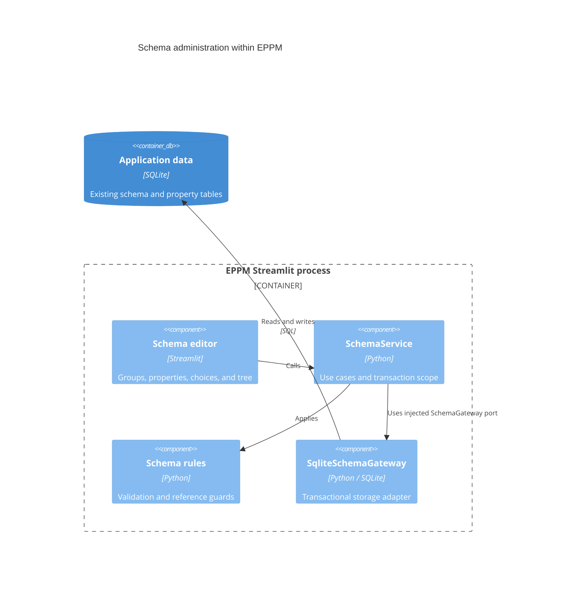

# ADR 0003: Migrate project-schema administration

- Status: Accepted for the third migration increment; extended by [ADR 0004](0004-layered-organization.md)
- Date: 2026-09-08
- Parent increment: `f09db8baaebaa8e95691afe51e121fc843666a65`
- Branch: `migration/layered-project-types`

## Context

The schema repository combined SQL with rules protecting project values and
template defaults. The editor constructed repositories, chose property IDs and
group orders before saving, and committed each initial option separately after
creating its property. A failure could therefore leave a partially configured
property. Type-change validation also looked up an untrimmed ID before updating
the trimmed ID, allowing whitespace to bypass its stored-value check.

This increment follows the project-type and project/portfolio migrations. It
keeps the current SQLite tables, applied migrations, property IDs, project values,
template rules, and existing Settings navigation.

## Decision

Schema administration now uses an injected application service and typed storage
ports. Group/property/option records and validation live in the project domain.
The editor receives services and formats their plain-data results for Streamlit.

| Location | Responsibility |
| --- | --- |
| `app/domain/projects/schema.py` | Schema records, normalization, identifier/order rules, and reference guards |
| `app/application/services/schema.py` | Catalog reads and transactional schema operations |
| `app/application/ports/schema.py` | Schema store/gateway protocols and consistent editor snapshot |
| `app/infrastructure/repositories/schema.py` | SQLite queries, transaction lifetime, and safe error translation |
| `app/presentation/pages/schema.py` | Group, property, option, and tree sections using injected services |
| `app/presentation/components/schema_frames.py` | DataFrame formatting at the presentation boundary |
| `app/main.py` | Construction of the schema service and its adapter |

Ordinary service methods provide the command and query interface. No new runtime
dependency or database schema migration is required.

## C4 level 3: schema components

The following components run inside the existing Streamlit application process.
The service's gateway dependency is supplied through its application port.



## Transactions and preserved rules

The editor reads groups, properties, and options in one consistent snapshot.
Each mutation acquires `BEGIN IMMEDIATE` before reading references or allocating
identifiers, then commits once or rolls back completely. Connections close after
both successful and failed operations.

- Creating a property includes its definition, applicability membership, and all
  initial choices in one transaction. An error in a later choice restores the
  complete original state.
- Passing `param_id=None` allocates an automatic `PRM_` ID under the writer lock.
  The displayed ID remains a preview. Explicit IDs and the historical numeric/PRM
  sequence interpretation remain available to compatibility callers.
- The group editor's automatic order fallback runs inside the creation
  transaction. Strict creation and group edits retain name/order conflict errors.
- Deleting a group ungroups its properties without deleting those properties or
  their values. Ungrouping rolls back if deleting the group fails.
- Property type changes and deletion remain blocked by any stored project value
  or template default, including explicit null/empty value rows.
- Option deletion checks both scalar and list references in projects and template
  defaults. Existing duplicate-option behavior is preserved.
- IDs are normalized before both reference checks and writes, closing the
  whitespace bypass in property type changes.
- Updating property details with unspecified applicability preserves its scope.
  Supplying a new scope saves it atomically with the other details.
- Existing editor constraints on blank names/choices, positive group orders, and
  nonnegative option orders now also apply to direct application callers.

The service does not retroactively rewrite stored project data after changes to
required rules or applicability. Existing effective-template and project-save
validation behavior remains in force.

## Presentation and compatibility

The five schema tabs, existing widget keys, assignment controls, and live tree
remain available. Group, property, option, and tree rendering now have separate
functions. The Settings route composes the migrated editor directly. Failed
writes display safe application messages, and concurrent missing-record edits
are reported instead of showing a successful update. Settings navigation captures
translated labels during rendering, keeping callbacks consistent when evaluated
outside the current locale context. A French-host/English-app regression covers it.

The following compatibility surfaces remain for planning, integrations, and the
legacy shell:

- `src/repositories/schema_repo.py` delegates to the application service while
  preserving DataFrame columns, integer flags, return values, and SQLite errors.
- `src/services/schema_service.py` delegates identifier/order helpers and adapts
  legacy DataFrames to pure required-property validation.
- `src/models/schema.py` re-exports the domain records.
- `src/views/schema_def_view.py` composes the migrated page using the old function
  signature.
- `ProjectTypeRepository.set_applicability_on_connection` remains as a tested
  compatibility helper. Migrated schema operations call the infrastructure
  membership adapter directly on their own transaction.

Infrastructure continues to have no `src` imports. Domain and application remain
independent of pandas, Streamlit, configuration, and SQLite. The core import test
now includes schema modules and runs without installed third-party packages.

## Verification

New tests cover pure input/identifier rules, scalar and list reference protection,
explicit-null protection, rollback after partial writes/deletes, atomic
applicability changes, connection closure, writer reservation, concurrent creates,
legacy contracts, and the pre-migration ID-preview helper.

Streamlit tests exercise group creation/editing/deletion, property creation with
initial options and selected-type scope, property editing, option add/delete,
reference errors, ungrouping without value loss, partial-write error handling, and
the actual Settings route. Existing project, planning, seeding, collaboration,
launchers, and component regressions remain part of the full suite.

Final validation on Python 3.14.6:

- 264 Python tests passed, with 14 subtests.
- 23 JavaScript component tests passed.
- Migrated domain/application/infrastructure: 873 of 876 statements (99.66%).
- Overall `app` and `src`: 5483 of 7443 statements (73.67%).

Run the same checks from the repository root:

```bash
python -m pytest -q --cov=app --cov=src --cov-report=term-missing
node --test tests/*.cjs
```

The repository-wide 99% coverage target remains distinct from migrated-core
coverage. Existing connection warnings from unmigrated code remain. Docker is
unavailable in this environment, so no image build is claimed. `AGENTS.md` and
applied database migrations are unchanged.

## Next increment

Organization management is completed in ADR 0004: functions, employees, teams,
function types, and calendar exceptions. Follow with resource pools/capacity and planning use cases while
retaining their lazy loading and performance checks. Collaboration internals,
shared translations, and legacy routing still have explicit migration boundaries.
Finance features should use the new layers with separately defined financial rules.
