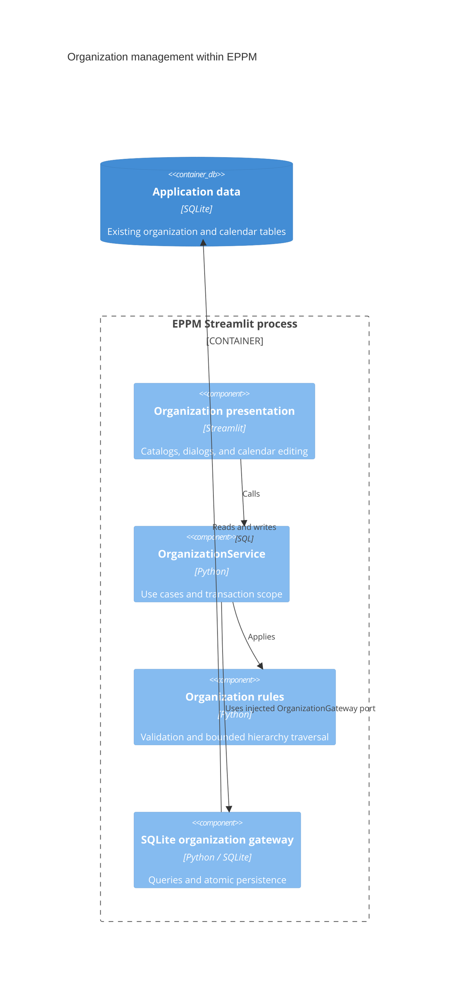

# ADR 0004: Migrate organization management

- Status: Accepted for the fourth migration increment
- Date: 2026-09-08
- Previous increment: [ADR 0003](0003-layered-schema-administration.md)

## Context

Organization dialogs called SQLite repositories directly. Validation lived in a
DataFrame-oriented service and was not consistently applied by non-UI callers.
Saving a team committed its details before replacing its members. Creating an
employee committed the profile before inserting an optional calendar exception.
Calendar overlap queries also used a separate connection before the write, so two
writers could both pass the check and insert overlapping inclusive periods.

## Decision

Move organization management through injected application services and typed
persistence ports. Keep the current SQLite tables, IDs, foreign keys, seeding
interfaces, widget keys, navigation, and table assets. No dependency, database
schema change, API server, or new runtime container is introduced.

| Location | Responsibility |
| --- | --- |
| `app/domain/organization/models.py` | Function types, functions, teams, employees, calendar overrides, and hierarchy nodes |
| `app/domain/organization/rules.py` | Validation, normalization, employee-code preview, and cycle-safe hierarchy traversal |
| `app/application/ports/organization.py` | Plain-data calendar query records and transactional storage contracts |
| `app/application/services/organization.py` | Organization operations and atomic multi-record saves |
| `app/infrastructure/repositories/organization.py` | Existing SQLite queries, connection ownership, and safe error translation |
| `app/presentation/components/organization_frames.py` | DataFrame conversion and display-label enrichment |
| `app/presentation/components/organization_dialogs.py` | Organization and calendar dialogs using an injected service |
| `app/presentation/pages/organization.py` | Four independently loaded organization catalog sections |
| `app/main.py` | Concrete organization dependency construction |

## C4 level 3: organization components

All components run inside the existing Streamlit process. Application services
depend on ports; the composition root supplies the concrete SQLite gateway.



## Transactions and preserved behavior

- Every application operation owns one connection, closes it on every exit, and
  commits or rolls back once. Writes reserve the SQLite writer with
  `BEGIN IMMEDIATE` before querying guards or changing data.
- Team creation and editing can include exact membership replacement in the same
  transaction. Omitting membership preserves the current list; an empty list
  clears it. Duplicate member IDs are collapsed as before.
- Employee creation can include an initial calendar exception. Its employee ID
  is assigned from the new profile; failure leaves neither record persisted.
- Calendar overlap checks execute under the writer reservation and exclude the
  current exception during edits. Periods remain inclusive. Employee deletion
  still cascades to its exceptions; other reference restrictions remain intact.
- Names and employee fields retain their trimming/case rules. Occupation values
  remain finite percentages between 0 and 100. Employee-code suggestions retain
  the historical numbering interpretation and are previews, not reservations;
  uniqueness is enforced during persistence.
- Existing integration tests use functions with capacity above 100%. Those
  multi-FTE records remain supported by application operations. The editor and
  its existing `validate_function` helper retain their 0–100 input range. Changing
  that historical distinction requires a separate business decision.
- The level-three hierarchy lookup retains its visited-node guard and 20-hop
  limit, preventing cycles from causing unbounded traversal.
- Missing-record updates/deletions retain boolean results for callers. Migrated
  dialogs check those results and display an error instead of a success toast.
  Storage errors expose safe application messages, preserving causes internally.

## Compatibility and remaining boundaries

`src/models/organization.py` re-exports the domain records.
`src/repositories/organization_repo.py` delegates to the service and preserves
legacy DataFrame columns, integer flags, and SQLite exception types.
The resource-pool repository's four team-membership methods also delegate to the
organization service, so there is one membership write implementation.

`src/services/organization_service.py` reuses migrated validation, hierarchy
traversal, and organization display formatting. Its remaining project DataFrame
enrichment is a planning compatibility surface awaiting the planning increment.
The Settings shell composes the four migrated sections directly; it still owns
the existing navigation and unmigrated tag/resource-pool sections.

Existing JavaScript table assets remain under `src/components/` and are registered
when rendered in the active Streamlit runtime. No JavaScript contract or asset is
changed. Only the open organization tab loads its catalogs. Migrated presentation
imports no legacy repositories or infrastructure; infrastructure imports no `src`.
Domain/application imports remain independent of Streamlit, pandas, and SQLite.

## Verification

Tests use Python 3.14 and disposable databases with the real SQLite schema. They
cover normalization, existing capacity values, CRUD and missing IDs, uniqueness,
foreign keys, membership rollback, initial-exception rollback after an earlier
profile insert, concurrent overlapping writes, writer reservation, connection
cleanup, calendar boundaries, and compatibility contracts.

Streamlit AppTest exercises team and employee dialogs, initial exceptions,
calendar editing/deletion, safe failures, function/type editing, concurrent
deletion, and the actual Settings route with hidden pool loading prohibited.
For calendar tests only, the test harness maps fragment reruns to full reruns
because AppTest does not reproduce browser fragment scheduling. Production
fragment behavior remains unchanged.

Run validation from the repository root:

```bash
python -m pytest -q --cov=app --cov=src --cov-report=term-missing
node --test tests/*.cjs
```

Validation on Python 3.14.6:

- 291 Python tests passed, with 14 subtests.
- 23 JavaScript component tests passed.
- New organization domain/application/infrastructure: 100% statement coverage.
- All migrated domain/application/infrastructure: 1359 of 1362 statements (99.78%).
- Overall `app` and `src`: 6150 of 7798 statements (78.87%). The repository-wide
  99% target remains unmet; migrated-core coverage is measured separately.

The existing Docker container was healthy and successfully imported the new
organization service and SQLite gateway from its development bind mounts. No
database rewrite, reseed, or image rebuild was performed.

## Next increment

Migrate resource-pool catalogs, groups, assignments, and capacity use cases,
preserving their lazy loading and deduplication behavior. Follow with planning,
tags, and collaboration internals. Shared translations and legacy routing remain
explicit migration boundaries. Finance requires separately defined financial
rules and should be implemented directly in the new layers.
