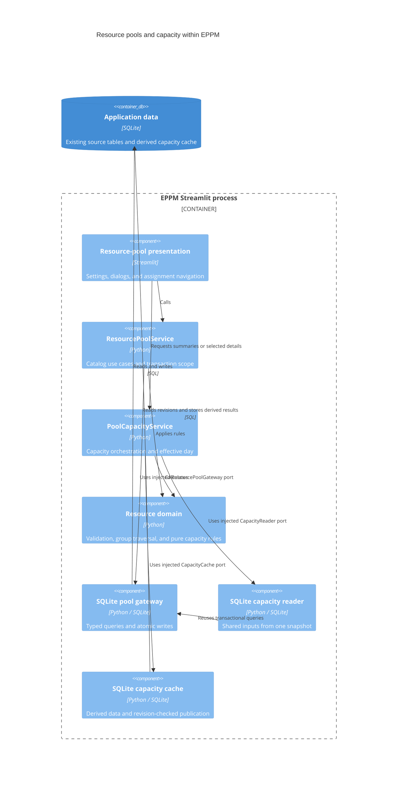

# ADR 0005: Migrate resource pools and capacity

- Status: Accepted for the fifth migration increment
- Date: 2026-09-08
- Previous increment: [ADR 0004](0004-layered-organization.md)

## Context

Resource-pool Settings controls called repositories and a DataFrame-oriented
capacity calculator directly. Saving pool details and tags used separate commits.
Group creation needed compensating deletion when membership failed; group editing
could replace members before discovering that the new name was invalid.

Capacity caching already supported per-pool invalidation, durable JSON, lazy
details, and revision-checked publication. Its input loader assembled shared data
through multiple repository connections, so a concurrent edit could produce a
mixture of source versions before publication was checked.

## Decision

Move pool catalogs, recursive groups, mappings, assignments, and capacity use cases
into the existing four layers. Inject services into pool Settings presentation.
Keep SQLite, existing tables and triggers, stable IDs, calculation behavior,
navigation, seeding, and planning interfaces. No database technology, dependency,
container, or schema migration is introduced.

| Location | Responsibility |
| --- | --- |
| `app/domain/resources/models.py` | Pool/group/mapping/assignment records and capacity results |
| `app/domain/resources/rules.py` | Normalization, finite numeric validation, and cycle-safe group traversal |
| `app/domain/resources/inputs.py` | Explicit organization and allocation inputs to capacity calculations |
| `app/domain/resources/capacity.py` | Resource deduplication, precedence, calendar overrides, and date resolution |
| `app/domain/resources/timeline.py` | Interval-boundary demand calculation |
| `app/domain/resources/capacity_rules.py` | Daily overload checks, intervals, and project status |
| `app/application/services/resource_pools.py` | Catalog operations and atomic pool/tag and group/member saves |
| `app/application/services/pool_capacity.py` | Capacity orchestration with an injected reader, cache, and clock |
| `app/application/ports/` | Typed pool transaction, capacity reader, and cache contracts |
| `app/infrastructure/repositories/resource_pools.py` | Existing SQLite queries, writer reservation, and safe storage errors |
| `app/infrastructure/repositories/pool_capacity.py` | Shared input reads in one SQLite snapshot |
| `app/infrastructure/database/pool_capacity_cache.py` | Existing cache schema, triggers, JSON format, and revision checks |
| `app/presentation/pages/resource_pools.py` | Selected pool details and summary cards |
| `app/presentation/components/resource_pool_dialogs.py` | Pool/group/mapping controls, member inspection, and assignment actions |
| `app/presentation/components/resource_pool_frames.py` | DataFrame conversion for presentation and legacy callers |
| `app/main.py` | Dependency construction and explicit ownership of bounded process cache state |

## C4 level 3: resource-pool components

All components remain within the existing Streamlit process. Application services
depend on ports; the composition root injects their concrete implementations.



## Transactions and preserved behavior

- Pool details and optional dictionary-tag replacement commit together. Omitting
  `tag_ids` preserves tags; `[]` clears them. Failed reference checks or writes
  roll back the details as well as associations.
- Group details and optional membership replacement commit together. Omitting
  both membership arguments preserves members. Supplying either argument replaces
  the complete membership, with an omitted counterpart treated as empty.
  Duplicate IDs collapse; shared descendants resolve to unique pools.
- Writes reserve SQLite's writer with `BEGIN IMMEDIATE` before checking references
  or cycles. Concurrent opposite group links cannot both commit. Existing database
  constraints and cycle triggers continue to protect direct SQL callers.
- Missing-record edits/deletions retain boolean results. Migrated controls check
  these before reporting success. Database errors become safe application errors;
  internal causes are preserved. HTML assignment labels are escaped.
- Mapping upserts now return the matching mapping's actual ID, including when
  `ON CONFLICT` updates an existing row. SQLite's unrelated `lastrowid` is no longer
  returned on that path.
- FTE and allocation validation rejects nonfinite values as well as the existing
  invalid ranges. Legacy vacant functions and multi-FTE positions remain supported.
- Capacity still counts employees once, takes the highest team allocation, applies
  direct function overrides, and gives explicit employee mappings precedence.
  A valid zero-percent mapping still counts as assigned resources; it does not
  fall back to theoretical capacity. Historical implicit team membership remains.
- Demand remains the sum, per project, of the larger project-level or task-level
  allocation. Date ranges remain inclusive, with custom, task, project, and current
  day fallback in that order for each endpoint. Zero-demand dates, gaps, sparse
  calendar overrides, the 25-year calculation cap, and rounding order are preserved.

## Snapshot and cache consistency

The capacity reader loads organization catalogs, exceptions, team membership,
project date bounds, pools, mappings, and assignments once in a single read
transaction. Query count stays constant as the number of requested pools grows.
Calculations receive plain records and an explicit date; they perform no I/O.

The cache retains version 1 JSON, its invalidation triggers, source epoch/revision,
date keys, per-employee dependency index, selected-pool requests, and eight-entry
process bound. The composition root owns the process state and injects it into
adapters. Revision and cached-row reads also share one transaction. Publication
reserves the writer and verifies that the source revision has not changed; stale
calculations are discarded. Repeated changes yield a safe retry message.

The selected calculation date is passed through the cache to the service, avoiding
a mismatch between a persisted date key and a calculation that crosses midnight.

## Compatibility and remaining boundaries

`src/models/resource_pool.py` and `src/services/capacity_timeline.py` re-export the
migrated domain. The legacy resource-pool repository delegates operations to the
application service while preserving DataFrame columns and SQLite exception types.
The legacy capacity service converts injected repository/DataFrame inputs into
domain inputs; it contains no capacity business rules. The legacy cache delegates
to the new cache and snapshot reader while retaining its existing call shape.

Settings composes the migrated pool page only when its tab is open. Recursive
group data loads only when its expander is open. Summary cards use lightweight
results; full details are requested only for the selected pool. Existing widget
keys, planning links, assignment removal, and the absence of a daily chart remain.

Pool-tag replacement now uses the pool application service. General tag dictionary
administration and legacy individual tag operations remain for the tag increment.
Planning task/project assignment dialogs still use compatibility adapters; their
writes and capacity calculations now reach the migrated implementations. Planning
transport, planning summary caches, collaboration internals, routing, and shared
translation bridges remain explicit migration boundaries.

## Verification

Use Python 3.14 and disposable databases with the real SQLite schema:

```bash
python -m pytest -q --cov=app --cov=src --cov-report=term-missing
node --test tests/*.cjs
```

Regression coverage includes atomic creation/editing and rollback, cascades,
mapping upsert identity, simultaneous group edits, reader snapshots during a
concurrent writer, constant query counts, stale cache publication, date changes,
warm disk reads, bounded memory, and pure capacity edge cases. Streamlit AppTest
exercises pool/group/mapping dialogs, safe failures, Settings lazy loading,
assignment escaping, and unassignment. The group-inspector test controls only
expander visibility; its widgets and database operations remain real.

The complete capacity payloads also match the previous committed calculator for
all 103 pools in a disposable seeded database. Docker's existing container is
healthy and imports the migrated modules through development bind mounts. It
continues to use `/app/data/ppm_mock.db`, backed by the host `data` directory.
No application database rewrite, reseed, or image rebuild was performed.

Validation on Python 3.14.6:

- 316 Python tests passed, with 14 subtests.
- 23 JavaScript component tests passed.
- Resource domain/application/infrastructure: 904 of 909 statements (99.45%).
- All migrated domain/application/infrastructure: 2265 of 2273 statements (99.65%).
- Overall `app` and `src`: 6661 of 8098 statements (82.25%). The repository-wide
  99% target remains unmet; migrated-core coverage is measured separately.

## Next increment

Tag management was migrated first in [ADR 0006](0006-layered-tags.md) to supply the
application boundary needed by planning selectors. Migrate planning/task/dependency
operations and their presentation callers, using the resource and capacity services
introduced here. Follow with collaboration and existing budget calculations, then
runtime/bootstrap migration and removal of the remaining runtime compatibility paths.
