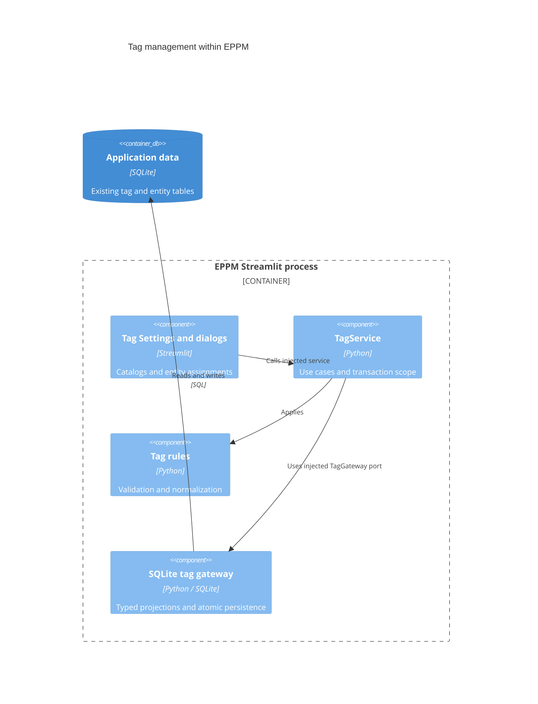

# ADR 0006: Migrate tag catalogs and assignments

- Status: Accepted for the sixth migration increment
- Date: 2026-09-08
- Previous increment: [ADR 0005](0005-layered-resource-pools.md)

## Context and decision

Planning and Settings depended on a tag repository that combined SQLite queries,
DataFrame construction, and deletion guards. Tag validation was called separately
by dialogs. Move tagging ahead of planning so its selectors and assignments can
use an application service during the planning migration.

Keep the existing SQLite schema, dictionary/free-tag behavior, tag IDs, cascades,
component contracts, widget keys, and bounded task searches. No schema migration
or new runtime dependency is introduced.

| Component | Responsibility |
| --- | --- |
| `app/domain/tags/models.py` | Group, dictionary, and project/task/pool assignment records |
| `app/domain/tags/rules.py` | Label validation, assignment normalization, and optional group checks |
| `app/application/ports/tag_records.py` | Typed catalog, assignment, selector, and paging projections |
| `app/application/ports/tags.py` | Transactional persistence contracts |
| `app/application/services/tags.py` | Tag operations, authoritative validation, and deletion guards |
| `app/infrastructure/repositories/tags.py` | Existing SQL, connection ownership, and safe storage errors |
| `app/presentation/pages/tags.py` | Four independently loaded Settings sections |
| `app/presentation/components/tag_dialogs.py` | Catalog and assignment editors using the injected service |
| `app/presentation/components/tag_frames.py` | Display/compatibility DataFrame conversion |
| `app/presentation/components/tag_tables.py` | Registration of the existing table assets in the active runtime |
| `app/main.py` | Concrete dependency construction |

## C4 level 3: tagging components

## Preserved business behavior

Catalog names are trimmed and must not be blank. Project/task assignments require
a valid entity ID and a dictionary reference or nonblank free tag; both fields may
coexist. Foreign keys remain authoritative for reference existence. A dictionary
deletion removes project, task, and pool assignments atomically. Referenced groups
cannot be deleted. Pool-tag replacement continues to share the resource service's
atomic operation; individual associations now use the tag service.

Existing tests and seeding use dictionary tags from arbitrary groups for both
project and task assignments. Preserve that behavior. The historical optional
group-validation helper and group-specific selectors remain available; this
increment does not turn those selection conventions into a new global persistence
constraint.

## Transactions and presentation

Each operation owns one connection and closes it on every exit. Writes reserve the
SQLite writer with `BEGIN IMMEDIATE` before checking group references. Failed
dictionary deletions roll back earlier association deletions. Missing-record
changes keep boolean results; migrated dialogs check them before reporting success.
SQL failures become safe application errors with internal causes retained.

Task-tag counts and rows share one read snapshot. Search/filter values remain bound
parameters; sorting uses the existing allowlist and pages remain bounded. Invalid
component paging requests are translated to safe validation errors. Group tag
counts and dictionary usage counts are included in catalog queries, removing
per-row repository calls from Settings. Editors query minimal project identities
and at most 50 task choices by default, retaining the current task even when it is
outside the search page.

The Settings shell calls the four migrated sections only when their tabs are open.
Existing JavaScript assets stay at their current paths until the runtime/assets
increment. Tag table events and translated labels are preserved.

## Compatibility and verification

Legacy tag models re-export the domain records. The old repository adapts typed
results into its historical DataFrame/dictionary shapes and restores SQLite error
types for remaining callers. The old validation service delegates to pure rules.
Planning callers will move to the application service in the next increment.

Tests cover domain normalization, combined/free tags, cross-group compatibility,
foreign keys, cascades, rollback after partial deletion, writer reservation,
connection cleanup, consistent paging during a concurrent write, bounded selectors,
real dialog CRUD, safe failures, and component-event routing. The AppTest empty-tag
case selects the rendered option by index: a raw `None` in AppTest represents no
interaction rather than the browser's explicit empty option.

Validation on Python 3.14.6:

- 336 Python tests and 14 subtests passed.
- 23 JavaScript component tests passed.
- Overall `app` and `src` statement coverage: 7262 of 8471 statements (85.73%).
  The repository-wide 99% target remains unmet; this is not a claim that the
  remaining legacy or presentation workflows are fully covered.

## Remaining migration sequence

1. Planning, tasks, dependencies, planning caches/transport, and portfolio overload reads.
2. Project collaboration catalogs, contacts, and event logs.
3. Existing budget presentation and financial calculations in explicit domain/application services.
4. Database bootstrap/maintenance, translations/assets, and the application shell.
5. Retire runtime compatibility dependencies and audit all layer boundaries.

Each remaining increment is validated and committed separately, as requested.
