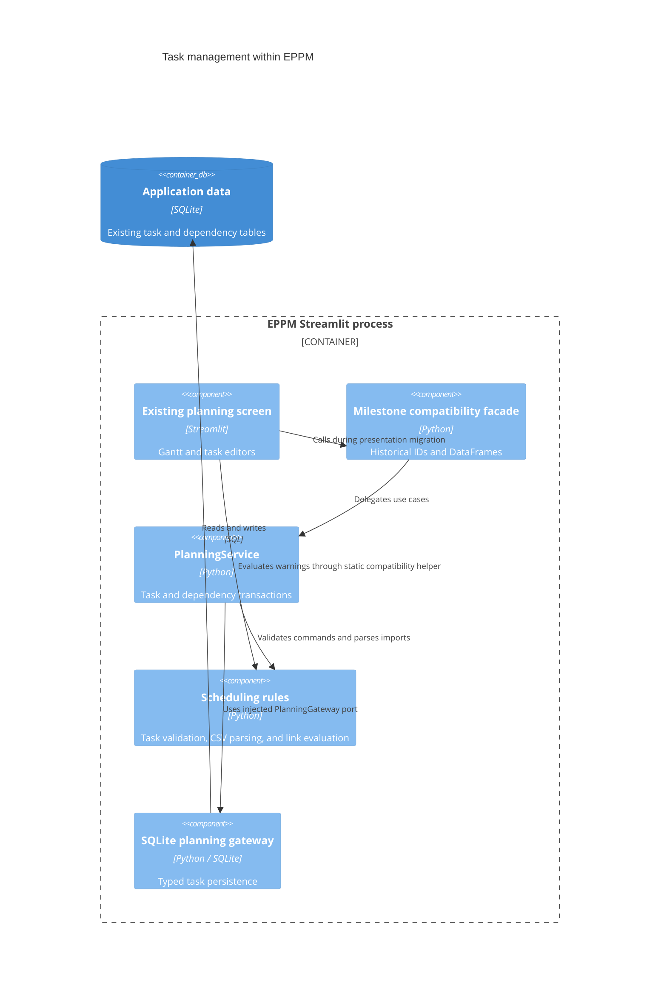

# ADR 0007: Migrate task and dependency use cases

- Status: Accepted for the seventh migration increment
- Date: 2026-09-08
- Previous increment: [ADR 0006](0006-layered-tags.md)

## Context and decision

Update: [ADR 0028](0028-project-plans.md) makes schedule edits append immutable
plans for versioned projects. Actual progress remains live. The legacy direct
editing workflow below remains available for unversioned operator data.

The planning repository combined task writes, dependency normalization, SQL, and
DataFrames. Creating or editing a task committed its details before replacing its
dependencies in another transaction. A failed dependency change could therefore
leave a partially applied edit. CSV parsing and scheduling rules also depended on
pandas and broad exception handlers.

Move task operations into the existing domain/application/infrastructure layers.
Keep SQLite, existing tables, IDs, ordering, task fields, and dependency semantics.
No database schema migration or runtime dependency is needed. Migrate the planning
core as a coherent increment before moving its larger Gantt presentation and data
loading pipeline.

| Component | Responsibility |
| --- | --- |
| `app/domain/planning/models.py` | Existing milestone, dependency, and link-code records |
| `app/domain/planning/records.py` | Typed task commands and scheduling inputs/results |
| `app/domain/planning/rules.py` | Task/date validation and established dependency defaults |
| `app/domain/planning/constraints.py` | FS, FF, SS, and SF warning evaluation |
| `app/domain/planning/csv_import.py` | Standard-library CSV parsing with numbered validation errors |
| `app/application/ports/planning.py` | Typed task projections and transactional storage contract |
| `app/application/services/planning.py` | Atomic task, dependency, and import use cases |
| `app/infrastructure/repositories/planning.py` | SQL, connection ownership, and safe storage errors |
| `app/presentation/components/planning_frames.py` | DataFrames for existing task displays |
| `app/presentation/components/planning_imports.py` | File upload decoding |
| `app/main.py` | Planning dependency composition |

## C4 level 3: task management components

## Behavior and integrity

Task details and requested predecessor replacements now commit or roll back
together. Writes reserve SQLite's writer before making related changes. Deletion
cleans incoming/outgoing links and the legacy single-predecessor column in the
same transaction. Bulk imports validate all rows first, then insert all rows in
one transaction. The existing bulk import's single-predecessor column behavior is
preserved; it does not introduce a separate multi-link import format.

Task names must be nonblank. Dates use ISO calendar dates, cannot end before they
start, and can represent zero-duration milestones. These existing editor/import
rules now apply at the application boundary as well. Progress retains its 0–100
clamp. CSV blank required fields are rejected rather than converted into the text
`nan`. Optional fields, quoted commas, UTF-8 uploads, and decimal-text predecessor
IDs retain their documented import behavior.

Dependency defaults are unchanged: unknown link types become FS, invalid lag
values become zero, empty links and self links are ignored. Whole-project and
cross-project task dependencies remain supported. The four warning rules use
calendar-day offsets and allow negative lag. Incomplete historical dates cannot
establish a violation. Evaluation is a single pass, including cyclic input; no
new cycle prohibition or automatic task rescheduling is introduced.

Storage errors expose safe application messages and retain internal causes for
diagnosis. Compatibility adapters restore historical SQLite exception types and
project-ID parsing for old callers. New application contracts use typed records
and numeric identities. Bounded selectors, batched project reads, ordering, and
existing chart warning fields are preserved.

## Verification

Tests exercise partial task/dependency failure, dependency replacement rollback,
mid-batch import failure, deletion cleanup rollback, writer reservation, connection
closure, safe errors, and a real concurrent WAL writer with a stable reader
snapshot. Domain tests cover the four link types, negative lag, cyclic and
incomplete schedules, CSV validation, and normalization. Existing planner, paging,
resource, seeding, repository, and application tests exercise the compatibility
facades.

Validation on Python 3.14.6:

- 358 Python tests and 14 subtests passed.
- 23 JavaScript component tests passed.
- Planning domain/application/infrastructure: 393 of 393 statements (100%).
- Overall `app` and `src`: 7433 of 8594 statements (86.49%). The repository-wide
  99% target remains unmet, especially in remaining legacy and presentation code.

## Remaining work

The Gantt screen, planning input caches, summary-cache maintenance, transport
formatting, and portfolio overallocation reads still need migration. They will use
the task, tag, resource, organization, schema, and project services already in
place. Collaboration, budget calculations, runtime/bootstrap, translations/assets,
and final removal of runtime compatibility dependencies remain in the overall
migration scope. Each coherent increment is validated and committed separately.
