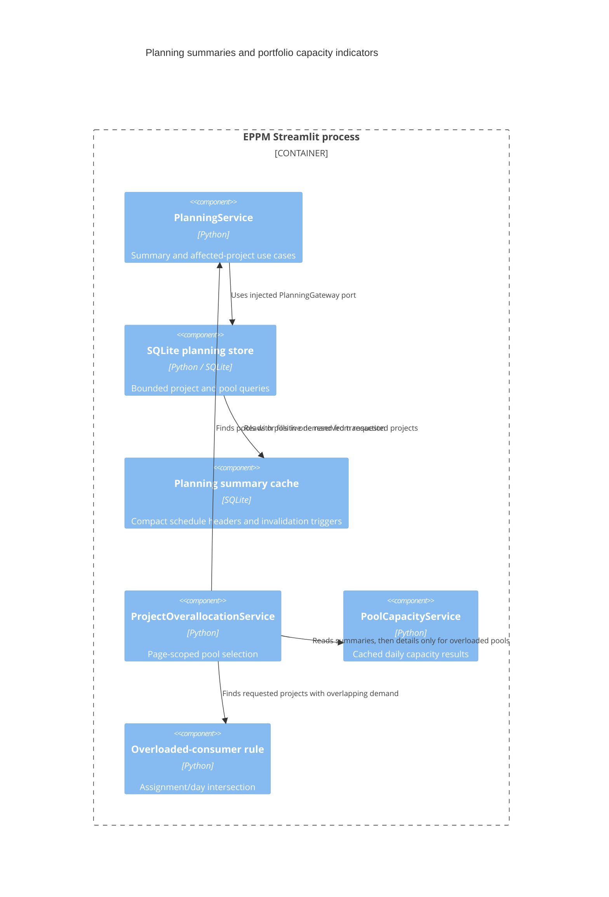

# ADR 0008: Migrate planning summaries and portfolio overload indicators

- Status: Accepted for the eighth migration increment
- Date: 2026-09-08
- Previous increment: [ADR 0007](0007-layered-planning-core.md)

## Context and decision

Planning summaries and affected-project lookups still ran SQL in a Streamlit
cache module. The portfolio composition root also imported a legacy function
combining SQLite pool selection and daily-overload logic.

Move these reads behind the planning application boundary and extract the
portfolio overload rule into the resource domain. Reuse the existing capacity
service and its cache. Keep the current SQLite tables, indexes, invalidation
triggers, summary fields, and positive-demand/any-overloaded-day behavior.
No new schema version, technology, or runtime dependency is introduced.

## C4 level 3: planning read components

The existing summary installation and SQL projection now live in
`app/infrastructure/database/planning_summary_cache.py`. `PlanningService` owns
the transaction used to fill missing headers. A concurrent task/project writer
cannot interleave between calculating and publishing a summary. Failure while
inserting multiple cache rows rolls back the whole fill, and failed task edits
restore the invalidated cache rows together with task/dependency data.

`affected_task_projects` returns the edited project, direct task/whole-project
successors, and its assigned pools. It preserves targeted Gantt refresh behavior.
The existing SQL warning projection remains necessary to open large schedules
without hydrating all tasks. Integration tests compare it against the domain's
four scheduling rules, including boundary dates and positive/negative lag.

`ProjectOverallocationService` selects pools with positive demand from the current
portfolio page, reads cached summary cards, and loads details only for overloaded
pools. `app/domain/resources/overallocation.py` intersects those daily results with
positive dated assignments. It preserves staffed capacity, calendar exceptions,
unstaffed-pool fallback, and date resolution from the shared capacity calculation.
The portfolio composition root no longer imports the legacy overallocation module.

## Compatibility and remaining work

The old summary installer and overallocation function delegate to their new
implementations. The Streamlit planning data module still owns its revision cache,
but summary SQL, index maintenance, and affected-project SQL have moved out.

The Gantt screen, catalog/task display loaders, pool display assembly, transport,
and their legacy runtime dependencies remain for the next presentation increment.
Collaboration, budget calculations, runtime/bootstrap, translations/assets, and
the final dependency audit remain in scope. Each increment is committed separately.

## Verification

Validation on Python 3.14.6:

- 387 Python tests and 14 subtests passed.
- 23 JavaScript component tests passed.
- New summary-cache and overload domain/application modules: 68 of 68 statements (100%).
- Overall `app` and `src`: 7465 of 8624 statements (86.56%). The repository-wide
  99% target remains unmet.

Tests cover domain/SQL warning parity, atomic failed cache fills, writer reservation,
task-edit rollback restoring cached data, existing-database installation, targeted
refresh, dated positive-demand filtering, and the existing lazy Gantt workflows.
