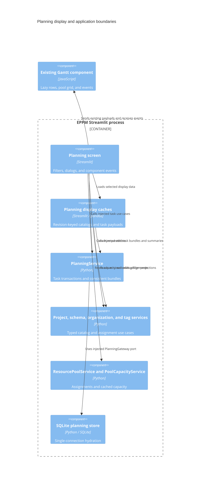

# ADR 0009: Migrate the Gantt screen and planning display pipeline

- Status: Accepted for the ninth migration increment
- Date: 2026-09-08
- Previous increment: [ADR 0008](0008-layered-planning-read-models.md)

## Context and decision

Update: [ADR 0028](0028-project-plans.md) adds Project plans with a paired
reference/alternative Gantt. Current portfolio remains the default for existing
filters and drill-through; its versioned schedules are read-only.

The Gantt screen still constructed repositories, loaded caches through database
paths, and called legacy capacity helpers. Its project filters mixed DataFrame
formatting with legacy organization and portfolio services.

Move the complete planning screen and display caches into presentation. Inject
the existing application services through `PlanningWorkspace`, composed in
`app/main.py`. Keep the current widgets, dialogs, navigation identities, custom
component protocol, lazy hydration, interval transport, and capacity semantics.
The application shell now routes Planning directly to the migrated screen.

| Component | Responsibility |
| --- | --- |
| `app/presentation/pages/planning.py` | Gantt screen, filters, tag/pool dialogs, and component callbacks |
| `app/presentation/components/planning_workspace.py` | Injected task, tag, resource, capacity, organization, schema, and project services |
| `app/presentation/components/planning_catalog.py` | Project property and organization display formatting |
| `app/presentation/components/planning_data.py` | Revision-keyed display caches and bounded task payload assembly |
| `app/presentation/components/planning_events.py` | Decode and validate the existing component JSON field types |
| `app/presentation/components/planning_transport.py` | Lossless daily-value interval transport |
| `app/presentation/navigation.py` | Stable page identities |
| `app/application/ports/planning.py` | One-snapshot task/link bundle |
| `app/application/services/projects.py` | Minimal planning catalog use case |
| `app/infrastructure/repositories/planning.py` | Shared-connection task, dependency, tag, and assignment reads |
| `app/domain/resources/overallocation.py` | Existing assignment warning predicate |

## C4 level 3: planning presentation components

## Consistency and preserved behavior

Task hydration now reads tasks, dependencies, task tags, and resource assignments
on one connection and snapshot. A concurrent write cannot combine an old task
schedule with new tags or assignment demand in the same payload. Only requested
project IDs are hydrated. Project catalog reads fetch only the filter properties
selected by the user.

Display-cache keys retain the full database revision, including source identity.
Injected service objects are excluded from Streamlit hashing. Separate database
workspaces cannot share cached project data. Scope tokens, bounded project
hydration, eviction, stale-response rejection, external predecessor lookup, and
targeted task-edit patches retain their existing behavior.

Pool capacity comes from the shared application cache. Opening a task-assignment
dialog reads summaries only for displayed statuses and unspecified-capacity pool
labels. The full-scope grid reuses existing daily results; selected-scope demand
continues to call the shared domain rules. Zero capacity and missing-day gaps
remain intact in interval transport.

The component boundary checks scalar and collection types. Task validation remains
in application/domain services, including dependency-list validation for callers
that bypass the UI. Invalid events are consumed once. Missing-record mutations
are checked before displaying success. The screen handles safe errors from all
injected services. Free-tag labels in the project-tag dialog are HTML-escaped.

## Compatibility and remaining work

The old planning screen, cache functions, interval formatter, organization display
helpers, and portfolio flattening helper now delegate to their migrated owners.
Developer planning benchmarks use the new screen and workspace. The main shell's
remaining initialization/reload compatibility wiring will be removed in the
runtime increment.

Existing JavaScript assets retain their current filesystem paths until the asset
migration. Presentation's shared i18n bridge remains until translations and locale
state are migrated. Collaboration, existing budget calculations, database
bootstrap/maintenance, the application shell, and the final runtime dependency
audit remain in the overall scope. Each increment is committed separately.

## Verification

Existing lazy-planning, flexible-filter, hierarchy, capacity-cache, task-pool
dialog, and application tests now run against the injected screen. New AppTests
exercise real Gantt create/edit/progress/delete workflows, stale records,
malformed/conflicting requests, catalog errors, and escaped tag labels. SQLite
integration tests verify concurrent task/tag/assignment snapshot consistency and
independent-database display caches. Static checks enforce layer boundaries and
check compiler-resolved global names in all migrated planning modules.

Validation on Python 3.14.6:

- 405 Python tests and 14 subtests passed.
- 23 JavaScript component tests passed.
- Overall `app` and `src`: 7655 of 8750 statements (87.49%). The repository-wide
  99% target remains unmet; presentation coverage is not represented as core coverage.
- The existing Docker container is healthy and imports the migrated planning
  composition and screen through its bind mounts. No reseed or image rebuild was needed.
