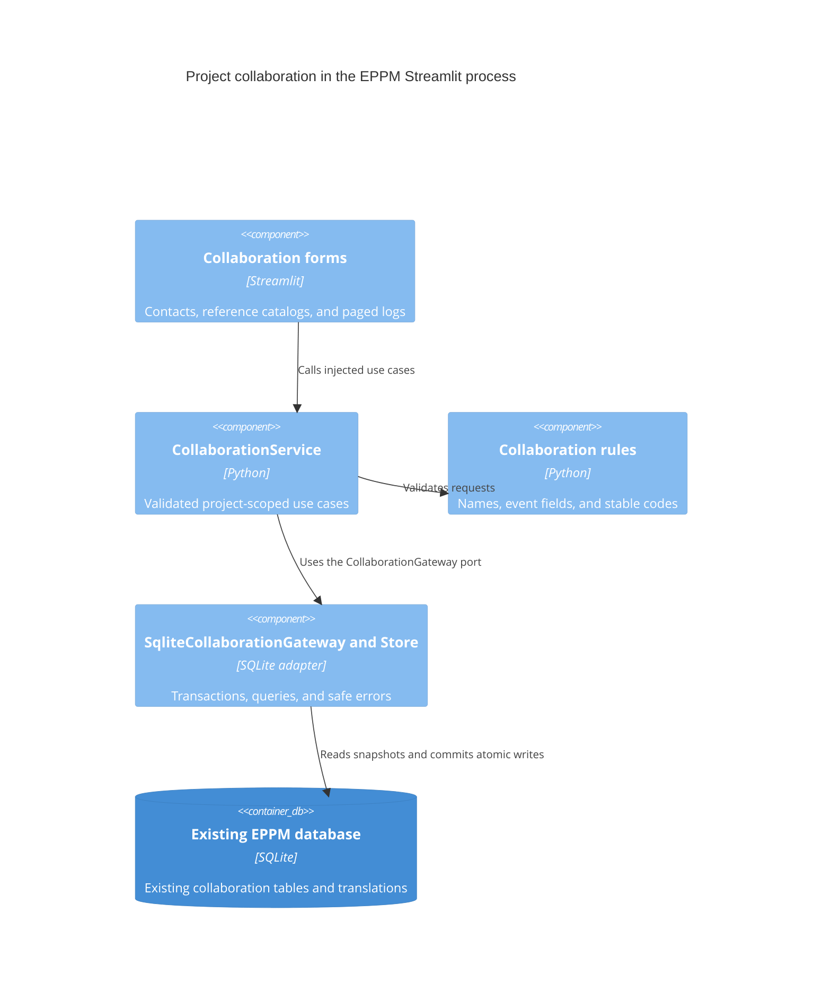

# ADR 0010: Migrate project collaboration

- Status: Accepted for the tenth migration increment
- Date: 2026-09-08
- Previous increment: [ADR 0009](0009-layered-planning-presentation.md)

## Context and decision

Project contacts, responsibility roles, event types, and logs still used a
repository that combined validation, database access, and transaction ownership.
Their Streamlit forms constructed that repository and handled SQLite exceptions.

Move validation and stable event codes into `app/domain/projects/collaboration.py`.
Add `CollaborationService` with typed application projections and an injected
transaction gateway. Move SQL into `SqliteCollaborationStore`; its gateway owns
connection lifetime, snapshots, atomic writes, and safe error translation. Move
the existing forms into `app/presentation/pages/collaboration.py` and inject their
service from `app/main.py`. Settings calls the new catalog screen; project
workspaces receive lazy callbacks bound to the new service.

## C4 level 3: collaboration components

## Preserved behavior and consistency

- Contacts belong to functions. Current occupants appear automatically; vacant
  functions display their names. Duplicate assignments and references remain
  protected by real database constraints.
- Catalog renames preserve IDs and write the canonical name and English label in
  one transaction. Other translations retain their existing fallback behavior.
- Event scope and state codes, optional deadlines, project ownership, newest-first
  paging, and the existing forms and widget identities are unchanged.
- Contact assignments and occupant resolution now use one connection and snapshot
  for their two reads. Concurrent deletions cannot mix different organization states.
- Malformed event text, deadlines, and page requests are rejected at the application
  boundary. Read and write errors shown by the UI contain safe application messages.

No schema change or data conversion is required. Applied migrations and existing
data remain intact. Historical repository and view entry points are compatibility
delegates; the repository adapter preserves SQLite exception types for old callers.

## Verification and remaining migration scope

Real SQLite tests cover constraints, project ownership, translations, atomic
rollback, connection closure, input validation, and concurrent snapshot consistency.
Streamlit AppTests cover contact editing, catalog deletion protection, all event
fields, paging, missing configuration, and safe read/write failures. Static tests
enforce inward dependencies and core imports without third-party packages.

Budget calculations and screens, database bootstrap/maintenance, translations,
component asset ownership, the settings/application shell, and final runtime
dependency removal remain in the overall migration goal. Repository-wide coverage
is tracked separately from coverage of this increment.

Validation on Python 3.14.6: 418 Python tests and 14 subtests passed; all 23
JavaScript tests passed. The collaboration domain, service, adapter, and screen
covered all 272 statements. Overall `app` and `src` coverage was 7808 of 8900
statements (87.73%); the repository-wide 99% target remains unmet. The running
Docker container successfully imports the new collaboration composition and screen.
