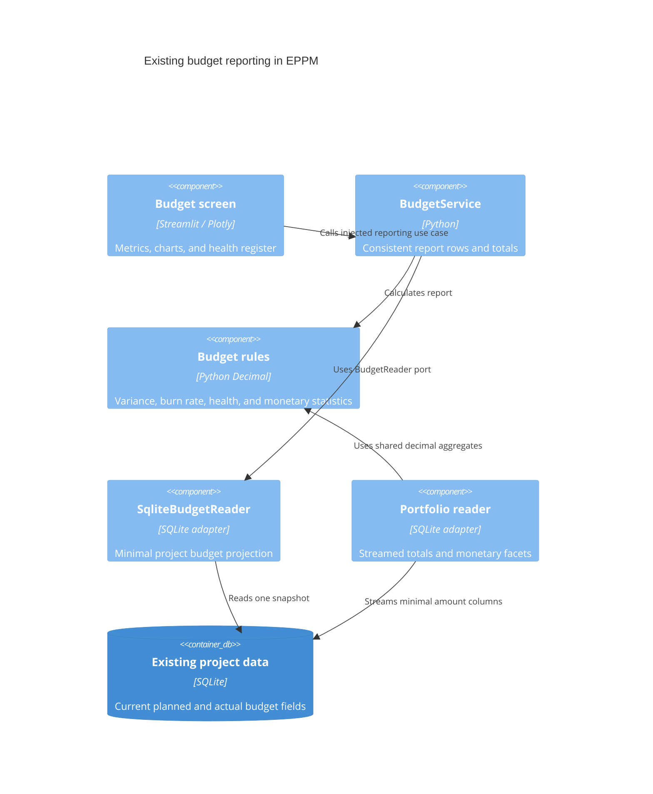

# ADR 0011: Migrate existing budget reporting

- Status: Accepted for the eleventh migration increment
- Date: 2026-09-08
- Previous increment: [ADR 0010](0010-layered-project-collaboration.md)

## Context and decision

The budget screen loaded every project and custom property through a legacy
repository. It and the portfolio detail panel duplicated variance, burn-rate,
and health calculations using floats. Legacy portfolio metrics and SQLite's
aggregate sum/average also used binary floating-point arithmetic.

Move the existing reporting rules into `app/domain/projects/budgets.py`, using
Decimal for monetary arithmetic. `BudgetService` receives a `BudgetReader` and
builds rows and totals from one source snapshot. `SqliteBudgetReader` selects only
project identity, status, planned budget, and actual spend. The portfolio reader
streams the two amount columns into the same decimal aggregate rules with constant
memory. Monetary facet averages also use decimal rules; conversions to numeric
chart/grid values happen only after calculation.

The existing budget layout moves into `app/presentation/pages/budgets.py` and
receives its service from the composition root. The portfolio detail panel uses
the same project analysis. Historical budget-screen and DataFrame helper APIs
delegate to their migrated owners.

## C4 level 3: budget reporting components

## Data compatibility and business scope

This increment migrates the existing planned-budget and actual-spend reporting.
It does not create forecasts, commitments, approvals, or period-closing workflows
that do not exist in the application. Existing project writes and SQLite REAL
columns remain compatible. Each stored number is converted through its decimal
string before arithmetic; this prevents new binary sum/subtraction errors but
cannot recover precision already lost in historical storage. An authoritative
ledger still requires an explicit storage/data migration and financial decisions.
No schema changes, reseeds, or project-value rewrites occur in this increment.

The 85-percent health threshold and aggregate zero/non-positive-budget convention
are preserved. Spending against a zero project budget now has an undefined
percentage displayed as an empty value instead of infinity; its health remains
over budget. Zero planned and zero actual remain zero percent. Numeric project IDs
are converted to display strings before constructing chart labels.

## Validation and remaining work

Tests cover fractional-euro totals, threshold boundaries, zero budgets, malformed
amounts, shared report/portfolio totals, decimal monetary facets, concurrent read
consistency, actual chart rendering, and safe empty/error states. Existing project,
portfolio paging, and legacy metrics tests exercise compatibility.

Database bootstrap/maintenance, translations, component asset paths, the settings
and application shell, and final legacy runtime dependency removal remain in the
overall architecture migration goal.

Validation on Python 3.14.6: 441 Python tests and 14 subtests passed, along with
23 JavaScript tests. New budget domain, reporting, adapter, display conversion,
and screen modules have full statement coverage. Overall `app` and `src` coverage
is 7952 of 8997 statements (88.39%); the repository-wide 99% target remains unmet.
The running Docker container imports the migrated budget composition and screen.
