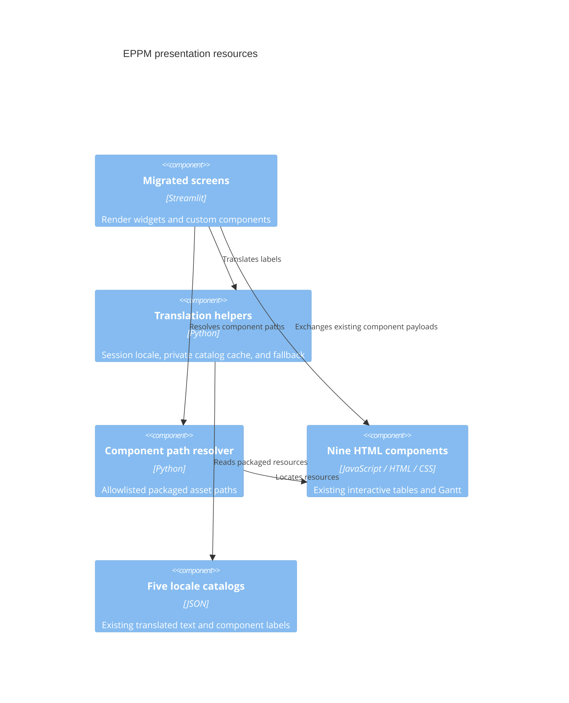

# ADR 0012: Own translations and component resources in presentation

- Status: Accepted for the twelfth migration increment
- Date: 2026-09-09
- Previous increment: [ADR 0011](0011-layered-budget-reporting.md)

## Context and decision

Migrated screens still resolved nine HTML components under `src/components`, and
their shared i18n module delegated to the legacy translator. That translator used
a process-wide mutable fallback locale and exposed mutable cached catalogs.

Move the nine HTML components and five JSON catalogs into
`app/presentation/assets/`, preserving every resource byte. Resolve known
component names through `app/presentation/assets.py`. Keep the existing widget
identities, JavaScript protocols, CSS, and translation keys. Update JavaScript
tests, the Gantt benchmark, and package-data declarations to the new owner.

The implementation in `app/presentation/i18n.py` now owns translation lookup,
aliases, interpolation, English fallback, and locale state. Streamlit sessions
retain their own preference; non-UI callers use a ContextVar instead of a shared
process fallback. Catalog caching remains private. Public catalog and section
results are copies, so a caller cannot alter another session's translations.
Malformed or missing packaged catalogs are logged without exposing file contents.

The old i18n imports are compatibility reexports. No migrated presentation module
needs a legacy translation import; remove that exception from the layer checks.

## C4 level 3: presentation resource components

## Verification and remaining scope

Resource hashes match before and after relocation. Tests exercise independent
Streamlit sessions and non-UI contexts, existing language aliases, fallbacks,
interpolation errors, cache mutation protection, and safe malformed-resource
handling. A wheel built from an isolated source copy contains all 14 resources;
an extracted-wheel smoke check resolves the component files and French catalog
without using the source checkout.

Database initialization, seeding/maintenance, settings/application shell wiring,
and the final runtime legacy dependency audit remain in the overall goal.

Validation on Python 3.14.6: 451 Python tests and 14 subtests passed; all 23
JavaScript tests passed against the new asset paths. Translation and asset helper
modules have full statement coverage. Overall `app` and `src` coverage is 7968 of
9003 statements (88.50%); the repository-wide 99% target remains unmet. Docker and
the extracted wheel both resolve the packaged presentation resources.
