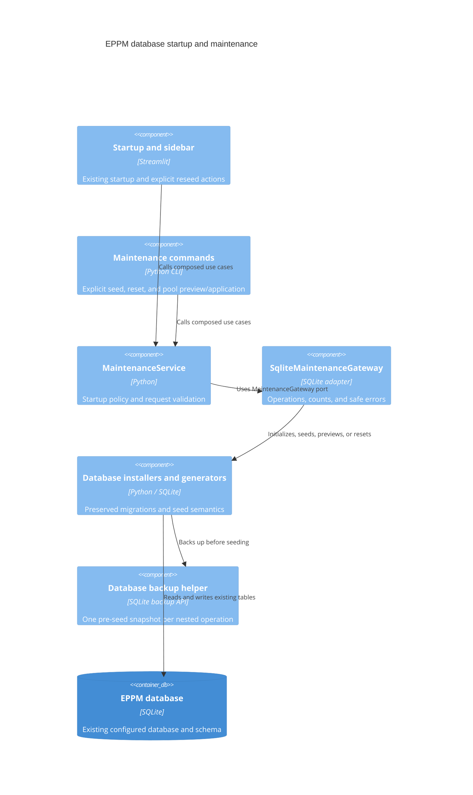

# ADR 0013: Migrate database startup and maintenance

- Status: Accepted for the thirteenth migration increment
- Date: 2026-09-09
- Previous increment: [ADR 0012](0012-presentation-resources-and-locale-state.md)

## Context and decision

Database initialization, default catalogs, backups, and demo generators still
belonged to `src/database` and executable scripts. The Streamlit shell queried
counts with SQL and selected seed implementations itself.

Move database operations to `app/infrastructure/database/`: schema initialization,
project-type and collaboration migrations, backups, default seeding, demo catalog,
bulk generation, pool scenarios, and resets. Applied migration logic is unchanged:
an AST comparison excluding imports verifies the relocation. Historical files
retain compatibility exports. Seeders use the existing application project
validation through a shared transaction-bound project writer instead of a legacy
repository facade.

`MaintenanceService` receives a `MaintenanceGateway`. It implements ordinary and
forced startup, validates generation limits before storage, and exposes explicit
reset and pool-preview/application operations. `SqliteMaintenanceGateway` handles
storage and backup failures with safe application errors and retained causes.
Startup, sidebar operations, and CLI commands use the composed service. CLI
options and the pool JSON report remain available at their existing entry points.
The old default-seeder command delegates to `scripts/seed_defaults.py`.

## C4 level 3: startup and maintenance components

## Preserved data behavior

Ordinary startup does not overwrite populated or custom catalogs. Forced startup
with a positive project count runs the existing bulk generator; zero requests the
curated demo. Nested seed operations retain a single pre-seed backup, including
WAL data. Backup failure aborts before seed changes. Additive pool scenarios are
prepared on a snapshot and checked against source changes before applying.

The existing reset transaction retains its cleanup order and rolls back earlier
child deletions if a later deletion fails. Full seeding still consists of the
existing initialization/reset/generation stages; it is not represented as one
cross-stage transaction. Its pre-seed snapshot remains the recovery mechanism.

Default seeding now treats only missing-table errors as an incomplete database.
Other SQLite operational errors propagate rather than being mistaken for an empty
catalog. No database technology, applied migration version, or persisted business
schema changed. Validation uses temporary databases; the live database is not reset.

## Verification and remaining work

Tests cover clean and repeated initialization, preserved migration ordering,
constraints, backup recovery, reset rollback, invalid requests before storage,
safe errors, real CLI commands, and read-only pool preview. Existing legacy-schema
upgrade and seeder tests exercise the relocated implementations.

The application/settings shell, removal of active legacy runtime imports, and
final architecture/coverage validation remain in the overall migration goal.

Validation on Python 3.14.6: 472 Python tests and 14 subtests passed; all 23
JavaScript tests passed. The maintenance service and gateway have full statement
coverage. Overall `app` and `src` coverage is 8457 of 9486 statements (89.15%);
the repository-wide 99% target remains unmet. Docker imports the relocated schema
initializer and maintenance composition successfully.
