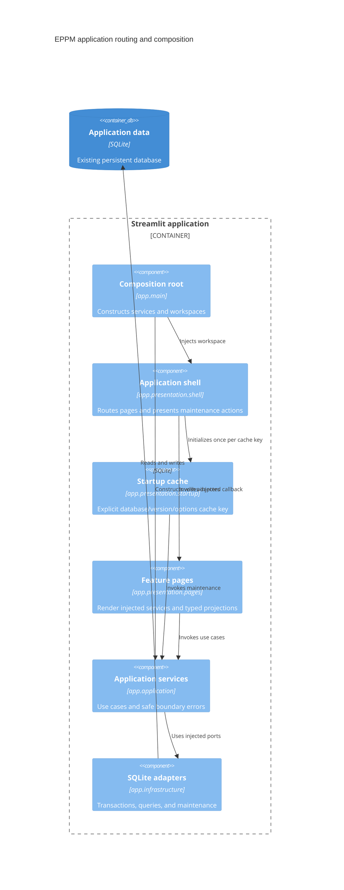

# ADR 0014: Layered application shell and runtime composition

- Status: Accepted for the fourteenth migration increment
- Date: 2026-09-09

## Context and decision

The feature pages and maintenance operations had migrated, but startup still ran
`app/presentation/legacy_shell.py`. Settings assembled repositories, and benchmark
commands imported compatibility modules. These dependencies kept legacy code on
the normal application path.

`app/main.py` now composes an `ApplicationWorkspace`: a maintenance service,
explicit database identity and startup options, and injected page callbacks.
`app/presentation/shell.py` handles navigation and display. Settings receives a
`SettingsWorkspace` of application services and renders only its active section.
Presentation does not construct repositories, read configuration, or open SQLite.

Startup caching keys include the database identity, schema version, force flag,
and requested project count. The injected service is excluded from hashing.
Explicit sidebar reseeding invalidates display data but preserves the startup
resource cache, preventing a second automatic reset when forced startup is enabled.
Schema deep links update the section widget before rendering, including after an
earlier visit to Settings. Malformed/nonpositive planning IDs are ignored.

Both source launchers continue through `app.main.main`. Historical `app` helper
exports resolve lazily through `app/compatibility.py`; `src` adapters delegate to
the migrated owners. Benchmark commands use the migrated configuration/database
owners. No application or active script imports `src`, and the legacy shell is removed.

## C4 level 3: application composition and presentation

## Compatibility and validation

The navigation choices, widget keys, lazy sections, translations, and maintenance
commands remain available. No schema migration, database technology change, or
live-data reset is part of this increment. Removing the historical `src` import
surface would be a separate compatibility decision.

Regression tests exercise real Streamlit routing, source/version startup cache
isolation, one-time sidebar reseeding, preserved edits on reruns, safe maintenance
errors, schema deep links, CLI behavior, and historical helper exports. A fresh
process renders Portfolio, Planning, and Settings and asserts that no `src` module
was imported. Static boundaries cover all application and developer-script imports.

Validation: 488 Python tests and 14 subtests pass, along with 23 JavaScript tests.
The running Docker container composes all page callbacks without importing `src`
and resolves the existing `/app/data/ppm_mock.db` bind-mounted database. This smoke
check does not initialize, seed, or change the live database.

Overall `app` and `src` statement coverage is 8528 of 9465 statements (90.10%).
The 99% repository target remains a validation gap, primarily in presentation
interactions and historical schema-upgrade branches. Completion of the dependency
migration does not imply that coverage has reached the target.
