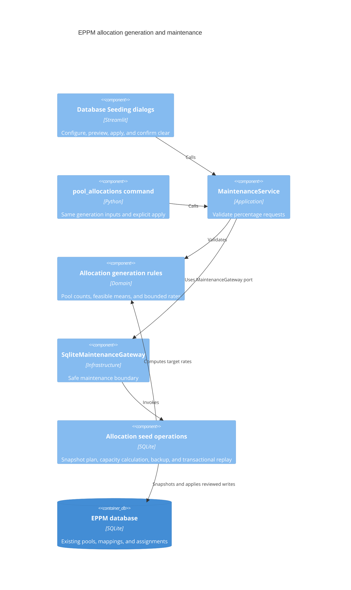

# ADR 0016: Project experience and configurable allocation generation

- Status: Accepted for the requested project experience increment
- Date: 2026-09-09

## Decision

Keep the existing layered architecture and SQLite database. Add the
`project-experience-v1` migration after the existing project-type and collaboration
migrations. It adds `employee.landline` and `schema_parameter_translation`, whose
composite key is `(param_id, locale)` and whose property reference cascades on delete.
Existing employee values and applied migration implementations remain unchanged.
Fresh demo employees receive mobile and landline numbers; upgrades do not fabricate
contact details for existing people.

`SchemaService` validates translation writes through its port. Presentation resolves
the selected-language alias, default alias, and parameter name in that order, using
stable property IDs for values and filter state. Creation, editing, and inspection
share property grouping and display-label helpers.

Contact reassignment is a project-scoped application operation that changes only
the function. Contact removal, allocation unassignment, allocation clearing, and
project deletion require explicit UI confirmation. The project editor shows its
delete confirmation inside the existing popup because Streamlit forbids nested
dialogs. A shared v2 action table supplies accessible row buttons for contacts and
allocations, inserts labels as text, and validates returned row IDs/actions.

## Allocation semantics

The user confirmed that all usage values are percentages of pool capacity and that
over/under percentages apply within the selected allocated pools. Remaining selected
pools receive 100%. Average usage is an unweighted mean over selected pools during
their allocated periods; maximum excess is added to 100%. Allocated and unstaffed
shares use all pools as denominator. Counts use nearest whole-pool rounding and
largest remainders for categories. Impossible mixes report a feasible mean range.

The domain generates deterministic bounded target rates. Infrastructure builds a SQL
plan on a temporary SQLite snapshot, using existing daily capacity calculations.
Calendar changes split assignment periods; zero-capacity dates receive no demand.
Demand is rounded down to 0.001 FTE to respect the maximum, and requests that cannot
retain their category at that precision fail before changing live data. Preview rows
include target, realized mean, and peak percentages.

Generation replaces project/task demand and adjusts mappings to achieve the unstaffed
share. Missing unstaffed capacity is initialized from prior available capacity or
1 FTE. Other pools retain existing staffing where usable, otherwise an eligible
employee is assigned. The preview describes these mutations. Apply takes a pre-seed
backup, reserves the SQLite writer, checks the source fingerprint, and replays the
plan atomically. Clearing deletes only demand, backed up and transactional.

## C4 level 3: affected components

## Additional presentation changes

Task creation emits a scoped Gantt patch instead of replacing the chart snapshot.
The browser preserves viewport offsets and expands the affected project. A capacity
checkbox filters overallocated pools using daily capacity within the displayed
period, preserving group ancestry and composing with the selected-project filter.
Portfolio overallocation indicators are informational; row context menus provide
navigation. Actual schedule CSV exports and import templates begin with consecutive
step numbers. Exports are loaded only when the CSV section is open.

## Validation

Real SQLite tests exercise clean and existing database upgrades, repeat migration,
foreign keys, rollback, backup creation, stale previews, capacity calendars, achieved
allocation mixes, contact reassignment, and alias fallback. Streamlit AppTest covers
creation tabs, landline/contact data, confirmations, generation preview/application,
and multi-project Gantt focus. JavaScript tests cover text-only rendering, row action
identity, context menu navigation, viewport retention, and combined pool filtering.

Final validation: 527 Python tests and 14 subtests pass on Python 3.14.6; all
26 JavaScript tests pass. Statement coverage is 89.60% (7,814/8,721); the existing
repository-wide 99% target remains unmet, primarily in presentation and older schema
migration branches. The rebuilt Python 3.14.7 Docker image passes initialization,
landline seeding, alias translation, allocation preview/apply/clear, CLI, and foreign
key checks on an ephemeral database.

The development database was backed up before its additive migration. Checked
business rows were identical before and after, including 10,000 projects, 73,952
tasks, 50 employees, 127 pools, 99 mappings, 10,251 allocations, two contacts, and
258,000 property values. The refreshed container is healthy and retains
`./data:/app/data`, `DB_NAME=/app/data/ppm_mock.db`, and disabled reseeding.
