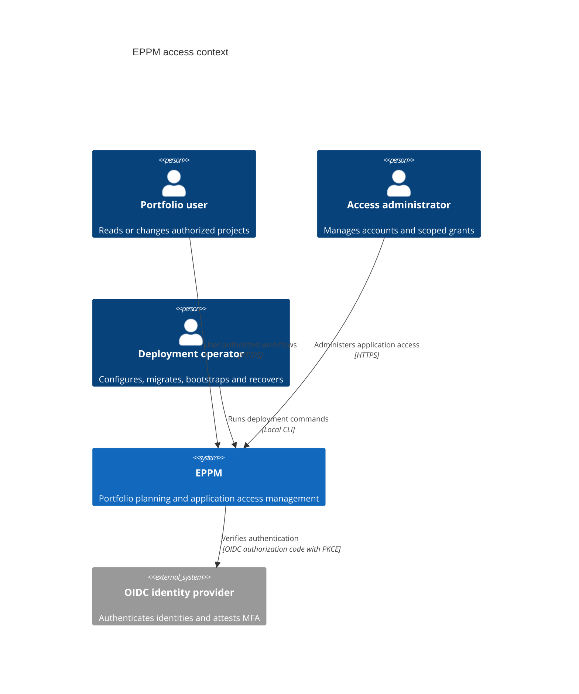
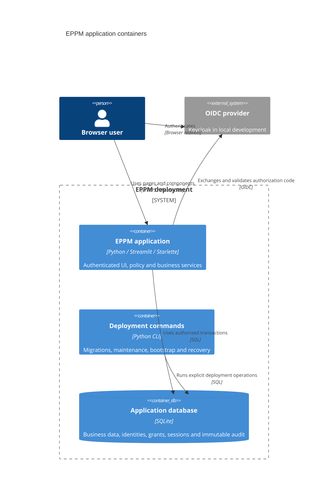
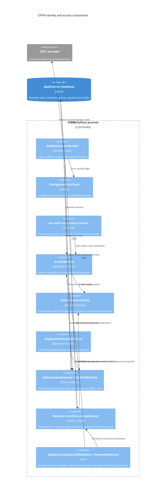

# ADR 0019: OIDC identities, explicit grants, and persistent application sessions

- Status: Accepted; implemented and verified on the feature branch
- Date: 2026-09-09
- Specification: [OIDC and access management](../implementation/oidc-and-access-management.md)

## Context and decision

The application previously had no application accounts or authorization. Employee
records remain business data and confer no application permissions. The new
identity mapping uses the exact configured OIDC issuer and subject, with a unique
database constraint. Email is profile data. Verified first login creates a pending
account without grants and never reactivates a disabled account.

Fixed permissions and role membership live in `app/domain/access/models.py`.
`AuthorizationPolicy` resolves current status, session timing, grants, and matching
project scope through an injected access store. Each permission must come from the
same assignment as its matching scope. Administrator roles are global and separate:
`access_admin` has no business privileges; `business_admin` has no approval rights.

SQLite remains the application database. Security-changing transactions acquire
the writer before checking invariants. This serializes bootstrap, role changes,
and last-active-administrator validation without introducing another database.
The specification explicitly retains SQLite, so integration/concurrency evidence
uses the actual SQLite database rather than substituting PostgreSQL.

The initial migration creates application users, identities, role assignments,
sessions, transient OIDC state, immutable audit records, and durable setup state.
Any access-admin grant permanently closes initial bootstrap. Audit insert failure
rolls back the security mutation. Application audit update/delete triggers reject
changes. Backup, retention, recovery, and reset remain deployment responsibilities.

## Scope identity and invalidation

Supported conditions use equality or membership over project type IDs and single
ENUM properties. All conditions in one assignment must match. Independent role
assignments provide alternatives. All references are validated before the grant.
The policy reads current persisted project property values and ignores invalid
grants. All scope-eligible properties require protection in business write paths.

ENUM properties receive separate monotonic scope IDs. Deleting or retyping a
property leaves a tombstone, including during legacy business resets that disable
foreign keys. Deleting selected projects, project types, or options permanently
invalidates the affected assignments. Changing an option's meaning also invalidates
its assignments. Reusing a business ID cannot silently retarget an old rule.
An administrator must revoke an invalid assignment before granting a replacement.

## OIDC and browser sessions

The supported `st.App` ASGI integration adds Authlib routes and middleware to the
normal Streamlit script. Native Streamlit authentication alone does not support the
required application idle/absolute limits and cross-tab revocation; its documented
identity cookie lifetime is 30 days. This is the concrete reason for custom routes,
not a replacement frontend framework.

The launcher assigns `app = st.App(...)` directly at module level. Streamlit 1.63
discovers ASGI applications through constructor assignments in the module's AST;
an application returned only by a factory is not discovered. A test calls the
installed discovery implementation to protect this startup contract.

Local Keycloak and EPPM share a Compose network namespace and expose loopback
ports. Browser and server use the same `http://localhost:<provider-port>` issuer.
The imported client retains Keycloak's `basic` scope to supply `auth_time` alongside
the profile, email, and ACR mappings. Credentials are generated into ignored local
configuration, never committed in the realm or image build context.

Authlib 1.8.0 performs discovery, authorization-code exchange, S256 PKCE, nonce and
state verification, JOSE signature checks, claim validation, and JWKS rotation.
The adapter fixes the configured issuer, callback and algorithm allowlist. It rejects
unsafe metadata, issuer mix-up and duplicate callback parameters. The nonce remains
mandatory even if a token claims `nonce_supported=false`. Only minimal verified
identity/timing/MFA claims leave the adapter. No access or ID token reaches Streamlit
state, browser components, application audit, or cookies.

The adapter accepts only Authlib's `UserInfo` result from ID-token validation on
the code-exchange path. An ordinary JSON `userinfo` field in a token response is
not proof of identity. Responses without an ID token are rejected even when they
contain plausible issuer, subject, timing, and nonce fields; a signed ID token
supersedes any unverified profile hints returned alongside it.

Authlib transient data, including the PKCE verifier, stays in SQLite for at most ten
minutes. Its browser cookie contains a signed state marker. Reading transient data
atomically consumes it, preventing replay across workers. The application cookie is
an opaque random value, stored only as a SHA-256 digest in SQLite. Cookies are HttpOnly
and SameSite=Lax, and Secure outside explicit loopback HTTP development.

Application session defaults are 15 minutes idle, 8 hours absolute, and the verified
ID-token expiry if sooner. Access-management changes require authentication within
5 minutes. Production/staging administrator permissions also require an ACR value
that the deployment has verified attests MFA. Every login explicitly requests fresh
provider authentication. Background checks never update last activity.

The session component captures trusted pointer/keyboard interactions, including
same-origin component frames. Same-origin POST activity extends idle time. Logout
revokes the browser's shared application session, clears its cookie, and notifies
other tabs. A background status check detects expiry without extending it. These
browser controls complement, and do not replace, server checks for every protected
operation.

Custom HTTP mutations and WebSockets require the configured Origin. Host checks,
no-store responses, safe errors, clickjacking protection and restricted referrers
apply at the ASGI boundary. OAuth debug logging and raw Uvicorn access logging are
disabled because they can contain PKCE verifiers or callback authorization codes.

References: [Streamlit authentication](https://docs.streamlit.io/develop/concepts/connections/authentication),
[st.App](https://docs.streamlit.io/develop/api-reference/server/st.app),
[Authlib Starlette integration](https://docs.authlib.org/en/latest/oauth2/client/web/starlette.html),
[Authlib 1.8.0 ID-token parsing](https://github.com/authlib/authlib/blob/v1.8.0/authlib/integrations/base_client/async_openid.py).

## Business operations and transport integration

Application composition now requires an explicit `BusinessAccess` with the
server-resolved actor. Deployment/fixture callers use the separate
`app.operator_services` entry points and an identified `DeploymentActor`.
The running shell no longer initializes, seeds, resets, or counts the entire
database. Database initialization installs planning indexes and summary storage.
Navigation exposes only authorized business, settings, or access-management pages.
The obsolete presentation startup cache and allocation-seeding dialogs are removed.
Maintenance construction lives only in `app.operator_services`; the explicit seed
CLI delegates there. Import checks prevent presentation modules from taking a
maintenance-service dependency. Actual-entry-point tests verify that public startup
does not create storage and stale transport bindings cannot render administration.

Each existing SQLite business gateway begins its transaction before installing
`SqliteBusinessSecurity`. Connection-local read views filter ownership before
queries paginate, join, group, or total results. Scoped task dependencies hide
unreadable endpoints. Business writes explicitly address the main schema;
temporary triggers check persisted old/new owners in the same transaction,
including upserts, replacements, indirect dependency writes, and foreign-key
cascades. Required protected-property audit failure rolls back the business write.
Full shared-data APIs require business administration before reading or validating
catalog data; project screens receive separate minimal reference projections.

Display cache lookup always calls the injected service's current authorization
revision, including the actor and effective scope. Application capacity caching
never reuses the global deployment cache or employee-contribution payloads for
project-only readers. Scoped planning summaries do not reuse global dependency
warning flags that could reveal hidden projects.

`ApplicationSessionMiddleware` overwrites `x-eppm-browser-session` with a signed
binding of the validated session digest, account status, and security revision.
The pinned Streamlit 1.63 `server.trustedUserHeaders` configuration maps this
server-controlled value into the runtime owner identity; its session manager
compares complete identities before reusing a reconnect ID. This configuration
API is experimental and version-pinned; upgrades must verify reconnect ownership.
The application refuses business composition without the matching middleware
binding. Both WebSocket message directions revalidate session/status/revision.
Security changes require a fresh runtime; reconnecting never resets the persisted
authentication or activity deadlines. No background transport check records activity.

Native Streamlit upload routes check an active runtime ID, not application
ownership, so they are disabled. A custom component transfers a bounded UTF-8
CSV payload through the authenticated WebSocket instead. The server independently
validates its shape/size and the existing application parser validates the template
before replacement. Native media and metrics routes are also denied. CSV export
uses `/downloads/projects/{id}/template.csv`, which checks the current cookie and
project permission on every fetch, then returns a no-store attachment. Components
receive the endpoint, never a preauthorized CSV blob or reusable data URL.

## C4 level 1: system context

## C4 level 2: containers

## C4 level 3: implemented security components

The authenticated shell, business transaction guards, scoped caches and download
routes are connected. Project dialogs, collaboration actions, and planning controls
use current permission projections; their callbacks still reauthorize stored targets.
Account/access screens use the five existing language catalogs. Public and pending
screens provide the same session-local language selector as the application shell.
See the [deployment guide](../implementation/access-deployment.md) and
[ASVS evidence checklist](../implementation/access-security-evidence.md) for the
verification results, limitations, and production responsibilities.

## Verification

- Real SQLite tests cover identity uniqueness, exact issuer/subject separation,
  role/scope separation, current property changes, deleted/reused references,
  revocation, disabled accounts, timeout boundaries, concurrent bootstrap and last
  administrator changes, mandatory audit rollback, recovery, and reset preservation.
- Actual Authlib exchange/JOSE tests mock only remote HTTP. They cover wrong issuer,
  audience, authorized party, signature, expiry, nonce, state, metadata, replay,
  PKCE, JWKS rotation, origin checks and token-free browser cookies.
- Streamlit AppTest covers public/pending/disabled screens, fixed role assignment,
  unauthorized access administration and last-administrator validation.
- Business boundary tests cover public-service denial, authoritative old/new child
  ownership, cross-project dependencies, cascades, replacement writes, protected
  property auditing, scoped summaries, employee redaction and stale fragment caches.
- Real HTTP/WebSocket tests cover authenticated download fetch, forged runtime
  identity headers, session expiry/revocation/security changes, blocked native data
  routes, and server validation of malformed/oversized CSV component payloads.
- Final integration verification on 2026-09-10: 1,069 Python tests, 14 subtests, and all 42
  JavaScript tests passed. The opt-in real Keycloak browser workflow passed against
  the rebuilt image without source mounts, including grants, scoped exports,
  revocation, and logout across tabs. Three consecutive browser runs passed after
  moving live audit inspection into the Linux container. Statement coverage is
  99.02% (10,474 of 10,578 statements), meeting the repository's 99% target.
- Final UI checks cover stale project-detail fragments, scoped Gantt events and
  resource Settings dialogs, empty planning portfolios, and schema deletion during
  saving. Capacity race tests verify that changed scopes/inputs cannot publish stale
  results. The permission inventory includes all 213 public business-service methods.
