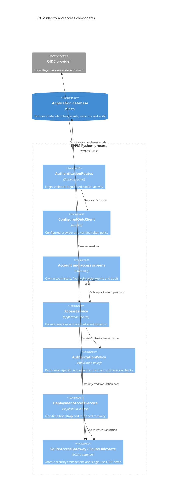

# ADR 0019: OIDC identities, explicit grants, and persistent application sessions

- Status: Accepted design; integration in progress on the feature branch
- Date: 2026-09-09
- Specification: [OIDC and access management](../implementation/oidc-and-access-management.md)

## Context and decision

The application previously had no application accounts or authorization. Employee
records remain business data and confer no application permissions. The new
identity mapping uses the exact configured OIDC issuer and subject, with a unique
database constraint. Email is profile data. Verified first login creates a pending
account without grants and never reactivates a disabled account.

Fixed permissions and role membership live in `app/domain/access/models.py`.
`AuthorizationPolicy` resolves current status, session timing, grants, and matching
project scope through an injected access store. Each permission must come from the
same assignment as its matching scope. Administrator roles are global and separate:
`access_admin` has no business privileges; `business_admin` has no approval rights.

SQLite remains the application database. Security-changing transactions acquire
the writer before checking invariants. This serializes bootstrap, role changes,
and last-active-administrator validation without introducing another database.
The specification explicitly retains SQLite, so integration/concurrency evidence
uses the actual SQLite database rather than substituting PostgreSQL.

The initial migration creates application users, identities, role assignments,
sessions, transient OIDC state, immutable audit records, and durable setup state.
Any access-admin grant permanently closes initial bootstrap. Audit insert failure
rolls back the security mutation. Application audit update/delete triggers reject
changes. Backup, retention, recovery, and reset remain deployment responsibilities.

## Scope identity and invalidation

Supported conditions use equality or membership over project type IDs and single
ENUM properties. All conditions in one assignment must match. Independent role
assignments provide alternatives. All references are validated before the grant.
The policy reads current persisted project property values and ignores invalid
grants. All scope-eligible properties require protection in business write paths.

ENUM properties receive separate monotonic scope IDs. Deleting or retyping a
property leaves a tombstone, including during legacy business resets that disable
foreign keys. Deleting selected projects, project types, or options permanently
invalidates the affected assignments. Changing an option's meaning also invalidates
its assignments. Reusing a business ID cannot silently retarget an old rule.
An administrator must revoke an invalid assignment before granting a replacement.

## OIDC and browser sessions

The supported `st.App` ASGI integration adds Authlib routes and middleware to the
normal Streamlit script. Native Streamlit authentication alone does not support the
required application idle/absolute limits and cross-tab revocation; its documented
identity cookie lifetime is 30 days. This is the concrete reason for custom routes,
not a replacement frontend framework.

Authlib 1.8.0 performs discovery, authorization-code exchange, S256 PKCE, nonce and
state verification, JOSE signature checks, claim validation, and JWKS rotation.
The adapter fixes the configured issuer, callback and algorithm allowlist. It rejects
unsafe metadata, issuer mix-up and duplicate callback parameters. The nonce remains
mandatory even if a token claims `nonce_supported=false`. Only minimal verified
identity/timing/MFA claims leave the adapter. No access or ID token reaches Streamlit
state, browser components, application audit, or cookies.

Authlib transient data, including the PKCE verifier, stays in SQLite for at most ten
minutes. Its browser cookie contains a signed state marker. Reading transient data
atomically consumes it, preventing replay across workers. The application cookie is
an opaque random value, stored only as a SHA-256 digest in SQLite. Cookies are HttpOnly
and SameSite=Lax, and Secure outside explicit loopback HTTP development.

Application session defaults are 15 minutes idle, 8 hours absolute, and the verified
ID-token expiry if sooner. Access-management changes require authentication within
5 minutes. Production/staging administrator permissions also require an ACR value
that the deployment has verified attests MFA. Every login explicitly requests fresh
provider authentication. Background checks never update last activity.

The session component captures trusted pointer/keyboard interactions, including
same-origin component frames. Same-origin POST activity extends idle time. Logout
revokes the browser's shared application session, clears its cookie, and notifies
other tabs. A background status check detects expiry without extending it. These
browser controls complement, and do not replace, server checks for every protected
operation.

Custom HTTP mutations and WebSockets require the configured Origin. Host checks,
no-store responses, safe errors, clickjacking protection and restricted referrers
apply at the ASGI boundary. OAuth debug logging and raw Uvicorn access logging are
disabled because they can contain PKCE verifiers or callback authorization codes.

References: [Streamlit authentication](https://docs.streamlit.io/develop/concepts/connections/authentication),
[st.App](https://docs.streamlit.io/develop/api-reference/server/st.app),
[Authlib Starlette integration](https://docs.authlib.org/en/latest/oauth2/client/web/starlette.html).

## C4 level 3: implemented security components

The ASGI wrapper and security screens exist but are not yet connected to the business
shell. This increment is not a secure deployment milestone. Business-service guards,
filtered queries/downloads, live Keycloak browser verification, and the final OWASP
evidence checklist remain part of the same feature before rollout.

## Verification so far

- Real SQLite tests cover identity uniqueness, exact issuer/subject separation,
  role/scope separation, current property changes, deleted/reused references,
  revocation, disabled accounts, timeout boundaries, concurrent bootstrap and last
  administrator changes, mandatory audit rollback, recovery, and reset preservation.
- Actual Authlib exchange/JOSE tests mock only remote HTTP. They cover wrong issuer,
  audience, authorized party, signature, expiry, nonce, state, metadata, replay,
  PKCE, JWKS rotation, origin checks and token-free browser cookies.
- Streamlit AppTest covers public/pending/disabled screens, fixed role assignment,
  unauthorized access administration and last-administrator validation.
- Latest full run before the final screen additions: 639 tests and 14 subtests passed;
  measured statement coverage was 90%. This does not meet the repository's 99% target.
