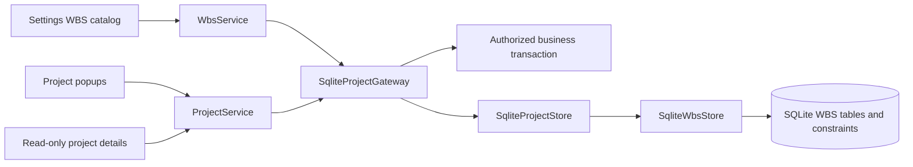

# 0020 — Shared WBS catalog and project allocations

Status: accepted for the requested WBS/OTP feature.

## Behavior

Every project template supports zero or more WBS assignments. A WBS can be shared
by projects; its combined allocation cannot exceed 100%. Percentages are integers
from 0 through 100, and new editor rows default to 100%. Remove an assignment to
detach a WBS; a zero-percent assignment is also valid. Individual project shares
do not have to sum to 100% across different WBS codes.

Business administrators maintain the shared catalog in Settings → Project
configuration → WBS (OTP in French). Codes are case-sensitive stable business
identifiers containing ASCII letters, digits, dots, dashes and underscores, with
an optional leading `#` for fictive entries. The base code is limited to 128
characters. Descriptions are optional business text, displayed with the code.
Renaming a catalog entry retains its assignments. Deleting an assigned entry is
rejected until its assignments have been removed through the project editor.

Project creators/editors manage assignments exclusively in project popups.
Project details display a read-only WBS/OTP tab. Custom web links belong only to
the Useful links tab. Browser-modal tab switches and row edits remain local.

## Transactions and authorization

The existing SQLite runtime is retained. The separately agreed PostgreSQL
migration has not begun; it must carry these new invariants into its baseline.
The additive `project-wbs-v1` migration creates `wbs` and `project_wbs` without
modifying existing business records or applied migrations.

`ProjectService` saves project fields, custom links and WBS assignments in one
writer transaction. Availability is reread under `BEGIN IMMEDIATE`, excluding
the edited project's existing share, before replacing assignments. SQLite
constraints/triggers independently protect integer percentages, unique project/WBS
pairs, foreign keys and the global 100% maximum. Competing saves serialize and
the loser receives a safe explanation of the current available percentage.

Shared-catalog writes require `business.manage`; assignment mutations require
current project-edit permission. Connection guards cover old/new project owners
and replacement writes. Scoped reads hide other projects' assignment rows.
Availability intentionally exposes a global percentage, including hidden projects,
because the user must know what can still be allocated. It exposes no hidden
project IDs, names, or individual shares.

Reference and assignment changes invalidate existing display revisions. Project
deletion cascades assignments. Project-only flushes retain the WBS catalog; full
business resets remove it after assignments. No authentication mode changes.

## C3 — Components

## Validation

The targeted pytest suite passed 311 tests and two subtests, including real
browser popup checks, native Streamlit widget dispatch, project authorization,
competing saves, atomic rollback, schema upgrades, reset ordering, display
fragments and translation-key parity. The six added WBS implementation modules
have 99% statement coverage (100% for domain rules, service, repository, migration
and native allocation editor; 96% for the Settings presentation boundary).

The local development database was backed up with SQLite's online backup API
before applying the migration inside Docker. Existing project, task, resource
allocation, contact, log and link counts were unchanged, and the foreign-key
check passed. The app container was restarted to load the updated implementation.

Authenticated read-only Chrome verification also passed for the create/edit project popups (Useful links visibility and WBS tab) and Settings > Project configuration > WBS. No live project or catalog records were changed during this browser check.
