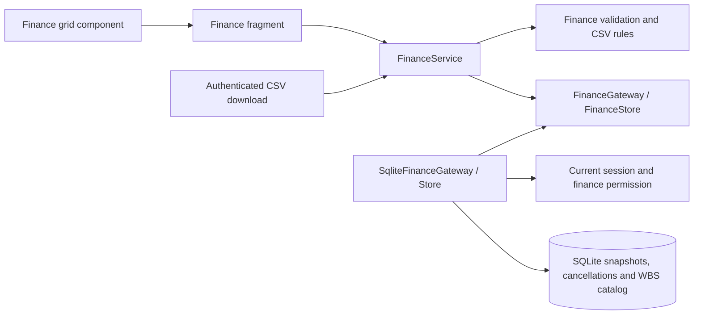

# ADR 0021: Shared versioned WBS budget plan

- Status: Accepted; simplified version workflow replaces the original major/minor decision
- Monetary representation: superseded by [ADR 0024](0024-postgresql-runtime.md);
  Decimal euros retain the existing range, cent precision and text interfaces.
- Updated: 2026-09-11
- Builds on ADR 0011 (project budget reporting), ADR 0019 (access policy), and ADR 0020 (shared WBS catalog)

## Decision and business behavior

Finance is one shared, initially empty budget plan, independent of project budgets
and project WBS allocation percentages. Project maintenance and catalog reseeding
must not delete financial history.

Each snapshot has an integer number (1, 2, 3…), a separate required name, status,
author, timestamp, and optional source snapshot ID. Numbers are displayed without
a text prefix. Every save appends the next global number, including status-only
changes and CSV imports. The save dialog prefills the selected source's name and
requires explicit status selection: Draft, Proposed, Approved, or Canceled.
Any old or canceled snapshot may be copied. Existing amounts are never overwritten.

Cancellation is the one status change that does not create a version. An immutable
finance_cancellation record holds the prior status, author, and timestamp. Reads
project Canceled as the effective status of that same snapshot. Original snapshot
metadata and values remain sealed. Cancellation is terminal; a new numbered copy
can use another status. Versions initially saved as Canceled retain their creation
author/time and cannot be canceled again. Canceled versions remain visible/exportable.

WBS codes follow catalog syntax, including optional fictive # prefixes. Unknown
codes are allowed; duplicate codes are rejected. Descriptions are live catalog
lookups and cannot be edited from Finance. Catalog changes do not rewrite finance
codes or amounts.

The grid displays current year minus five through plus fourteen, initially scrolled
to the current year. Historical amounts are read-only and retained under their old
code if a row is removed or renamed. Storage preserves absolute years outside the
display window. Blank and zero are distinct; Decimal validation and integer euro
cents provide exact financial arithmetic. Negative values, formulas, grouping,
more than two decimals, and amounts beyond signed 64-bit cents are rejected.

## Access and interfaces

All active authenticated users may view/export the shared plan, independently of
project grants. Finance editor and business administrator have finance.edit;
project editor alone does not. Access administrators assign roles through the
existing audited, recent-authentication workflow. Global-role MFA rules still apply.
Every read, download, validation, save, and cancellation rechecks current authority.

FinanceService provides view, save, cancel, validate_import, and export through
FinanceGateway/FinanceStore. Saves accept rows, source ID, required name/status,
and calendar year. BudgetVersion exposes number instead of major/minor, plus
optional cancellation audit metadata. GET/HEAD on the existing authenticated
/downloads/finance/{snapshot_id}/budget.csv route remain unchanged and uncached.

## Storage, migration, and concurrency

The applied finance-budget-v1 migration is unchanged. Additive finance-budget-v2
rebuilds snapshot metadata with a unique positive integer number and expanded status
constraint. Existing snapshots are numbered in creation-time/ID order, preserving
IDs, names, statuses, authors, timestamps, source relationships, rows, amounts,
and the ID sequence high-water mark. It adds the immutable cancellation table.
Foreign-key constraints and sealed snapshot triggers remain authoritative.

BEGIN IMMEDIATE serializes writers. Version allocation, history preservation, and
snapshot sealing occur atomically. Concurrent saves can both succeed with distinct
numbers because every save is independent. Cancellation validates the source and
inserts its audit record in one transaction; duplicate cancellations are rejected.
Errors roll back without partial writes and retain the browser draft.

Finance writes do not invalidate portfolio display or global permission caches.
SQLite remains the current runtime; any future PostgreSQL migration must preserve
these transaction and immutable-history invariants.

## Spreadsheet, CSV, and presentation

The virtualized grid displays at least 25 rows and retains 10 blank rows after the
last populated row, bounded by 10,000 rows. Entry and paste grow the grid locally.
Unused rows are subtly gray; entering a WBS removes that tint. Historical cells
remain gray/read-only. Entirely empty rows are ignored when saving/exporting;
amounts without a WBS cause a row-specific error. Name/status display separately
from the numeric version selector. No Add WBS, major/revision, or Propose/Approve
controls are needed. Save new version also allows unchanged contents.

Frozen code/description columns, virtualized scrolling, cell edits, Tab/Shift+Tab,
Enter/Shift+Enter, rectangular plain-value Excel copy/paste, and confirmation dialogs
stay browser-local. Explicit server actions rerun only the Finance fragment.
Unsaved navigation/reload/cancellation asks before discarding a draft.

CSV remains UTF-8/BOM with semicolon export and comma import support. It includes
all saved WBS rows and only current through current+14 years. Header and full-row
validation precede the replacement preview and name/status save dialog. Imports
replace current/future values while preserving omitted historical rows. Invalid
uploads never save partial data. Description cells cannot update the catalog.
Formula-like text is escaped on export. Limits remain 2 MiB and 10,000 WBS rows.

## C3 — Finance components

## Verification

Regression coverage includes numeric versioning, required name/status, old-source
copies, cancellation auditing and immutability, concurrent writers, real SQLite
migration and integrity, authorization, exact cents, CSV validation, historical
preservation, and isolation from portfolio caches. Browser checks cover row growth,
row tint, keyboard focus, save/import/cancel/copy workflows, reader restrictions,
and virtualized 1,000-row scrolling without application-shell reruns.

Verification on 2026-09-11: the full Python suite passed 1,436 tests and 14 subtests,
with one opt-in OIDC check skipped. After the final validation refinements, all 61
focused Finance/browser/localization checks passed; the five measured changed
Finance Python modules covered all 333 statements. All 70 existing JavaScript
tests passed. The 1,000-row browser check rendered 28 rows in about 15 ms and kept
the application shell at one run. Visual review confirmed numeric-only version
selection and gray unused rows. The backed-up development database migrated six
existing budget snapshots with unchanged contents and valid foreign keys.
