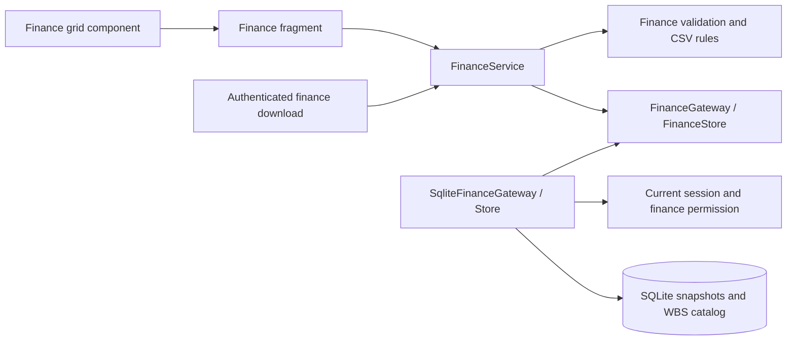

# ADR 0021: Shared versioned WBS budget plan

- Status: Accepted, implementing the agreed Finance page plan
- Date: 2026-09-10
- Builds on ADR 0011 (project budget reporting), ADR 0019 (access policy), and ADR 0020 (shared WBS catalog)

## Decision and business behavior

Finance is one shared, initially empty budget plan, independently versioned from
projects. It neither changes project budget fields nor distributes amounts using
project WBS allocation percentages. Project maintenance and catalog reseeding do
not delete financial history.

Each saved snapshot has a major number, minor number, major-version name, status,
author reference, timestamp, and optional source snapshot ID. First save is named
1.0. Revisions append the next minor number to the selected major, using its latest
revision. New majors use the next overall major number and require a new name.
Historical minor versions can be copied into a new major, but cannot overwrite a
later revision. Existing snapshots cannot be edited, replaced, or deleted.

All content saves create Draft snapshots. Propose and Approve each require explicit
confirmation and append the next minor snapshot with unchanged amounts. Both
finance editors and business administrators may approve. Approved financial data
remains available exactly as saved, even when a newer revision is Draft.

WBS codes follow the catalog syntax, including optional fictive `#` prefixes.
Unmatched codes are allowed; duplicate codes are rejected. Descriptions are a live
lookup from the shared catalog, not editable financial data or automatic catalog
creation. Catalog renames/deletions never rewrite saved finance codes or amounts.

The grid displays the application calendar year minus five through plus fourteen,
initially scrolled to the current year. Past amounts are read-only. Storage retains
absolute years outside the display window. Removing or renaming a row keeps its
old historical amounts under the old code; current/future data is replaceable.
Blank and zero are distinct. Authoritative amounts use integer euro cents, validated
with Decimal; browser decimal strings avoid JavaScript numeric precision loss.
Negative amounts, formulas, grouping separators, more than two decimals, and cents
outside SQLite's positive signed-64-bit range are rejected.

## Access and interfaces

All active authenticated users can view and export the complete shared plan,
including users with no project grants. Pending, disabled, expired, and revoked
sessions cannot read Finance. This is an explicit global financial visibility
decision, not a widening of project read scopes.

The global `finance_editor` role grants `finance.edit`, also granted to existing
business administrators. Access administrators assign the role using the existing
audited/recent-authentication workflow. Global-role MFA rules remain applicable.
Finance editors receive no project, catalog, or access-administration capability
from this role alone.

`FinanceService` provides view, save, change_status, validate_import, and export
operations using the injected `FinanceGateway`/`FinanceStore` contracts. Every
transaction rechecks the active session; writer transactions additionally require
the finance permission. Read projections include all snapshot metadata and one
selected snapshot with a batched amount query and one catalog query.

`GET /downloads/finance/{snapshot_id}/budget.csv` and HEAD regenerate an authenticated,
uncached attachment. No budget data or credentials are embedded in URLs. The
component's untrusted save/import payload is independently validated in Python.

## Storage, migration, and concurrency

Additive migration `finance-budget-v1` adds finance_snapshot, finance_row, and
finance_amount to the current SQLite runtime. Applied migrations are unchanged.
The existing role-assignment table's CHECK constraint is expanded by rebuilding
that table while retaining rows, identities, sequence high-water mark, indexes,
and referring security/scope triggers. Security audit and bootstrap state remain.

Snapshots and their rows/amounts are created and sealed in one BEGIN IMMEDIATE
transaction. Permanent triggers reject changes to sealed snapshots, including
INSERT OR REPLACE. Numbering and latest-revision checks occur under the same
writer lock. Concurrent stale revision saves fail without partial writes and
retain the local draft. Version metadata is the immutable authorship/status trail;
finance saves do not increment the global permission revision or refresh unrelated
portfolio/planning caches.

Production remains on the existing database architecture. The planned PostgreSQL
migration must carry these immutable-history and concurrency invariants forward.

## CSV, clipboard, and presentation

Export includes every saved WBS row and only current/future years. CSV is UTF-8
with BOM, semicolon-separated, with stable headers wbs_code, description, and all
15 year numbers. Import also accepts comma-separated CSV and plain decimal commas.
Description cells are informational and are resolved again from Settings. Text
that could be interpreted as a spreadsheet formula is safely escaped on export.

An import must pass complete validation before showing a replacement preview.
After confirmation it replaces the current/future draft, preserving historical
values of omitted codes. Saving then uses the same major/revision confirmation.
Cancellation leaves persisted data unchanged. Errors identify the row, year or
header problem. Limits are 2 MiB per CSV and 10,000 rows including retained history.

The custom grid freezes code/description columns and renders a small moving row
window. Cell edits, selection, scrolling, rectangular plain-text Excel paste, and
confirmation dialogs stay in the browser. Save, status, import validation and
version-selection actions rerun only the finance fragment. Local drafts survive
validation failures; explicit version/reload/sidebar navigation confirms discard.
The copy/paste workflow uses Shift-click for rectangular selection; it does not
evaluate Excel formulas or import workbook formatting.

## C3 — Finance components

## Verification

Tests cover exact cents and blank/zero values, immutable snapshots, major/minor
numbering, approvals, year rollover, historical preservation, CSV round trips and
errors, full role upgrades, pending/disabled/revoked authorization, authenticated
downloads, rollback, concurrent revisions, and project-maintenance isolation.
Browser checks exercise save/import/status/history, read-only historical cells,
Excel paste, and virtualized 1,000-row scrolling with no shell reruns.

Verification on 2026-09-10:

- The full Python suite reported 1,429 passed, two outdated expectations failed,
  one opt-in OIDC browser check skipped, and 14 subtests passed. The expectations
  were updated for global Finance visibility and independent display caches.
- The final affected Python suite passed all 82 tests, including both corrected
  expectations. The six measured Finance Python modules covered all 354 statements.
- All 70 existing JavaScript tests passed. Finance browser tests additionally
  verified save, import, approval, history, clipboard, and viewer access.
- A 1,000-row browser check rendered 28 rows and completed its measured scroll
  update in 12.1 ms without rerunning the application shell.
- The local development database was backed up before migration. Existing project,
  task, WBS, identity, role, and audit row counts were preserved; foreign-key checks
  passed, and the restarted app returned healthy. No budget rows were seeded.
