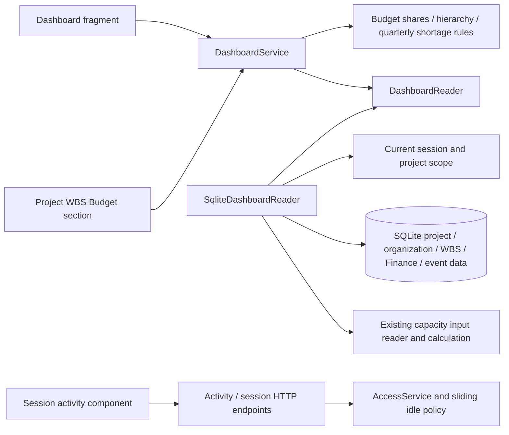

# ADR 0022: Authorized dashboard, allocated budgets, and sliding idle sessions

- Status: Accepted and implemented from the approved dashboard plan
- Date: 2026-09-11
- Builds on ADR 0019 (identity/access), ADR 0020 (WBS), and ADR 0021 (Finance)

## Dashboard and financial reporting

Dashboard is the normal signed-in landing page for active accounts. Explicit internal
project/planning destinations survive sign-in; destinations are allowlisted rather
than accepting arbitrary return URLs. Existing page choices remain session-local.

One authorized project catalog supplies five filters: Gantt-style flexible filters,
level-3 manager, level-4 manager, manager's team, and project manager. Fixed facets
use OR within each selection and AND across controls. Flexible fields retain Any/All.
Each facet considers the other filters and retains its authorized selections.
Function IDs distinguish identical occupant names. Primary reporting ancestors are
resolved with cycle/depth guards; a manager at the requested level or more senior
represents themselves. Team membership comes from team_function, not leadership.
No project grants produces an empty dashboard, never a global project catalog.

The five-row project page shows name, PRM_001 (Code Courrier), PRM_008 (phase), and
PRM_027 (strategic priority). Every chart and issue count covers all matching projects,
independently of which five rows are displayed. Scope is checked before all reads
and again before cache access, including old callbacks after grant changes.

Annual budget uses the latest numbered, effectively Approved Finance snapshot.
Cancellation selects the previous approved snapshot. Each current project WBS share
is multiplied by its approved amount with Decimal, rounded half-up to integer cents
per project/WBS/year, and those cents are summed. Blank differs from zero. Missing
codes are reported; absent annual data breaks the chart line. The identical service
supplies the project-details Budget table beneath WBS allocations. Neither view
changes approved Finance history or the existing project budget fields.

Both charts span current year minus five through plus fourteen. Quarter values are
the maximum daily sum of positive pool shortages. All competing demand contributes
on pools consumed by selected projects on that day. Spare capacity never offsets
another pool's shortage, and peaks on different days are not added. The database
adapter reuses existing capacity rules inside an explicitly authorized aggregate
boundary; only quarterly FTE values leave that boundary, not hidden projects or staff.

Active events whose event type has system_code=blocking_point are issues. The
additive dashboard-idle-sessions-v1 migration classifies the existing Blocking Point
entry without changing events. Renaming or translating that entry retains its
classification; a trigger classifies the default after an explicit catalog reseed.
The issues popup uses the existing multiline log table with no write actions.

## Activity-based authentication

This decision supersedes ADR 0019's token/absolute application-session deadlines.
OIDC signature, issuer, audience, nonce, PKCE, state, and expiry remain validated at
sign-in. A validated application session instead gets now + SESSION_IDLE_SECONDS,
default 900. Accepted activity atomically updates last_activity and expires_at.
No later token-expiry or eight-hour logout applies; SESSION_ABSOLUTE_SECONDS is
obsolete and ignored. The opaque HttpOnly application cookie has browser-session
lifetime and remains Secure outside explicit loopback development.

Trusted pointer movement/clicks, keyboard, wheel, and touch count, including
same-origin component frames. Activity requests are coalesced with leading/trailing
updates and no duplicate pending request. Synthetic events, chart animation,
rendering, and polling do not keep sessions alive. Temporary endpoint failures are
503/retryable; confirmed expiry or revocation still redirects to sign-in.

Logout, account disabling, revocation, Origin checks, cross-tab logout, and current
authorization on protected operations remain. Access administration still requires
recent authentication and production MFA. Provider-side account disabling is not
continuously introspected; revoke/disable the EPPM account to terminate active local
access. The migration revokes old sessions once so the policy starts with fresh login.

## C3 — Components and cache boundaries

Database reads batch properties, memberships, shares, and assignments. Bounded
authorized caches use database identity, business/security revisions, approved
snapshot ID, actor identity, selected IDs, and calendar day. Undated assignments use
today's date, and the daily key retains that existing planning rule across midnight.
The caches do not hash DataFrames.
Finance changes do not invalidate portfolio caches, and activity does not invalidate
business displays. Dashboard widget updates rerun its fragment, not the sidebar.
