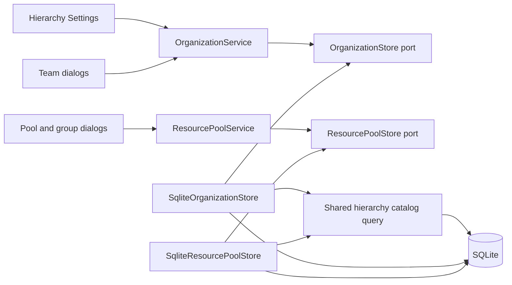

# ADR 0023: Optional shared hierarchy types

- Status: Accepted
- Date: 2026-09-12

## Decision

Teams, resource pools, and pool groups may each reference one hierarchy type.
The shared catalog starts with the stable codes `ressort`, `service`, `division`,
`equipe`, `region`, `brigade`, and `district`. Classification is informational:
it does not impose a parent-child order, change group membership, or affect
capacity calculations or authorization.

Each entity stores a nullable `hierarchy_type_id`. Existing records remain
unassigned. Users can select or clear the type in create/edit dialogs. Settings
offers a lazily loaded **Hierarchy types** tab under Organization Structure.
The same shared-settings authority used for teams and pools controls the catalog.

Codes remain stable; user-facing labels live in `hierarchy_type_translation`,
keyed by type and locale. Settings supports creating types, editing translated
labels, and deleting unused types after confirmation. Missing translations fall
back to English and then the code. The initial labels retain the requested terms
in every supported locale so administrators can supply their preferred wording.
Foreign keys restrict deletion of assigned types. Deleting an unused type also
deletes its translations. Concurrent changes remain within existing authorized
SQLite transactions and storage-error handling.

## C3 — Components



The existing organization service owns catalog administration; the resource
service exposes catalog choices. No new service, framework, or database technology
is introduced.

## Migration and operations

`hierarchy-types-v1` runs after the existing Dashboard migration. It creates the
catalog and translation tables, adds nullable foreign keys and indexes to the
three entity tables, and seeds the seven types once. Repeated startup/migration
does not undo label edits or restore deleted types. The catalog persists through
demo reseeding and project/organization flushes; administrators manage it explicitly.

Back up an existing database and run the normal migration command before using
the new application code:

```powershell
docker exec eppm_demo-app-1 python -m scripts.access_admin --database /app/data/ppm_mock.db migrate
docker restart eppm_demo-app-1
```

## Verification

Tests cover seed values, translations, optional assignment and clearing for all
three entity types, invalid identities, immutable codes, deletion protection,
migration rollback/idempotence, existing-row preservation, shared-settings
authorization, Settings CRUD, and create/edit dialogs. Browser coverage checks
catalog label edits followed by assigning and clearing a pool classification.

The affected regression suite passed after adding the catalog to display-revision
tracking; all 84 statements in the five new hierarchy modules were covered.
The local Docker database was backed up before migration on 2026-09-12. Its four
teams, 127 pools, and 53 pool groups were preserved with unassigned types. Foreign
key and integrity checks passed, and the restarted application reported healthy.
