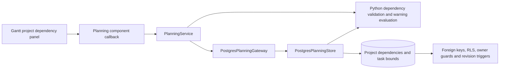

# ADR 0025: Project-owned scheduling dependencies

- Status: Accepted
- Date: 2026-09-14

## Decision

Store incoming whole-project dependencies separately in `eppm.project_dependency`.
The successor is a project; exactly one predecessor is another project or a step
in another project. Existing `task_dependencies` records and step-editing behavior
remain unchanged. Migration `0030_project_dependencies.sql` is additive and needs
no dependency conversion. Back up the database before applying it.

`PlanningService` owns typed read/save operations. Python validates inputs and
evaluates FS/FF/SS/SF constraints against the earliest start and latest end of
project tasks, using integer calendar-day lag, including negative lag. Undated
endpoints remain valid but unevaluable. Links warn and never reschedule anything.
Cycles retain bounded, warning-only evaluation; graph filters use deduplication.

Every save rechecks successor edit permission, predecessor visibility and an
opaque source revision inside the serializable transaction, including retries.
Explicit additions, updates and deletions preserve inaccessible links. PostgreSQL
retains foreign keys, row authorization, old/new owner guards and cache revision
invalidation. An authorized endpoint deletion cascades its project links even
when the other endpoint is inaccessible; it does not grant direct editing of
those links. Whole-project links survive schedule replacement; links to deleted
steps disappear in the deletion transaction.

## Interface

Both project labels and summary bars expose **Manage dependencies** when editable.
The existing dependency-row builder runs in project mode with all step fields
hidden. Loading is scoped and predecessor steps remain lazy. Save sends a delta;
Cancel discards it. Errors retain the draft and offer retry or explicit reload.
Project links contribute arrows, summary warnings, diagnostics and dependency
filters. Task-date and membership changes invalidate their source fingerprints.

## C3: components

## Consequences

For versioned projects, [ADR 0028](0028-project-plans.md) supersedes direct link
editing: dependencies are immutable plan content, edited through alternative
drafts. Removed endpoints remain in plan history and produce comparison warnings;
current projection links retain only live endpoints. Legacy unversioned edits
keep the authorization and transaction rules described here.

This adds storage and authorization infrastructure, without moving new scheduling
rules into SQL. Summary reads batch visible project links and their date bounds.
Whole-project warnings use the same endpoint semantics as step warnings. Separate
storage keeps task editing and schedule replacement independent from project links.
