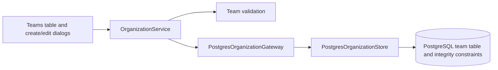

# ADR 0026: Optional parent teams

- Status: Accepted
- Date: 2026-09-15

## Decision

Each team may reference one parent through nullable `parent_team_id`, a foreign
key to `team.team_id`. Existing teams remain roots. Parentage is independent of
the optional hierarchy classification and does not alter staffing, capacity,
project filters, or authorization inheritance.

Settings → Organization Structure → Teams provides a Parent team selector in
both create and edit dialogs. No parent team clears the link. The selector
excludes the current team and descendants. The teams table displays the parent
name, with sorting and text filtering.

The domain validates positive identifiers and prevents self-parenting. The
application service validates ancestor chains against the current transaction's
catalog, with cycle-safe traversal. PostgreSQL migration `0038_team_parent.sql`
adds the indexed foreign key, self-reference check, and recursive cycle trigger.
Serializable application writes retry conflicting concurrent snapshots. The
foreign key restricts deletion of a referenced parent; detach or reassign its
children first. This preserves child teams and their existing assignments.

## C3 — Components

## Validation

Domain and UI tests cover optional values, invalid identifiers, descendant
exclusion, and clearing. Native PostgreSQL tests cover create, reparent, clear,
missing references, self-links, indirect cycles, restricted deletion, concurrent
opposite links, and Settings saves. Foundation tests validate clean migrations
and the migration ledger.
