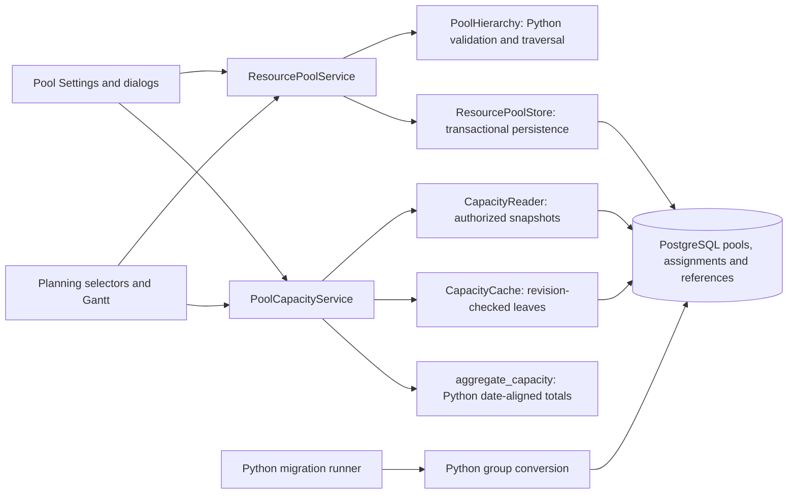

# ADR 0027: One pool hierarchy with Python business rules

- Status: Accepted
- Date: 2026-09-15
- Authority: Explicit user decision to replace pool groups with recursive pools,
  allow allocations only on leaves, and implement business logic in Python.
- Supersedes: The separate pool/group model retained by ADR 0005. PostgreSQL,
  existing authorization, and the four application layers remain in place.

## Decision

`ResourcePool.parent_pool_id` is optional. A pool has at most one parent and any
number of children. The role is derived from its children, not stored as a flag:

| State | Project/task allocations | Direct capacity | Capacity display |
| --- | --- | --- | --- |
| Leaf, without children | Allowed | Defined capacity, resource mappings and exceptions | Existing leaf calculation |
| Container, with children | Rejected | Cannot be edited or configured | Sum of its children |

`PoolHierarchy` validates identities, references and cycles, and traverses the
forest iteratively. `ResourcePoolService` validates the complete proposed change
inside each serializable transaction attempt. No new PostgreSQL business-rule
function or trigger implements this hierarchy.

Adding a child or moving a pool beneath an assigned parent is rejected, including
zero-FTE and historical assignments. The warning tells the user to remove or
reassign the parent's project/task allocations first. The same rule applies when
editing an assignment to target a container. Resource mappings and capacity
exceptions also block conversion until they are moved or removed, so they cannot
silently disappear from calculations. On successful conversion, the parent's own
defined capacity becomes zero (updated by user decision on 2026-09-15). These
changes roll back with any failed tag or detail save. Removing the last child
makes the parent a leaf again; its former
capacity is not restored automatically. Parent deletion requires moving or
deleting its children first.

PostgreSQL retains foreign keys, indexes and a self-reference check as structural
integrity constraints. Existing RLS, authorization, auditing and revision
infrastructure is preserved. An authorization-filtered, security-barrier view
exposes only assigned **pool IDs** to shared administrators. Python can therefore
check assignment existence without leaking projects, tasks, people, dates or FTE
values. Raw operator SQL must respect the Python rules; it is not a supported
application write path. No runtime role receives operator credentials or RLS
bypass privileges.

## Capacity and planning

Container capacity is the sum of descendant leaf capacities. Demand is summed
for the same date, preserving each leaf's project-versus-task demand rule.
Independent child peaks are not added to produce a parent peak. Leaf calendar
exceptions flow into parent calendars. Parent project filtering is applied to
each leaf before aggregation. The same employee allocated to different leaf pools
retains those pool contributions; the established employee deduplication remains
inside each leaf.

Only leaf results are persisted in the existing capacity cache. Container results
are calculated in Python from current leaf results, with ancestry checked before
and after loading. This avoids storing a parent result with an incomplete set of
descendant revision dependencies. Requests involving containers require leaf
details for date-aligned demand; leaf-only summary requests keep the lightweight
cache path. Portfolio totals include leaves only.

Planning retains its existing `node_type=group` / `group_id` container transport
fields for the Gantt component. Those IDs now identify **pools with children**;
there is no separate persisted group. Allocation selectors contain leaves only.
Settings provides an expandable pool tree with selection and right-click edit /
create-child actions, a parent selector, calculated container capacity and explicit
conversion warnings. The management title line is omitted; summary metrics remain.
Tree rows are 30% shorter, with bold containers, localized pool and hierarchy
types, and assignable followed by assigned capacity. Container assigned capacity
is the sum of child assigned capacities. Below the tree, only the selected pool's
overassigned periods, resource deduplication and detailed project/task allocations
are shown. Container details preserve the contributing leaf pool for each resource
and allocation. Columns show Pool Capacity (FTE), Current Capacity (FTE), Mappings
and Future Peak Demand (FTE). Mappings distinguishes employees, teams, both and no
direct mappings; containers indicate mappings via children.
Current capacity uses today's employee availability calendar when
any employee or team is mapped, including empty teams and zero availability.
Unmapped leaves use defined capacity less today's pool exceptions. Containers sum
their leaves' current capacities. This display is calculated in Python using the
capacity service's injected date. Containers have a light gray background.
Demand and overassigned periods are scoped by a project-status multiselect,
defaulting to In Progress. An empty status selection includes no projects.
Future peak demand is the maximum date-aligned required assignment from today
onward across that selected scope, with no fixed future cutoff. Past dates are
excluded. The portfolio peak also sums concurrent demand before taking its peak,
so unrelated pool peaks on different dates are not added together.
Right-click selects the pool and offers Gantt navigation to its consuming projects,
carrying the same statuses and the existing resource filter contract.
Editing and child creation use context actions;
conversion warnings appear only when a blocked creation is attempted.
Pool-tag choices and the hierarchy Tags column use dictionary entries whose
existing tag group is named `pool_tag`; there is no separate `tag_type` column.
Legacy links to other tag groups are hidden but preserved during pool edits.
Tag choices show only their names. Tag labels are loaded in one batch. Each tree
header opens an Excel-style menu with search, value checkboxes, select all,
apply/clear/cancel and ascending/descending sibling sorting.
Filters combine and retain matching rows' ancestors; matching branches are
expanded while filtering. Filters persist across dialog saves.
The edit dialog places exception management at the bottom. Creation optionally
accepts an initial exception, validated and saved with the pool in one Python
transaction. Containers expose a reminder to manage exceptions on their leaves.
Demo allocation generation also selects leaves only.

## Migration and future evolution

Migration 0040 adds the parent column. Its checksummed Python conversion hook
locks the old group tables, validates all memberships and converts groups to
pools. Existing pool IDs, assignments, tags, mappings and exceptions remain
attached to their original pools. Group descriptions, creation times and hierarchy
classifications are preserved; converted groups use the existing default Human
pool type. Empty groups become leaves under the same child-derived rule.

Multiple-parent pool memberships, multiple-parent group memberships, shared pool
and group names, or cycles block the whole migration and report conflicting
identities. No parent is chosen silently. Conversion and removal of the old group
tables commit with the migration ledger. Take a backup before upgrading a demo
database and resolve any reported conflicts before retrying.

If multiple parents become necessary, a later `pool_links(parent_pool_id,
child_pool_id)` table can replace this column. That change will need an explicit
decision on aggregating shared descendants.

## C3: components

