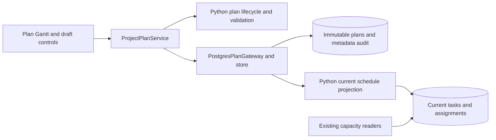

# ADR 0028: Project plans and scenario comparison

Status: implementation in progress on `feature/project-plan-scenarios`.

## Decision

Each project has immutable schedule/resource-assignment plan versions. A plan's
status, current designation and baseline designation are audited metadata.
New versions default to Proposed. Only Approved plans can be current/baseline.
Changing current does not move the baseline. Deleted is a soft deletion; only a
Business Admin can change Deleted status. Approvers and Business Admins approve
and designate plans; editors work in drafts and save new versions.

Project master data, finance, actual progress and resource availability remain
live. Comparison aligns stable task IDs, including renamed/added/removed tasks.
Reference appears above Alternative. Only Alternative is editable; Save creates
a new version rather than modifying either selected plan. Portfolio-wide named
selections are deferred.

## Storage and security

Migration 0041 introduces status translations, append-only JSON schedule
snapshots, metadata and append-only audit events. Runtime grants cannot update
content or remove history. Initial existing schedules become Approved current
plans with no baseline, captured by Python in the migration transaction.

The existing task/assignment tables are the current-plan projection, preserving
current-only resource calculations and planning readers. Python adoption rebuilds
that projection in the same transaction as the current designation. Existing
progress on surviving tasks is retained. New plans reserve stable task identities
without publishing their tasks into the current schedule.

Lifecycle and validation rules live in Python. No new PostgreSQL business
functions are introduced. Existing authenticated row-security predicates enforce
project scope. Projection write policies admit editors and approvers, while
Python entry points distinguish editing drafts from adopting approved plans.

## C3 components

## Validation

PostgreSQL tests cover immutable storage, scoped access, version creation,
approval/adoption, independent baseline selection, deletion/restoration,
stale metadata and atomic multi-project rollback.
