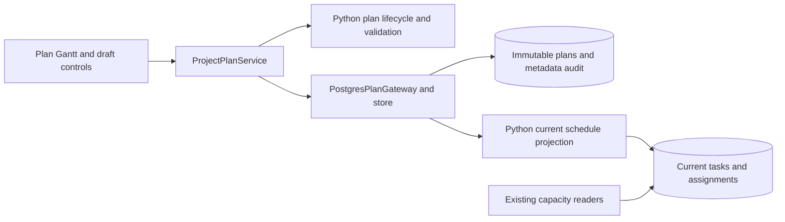

# ADR 0028: Project plans and scenario comparison

Status: Accepted and implemented on `feature/project-plan-scenarios`.

Storage and active/baseline behavior are superseded by
[ADR 0029: Relational project plans](0029-relational-project-plans.md).

## Decision

Each project has immutable schedule/resource-assignment plan versions. A plan's
status, current designation and baseline designation are audited metadata.
New versions default to Proposed. Only Approved plans can be current/baseline.
Changing current does not move the baseline. Deleted is a soft deletion; only a
Business Admin can change Deleted status. Approvers and Business Admins approve
and designate plans; editors work in drafts and save new versions.

Project master data, finance, actual progress and resource availability remain
live. Comparison aligns stable task IDs, including renamed/added/removed tasks.
Reference appears above Alternative. Only Alternative is editable; Save creates
a new version rather than modifying either selected plan. Portfolio-wide named
selections are deferred.

## Storage and security

Migration 0041 introduces status translations, append-only JSON schedule
snapshots, metadata and append-only audit events. Runtime grants cannot update
content or remove history. Initial existing schedules become Approved current
plans with no baseline, captured by Python in the migration transaction.

The existing task/assignment tables are the current-plan projection, preserving
current-only resource calculations and planning readers. Python adoption rebuilds
that projection in the same transaction as the current designation. Existing
progress on surviving tasks is retained. New plans reserve stable task identities
without publishing their tasks into the current schedule.

Migration 0042 retains actual progress even when a task is absent from the current
plan and later restored. Current projection links to removed tasks are pruned;
the immutable owner plan keeps those links. The plan Gantt reports unresolved
endpoints and resolves them again when that task is present in the compared plan.
The older current-portfolio Gantt shows only links with live endpoints.
Protected legacy primary references outside the approver's edit scope can block
task removal during adoption. This fails atomically with an explicit message;
it does not bypass another project's permissions.

New projects receive an empty Approved current plan in their creation transaction.
Legacy/operator-created projects can be initialized once from Project plans.
Current task, dependency, assignment and tag edits are allowed with project edit
permission even when saved plans exist. They change the live schedule and advance
the current revision without modifying saved snapshots or creating a plan.
The current portfolio remains the default view, preserving existing drill-through
filters; use Project plans to create alternatives. Actual progress has its own
editor and never creates a plan version.

### Current portfolio rescheduling (2026-09-16)

The user superseded the read-only current-portfolio behavior, including task and
project context-menu actions. Current
portfolio remains the default planning view. An editor can drag or resize live
tasks without creating a plan or rewriting any saved snapshot. The current plan's
revision advances to invalidate stale drafts. Date edits and baseline capture lock
the same project row and run in serializable transactions.

The project menu's **Set current project plan as baseline** explicitly freezes the
live schedule. If it differs from the saved current snapshot, this action appends
an Approved snapshot and designates it current and baseline. Otherwise it marks
the existing current plan. Approver/Business Admin permission remains required;
the Gantt asks for confirmation before replacing an existing baseline, including
when baseline lanes are hidden. Cancelling leaves the designation unchanged;
confirming retains the previous immutable plan in history.
Migration 0044 permits scoped approvers to insert this explicit snapshot. Python
continues to prevent approvers from saving edited drafts without edit permission.

**Show baseline** is initially unchecked. Enabling it keeps row heights unchanged
and reduces current task and project bar heights by 30%, draws bold dotted purple baseline lines underneath, and adds
purple rows for baseline-only tasks. Only current dependencies are rendered.
Baseline lanes are read in one scoped batch and are independent of live capacity.
The Project plans alternative editor reads the full live schedule in batches when its selection is current;
saved reference plans and baseline dates remain immutable.

Lifecycle and validation rules live in Python. No new PostgreSQL business
functions are introduced. Existing authenticated row-security predicates enforce
project scope. Projection write policies admit editors and approvers, while
Python entry points distinguish editing drafts from adopting approved plans.
Existing task and assignment authorization guards still protect ordinary direct
writes; scoped approver publication is covered by the new row-security policies.
Migration 0043 also preserves predecessor edit scope on direct link updates and
deletions, alongside the insert restrictions.

Snapshot reads redact inaccessible cross-project endpoints. Saving a copy retains
those protected links internally. Legacy destructive scheduling operations retain
their existing checks for references outside the actor's edit scope. The migration
backfill is a frozen Python helper covered by the migration checksum; runtime
codec changes do not alter an applied migration's checksum.

## Workflow

1. Open Planning → Project plans and select projects.
2. Choose a Reference (baseline when available) and Alternative per project.
3. Edit Alternative: change tasks, dependencies, tags and pool assignments using
   the grids, import a task CSV template, or move alternative bars on the Gantt.
4. Save creates Proposed plans by default (Draft is also available). Several
   project drafts save in one transaction. Cancel discards an unsaved draft.
5. A project approver or Business Admin approves a plan, then explicitly selects
   Set current and/or Set baseline. Neither designation implies the other.

Both comparison sides use current shared capacity and availability, including
exceptions; resource demand follows each selected plan's dates and assignments.
Optional resource impact includes other projects' current demand. Named portfolio
scenario sets and portfolio comparison grids remain outside this release.

## C3 components

## Validation

PostgreSQL tests cover immutable storage, scoped access, version creation,
approval/adoption, independent baseline selection, deletion/restoration,
stale metadata and atomic multi-project rollback. Additional tests cover populated
migrations, preserved actual progress, hidden and unresolved dependencies, new
project initialization, live capacity exceptions and relative assignment dates.
Streamlit and browser tests verify save/cancel and alternative-only Gantt editing.
Additional browser and PostgreSQL tests verify live drag without version creation,
explicit baseline capture, reduced row geometry and read-only baseline-only rows.
