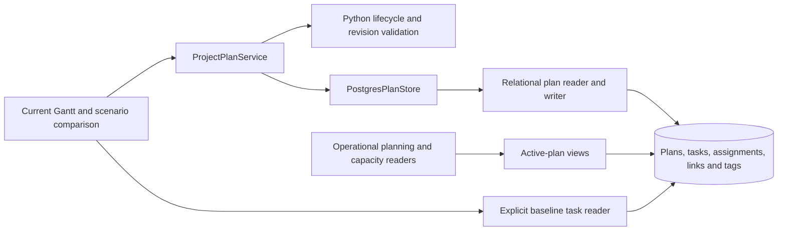

# ADR 0029: Relational plans and active schedule selection

Status: Accepted. Supersedes the JSON storage, projection rebuild and combined
current/baseline behavior in [ADR 0028](0028-project-plans.md).

## Decision

Each project has at most one active plan and at most one designated baseline.
Alternative scenarios are inactive until explicitly activated. Only Approved
plans can be activated or designated as baseline. Lifecycle authorization,
copying, activation, deletion and allocation cleanup run in Python services.
PostgreSQL provides foreign keys, uniqueness, transactions and row security;
no new database business functions are introduced.

The current portfolio is the default planning view. Editing or dragging a task
updates the active plan's rows and revision; it does not create another plan.
All operational task, demand, capacity, filter and export reads select active
plans. Explicit scenario comparison and baseline display select their requested
plan IDs. A project without an active plan contributes no operational schedule
or demand.

## Storage

`project_plan` stores metadata only; migration 0045 removes `content` JSON.
`project_task`, `resource_pool_assignment` and `project_dependency` belong to
`project_plan` through `project_plan_id`. Task dependencies and tags inherit
ownership from their task. Composite foreign keys prevent assignments from
targeting tasks in another plan or project.

Physical row IDs distinguish versions. Task identity across versions is
`coalesce(stable_task_id, id)`; assignment identity uses the same pattern with
`stable_assignment_id`. Existing rows can therefore retain their physical IDs.
Comparison matches stable task IDs, including renames and removed tasks.
Actual progress stays in `plan_task_actual` and follows the stable task identity.
Project master data, finance, pool definitions and availability remain shared.

Activating an ordinary alternative changes the active designation atomically
under a project lock. It does not delete or recreate task or assignment rows.
Outgoing plans retain their latest edits. Cross-project dependencies resolve
stable predecessor identities against the predecessor project's active plan.
Missing active predecessors remain unresolved, with historical links retained.

Deleting a scenario is soft deletion: status becomes Deleted and both active and
baseline designations are cleared. It does not automatically activate another
plan. Deleted plans are excluded from default planning. Existing Business Admin
restoration rules continue to apply.

## Baselines and revisions

Setting the current schedule as baseline creates a separate frozen copy. An
identical existing baseline is reused. Replacing the designation retains the old
frozen plan. The Gantt still asks for confirmation before replacement. Activating
a frozen baseline creates an editable working copy, leaving history intact.

A new revision copies source tasks, dependencies, tags and resource allocations
by default. Allocation values, pool choices, fixed dates and relative-date rules
are preserved independently in the new plan. New tasks start without allocations.
Removing a source task removes its allocations, tags and local dependency edges
from the revision. Explicit allocation edits remain possible. Source and baseline
allocations remain unchanged. Inactive revisions contribute no operational demand;
their capacity impact can be inspected through explicit comparison.

## Migration and security

The checksummed Python migration expands every retained JSON snapshot into rows.
It also creates a working plan from each project's existing live rows, preserving
unsnapshotted edits. Existing baseline designations and audit history survive;
former baselines identified by audit history also remain frozen. The entire
migration and its ledger entry commit together or roll back together.

Operational readers use `current_*` views; resolved dependencies use `effective_*`
views. Runtime writes remain subject to project permissions and plan editability.
The redacted current-task view is read-only. Frozen and Deleted plan children
cannot be rewritten by the runtime role. Copying an inaccessible predecessor
requires an exact source-link match; public plan DTOs continue to hide it.

The additional rows increase storage and require disciplined active-plan scoping.
Indexes support plan ownership and stable identities. General database backup or
explicit operator reset intentionally includes all history.

## C3 — Components

## Validation

Real PostgreSQL tests cover migration from populated storage, activation without
row replacement, single-active constraints, cross-plan assignment rejection,
frozen history, deletion, protected dependencies, shared actuals and allocation
inheritance/cleanup. Browser tests cover the current portfolio and explicit
scenario comparison, baseline replacement confirmation and former-task lanes.

Migration 0046 corrects a portfolio-scale read regression: signed permission
scopes are evaluated once per statement and primary predecessor resolution uses
a join instead of a per-task lookup through the edit-access graph. The task view
retains its security barrier, hidden-endpoint redaction and SELECT-only runtime
grant. Performance regressions cover 1,000 projects with inactive history and
primary links, and repeated revision reads across 10,001 projects.
