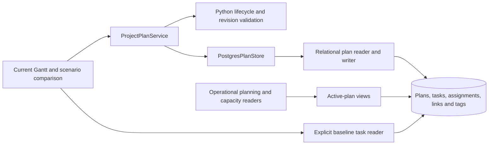

# ADR 0029: Relational plans and active schedule selection

Status: Accepted. Supersedes the JSON storage, projection rebuild and combined
current/baseline behavior in [ADR 0028](0028-project-plans.md).

## Decision

Each project has at most one active plan and at most one designated baseline.
Alternative scenarios are inactive until explicitly activated. Only Approved
plans can be activated through scenario management or designated as baseline.
Lifecycle authorization,
copying, activation, deletion and allocation cleanup run in Python services.
PostgreSQL provides foreign keys, uniqueness, transactions and row security;
no new database business functions are introduced.

The current portfolio is the default planning view. Its edit checkbox starts
unchecked and Python rejects Gantt mutations until it is enabled. Editing or
dragging a task normally updates the active plan; it does not create another plan.
All operational task, demand, capacity, filter and export reads select active
plans. Explicit scenario comparison and baseline display select their requested
plan IDs. A project without an active plan contributes no operational schedule
or demand.

The project context menu groups baseline creation, baseline soft deletion and
alternative display under Scenario management. Baseline mutations require edit
mode and existing approval privileges. Alternative selection excludes active,
deleted and frozen baseline plans. Comparison and baseline display are mutually
exclusive. Comparison uses half-height active bars above purple alternative
bars, with purple labels for alternative-only rows. Baseline lanes also retain
their purple color. In edit mode only alternative
bars can be dragged or resized; a revision-checked Python service updates that
scenario's existing task rows and audits the date change. Active plans remain unchanged. Resource consumption is compared in separate
active and alternative rows using the shared demand rules.

Comparison starts disabled on a new browser session and whenever navigation
opens the page again. Scenario management can explicitly hide comparison or
activate the displayed approved alternative after confirmation. Close alternative
view beside Clear all filters also closes comparison while retaining portfolio
filters and edit mode. Activation retains the previous plan as inactive.
Alternative dependency links use the alternative
schedule, including its added tasks. Contextual task, dependency, assignment,
task-tag operations target the selected alternative and check its revision
under the project lock. Deleted tasks release their scenario assignments.
Project tags and project logs remain shared; logging is available independently
of the Gantt edit checkbox, subject to project authorization.

Active and alternative scenarios share the Gantt step editor and the task/project
resource assignment dialogs. Alternative dialogs read scenario-owned tasks and
assignments and save through revision-checked Python plan services. Dependency
selectors use stable task identities for alternative edits. Capacity warnings
in these dialogs remain explicitly labelled as active-portfolio calculations.
Task/project hover tooltips and dependency details use the same renderers for
both lanes, supplied with each lane's dates, progress, tags, assignments and
Python-evaluated dependency warnings. Right-clicking an alternative dependency
opens the shared details card; its edit action targets the successor task's
step editor or the project dependency editor. Project dependency saves retain
stale drafts and use the same reload/error handling as the active-plan editor.
Task tags, project details, CSV import and CSV download also reuse the existing
interfaces. There is no separate alternative-scenario editing panel.
Shared project properties stay read-only when opened from comparison.
A task whose start and end dates are equal is a milestone, derived from its
dates without a second stored flag. Active and alternative lanes render it as
a diamond, including alternative-only tasks; the baseline uses a dotted diamond.
Milestones can move while retaining their one-day date range.

In edit mode, Create alternative scenario prompts for a nonempty name, copies
the active plan including its resource assignments, and immediately opens the
new scenario in comparison. This newly opened view uses light-blue bars,
blue labels and light-blue left-pane backgrounds. Dependency colors retain the
shared satisfied/violated conventions in both lanes.
This color choice belongs to the view, not the plan status: selecting an existing
scenario uses purple, even if it is still Draft. Closing comparison or leaving
the page clears the new-scenario styling. Every copied scenario starts as Draft,
including copies saved from the Project plans tab. Proposal and approval remain
explicit later lifecycle changes. Baseline snapshots and initial active plans
retain their separate creation rules. CSV imports follow the rules below.

Plan management is a lazy Project plans tab immediately after Project log in the
portfolio master-detail view. It uses the selected project without another project
selector. Unsaved drafts are kept separately for each project in session state.

## Storage

`project_plan` stores metadata only; migration 0045 removes `content` JSON.
`project_task`, `resource_pool_assignment` and `project_dependency` belong to
`project_plan` through `project_plan_id`. Task dependencies and tags inherit
ownership from their task. Composite foreign keys prevent assignments from
targeting tasks in another plan or project.

Physical row IDs distinguish versions. Task identity across versions is
`coalesce(stable_task_id, id)`; assignment identity uses the same pattern with
`stable_assignment_id`. Existing rows can therefore retain their physical IDs.
Comparison matches stable task IDs, including renames and removed tasks.
Progress is versioned in `project_task.progress_pct`. Copies inherit their source
plan's progress, then evolve independently. Activation never overwrites it.
Migration 0047 removes the redundant `plan_task_actual` mirror without changing
any existing task row or frozen baseline. This supersedes the earlier shared
actual-progress decision.
Project master data, finance, pool definitions and availability remain shared.

Activating an ordinary alternative changes the active designation atomically
under a project lock. It does not delete or recreate task or assignment rows.
Outgoing plans retain their latest edits. Cross-project dependencies resolve
stable predecessor identities against the predecessor project's active plan.
Missing active predecessors remain unresolved, with historical links retained.

Deleting a scenario is soft deletion: status becomes Deleted and both active and
baseline designations are cleared. It does not automatically activate another
plan. Deleted plans are excluded from default planning. Existing Business Admin
restoration rules continue to apply.

## Baselines and revisions

Setting the current schedule as baseline creates a separate frozen copy. An
identical existing baseline is reused. Replacing the designation retains the old
frozen plan. The Gantt still asks for confirmation before replacement. Activating
a frozen baseline creates an editable working copy, leaving history intact.

A new revision copies source tasks, dependencies, tags and resource allocations
by default. Allocation values, pool choices, fixed dates and relative-date rules
are preserved independently in the new plan. New tasks start without allocations.
Removing a source task removes its allocations, tags and local dependency edges
from the revision. Explicit allocation edits remain possible. Source and baseline
allocations remain unchanged. Inactive revisions contribute no operational demand;
their capacity impact can be inspected through explicit comparison.

## Migration and security

The checksummed Python migration expands every retained JSON snapshot into rows.
It also creates a working plan from each project's existing live rows, preserving
unsnapshotted edits. Existing baseline designations and audit history survive;
former baselines identified by audit history also remain frozen. The entire
migration and its ledger entry commit together or roll back together.

Operational readers use `current_*` views; resolved dependencies use `effective_*`
views. Runtime writes remain subject to project permissions and plan editability.
The redacted current-task view is read-only. Frozen and Deleted plan children
cannot be rewritten by the runtime role. Copying an inaccessible predecessor
requires an exact source-link match; public plan DTOs continue to hide it.

The additional rows increase storage and require disciplined active-plan scoping.
Indexes support plan ownership and stable identities. General database backup or
explicit operator reset intentionally includes all history.

## C3 — Components

## Validation

Real PostgreSQL tests cover migration from populated storage, activation without
row replacement, single-active constraints, cross-plan assignment rejection,
frozen history, deletion, protected dependencies, independent progress and allocation
inheritance/cleanup. Browser tests cover the current portfolio and explicit
scenario comparison, baseline replacement confirmation and former-task lanes.

Migration 0046 corrects a portfolio-scale read regression: signed permission
scopes are evaluated once per statement and primary predecessor resolution uses
a join instead of a per-task lookup through the edit-access graph. The task view
retains its security barrier, hidden-endpoint redaction and SELECT-only runtime
grant. Performance regressions cover 1,000 projects with inactive history and
primary links, and repeated revision reads across 10,001 projects.

## Dashboard resource plan scope

Dashboard resource allocation, overallocation and consumer drill-through use only
active-plan assignments and task dates. Migration 0048 repairs the resource reader
omitted from the original source conversion, preserving its existing private
competing-demand aggregate and calculation rules. Inactive alternatives, baselines,
and deleted plans cannot contribute demand. Both resource chart context menus can
filter to one pool; this recalculates its own quarterly peaks and capacity. The
filter applies to both charts, leaves the project/finance selection unchanged, and
can be removed with Show all pools or Clear all filters.

## CSV revision imports and comparison diagnostics

CSV import always creates a new revision with a mandatory version name, retaining
all existing plans. Editors import Draft revisions; scoped approvers and business
administrators may select Draft, Proposed, Approved or Rejected. Deleted is a
lifecycle action, not an import status. The active-plan checkbox is disabled and
unchecked; Python rejects import activation too. Import works without a source
plan and always leaves existing active designations unchanged. CSV exports and
the downloadable import template include `task_correlation_id`, the stable task
identity shared across plan revisions. Imports preserve supplied IDs even when
task names, dates or step numbers change. Blank IDs (or an absent column in older
files) create new identities. Duplicate, unknown or other-project IDs are
rejected. Step numbers still identify local CSV dependencies. CSV imports contain
no resource assignments. Activate a revision separately through
scenario management after approval. Day and month may have one digit; two-digit
years in slash-separated dates resolve to 2000–2099, preserving the selected
DD/MM or MM/DD order and rejecting invalid calendar dates. An unambiguous slash
date such as 9/20/2025 determines the order for other dates in that file, including
10/1/2026 (October 1). If there is no consistent unambiguous evidence, the selected
date format remains the fallback.

Baseline visibility is toggled in Scenario management immediately above Delete
baseline. Dual-view project rows show both task counts, with the active count above the alternative count
in its scenario color. Alternative constraint warnings open the shared diagnostics
and step editor using that scenario's stable task identity. Row heights are retained.

In dual view, pools and containers have comparison Total and Selected Projects
demand rows beneath their active rows, respecting the corresponding display toggles.
Alternative-only pools remain visible with Hide unused pools.
Python resolves assignment periods against each alternative schedule and reuses
project/task demand deduplication. Displayed alternatives replace their projects'
active allocations; all other projects retain active allocations. Status exclusions
apply to both plans, and Selected Projects additionally applies the portfolio
selection. Container rows sum their descendant pools.
Comparison demand rows appear only when daily consumption differs from the active
scope; zero/missing dates are equivalent and date shifts count as differences.
Unchanged container totals are hidden even if children offset each other's changes.
These rows retain the resource context menu: filters use active assignments with
the matching Total or Selected Projects scope, while allocation and edit actions
remain disabled. Closing
comparison removes the alternative consumption rows without altering active demand.

Task and project bar context menus inspect the clicked lane. Active bars never
inherit alternative constraint warnings or editing actions; alternative bars retain
their scenario-owned diagnostics. Project exports also follow the clicked lane.
In dual view, project and task tooltips identify the scenario by its saved name;
task-count tooltips read "Tasks in <scenario name>". Alternative dependencies use
the same neutral, violated and hover colors as active dependencies. Successful CSV
imports display a success banner confirming availability in the scenarios list.
