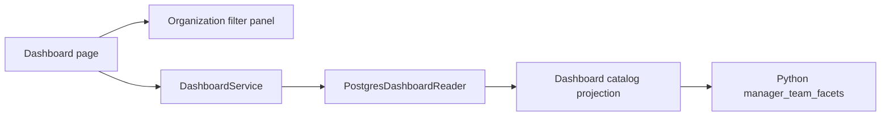

# Cascading organization filter panel

## Decision

The dashboard starts with a reusable organization filter panel. Services and
project managers are framed horizontal multiselect buttons; Division and Team
frames start collapsed. Buttons wrap so every available service is visible.
An ordinary click, Ctrl-click, or keyboard activation toggles an option without
clearing the other selections. Multiple values within a facet use OR; facets
combine with AND. No organization selection imposes no organization restriction.
The existing **In Progress** default and Clear all filters behavior are retained.

Choices come from currently readable projects, across statuses, not the current
status/pool/advanced filters. Services therefore remain visible when other
dashboard filters change. Division choices depend on selected services; Team
choices depend on services and divisions; managers depend on all three. A parent
change removes invalid downstream selections and resets the project page.

Project `function_id` identifies the manager. Employee names label the function
when available, falling back to the function title; duplicate names retain the
existing function-title/ID disambiguation. A manager's `team_function` memberships
and their `parent_team_id` ancestors provide service/division/team membership.
Stable hierarchy codes `service`, `division`, and `equipe` (also `team`) identify
these categories, independently of translated labels. Multiple membership paths
are unioned, and cycle detection bounds traversal. A missing category or manager
has the **Not assigned** option, represented internally by the empty string.
Unrelated private project organization labels are not exposed.

## Components (C3)

The panel takes an upstream-choice provider, label maps, a state-key prefix, and
a change callback so other pages can reuse its behavior without depending on
dashboard rendering. Business membership and filtering rules run in Python.
SQL reads existing rows in batches; no database functions or schema changes are
introduced. Existing catalog revision tracking invalidates team/member/name edits.

The same resulting project IDs feed the dashboard project list, budgets, issues,
and selected resource demand. Existing status-scoped competing resource demand
remains part of resource overcapacity calculations.

## Verification

Domain tests cover multiple memberships, incomplete paths, cycles and matching.
PostgreSQL tests cover authorized labels, employee-name fallback, parent changes,
missing mappings, and cache invalidation. Browser tests cover default status,
collapsed frames, Ctrl-click multiselect, deselection, downstream pruning, manager
selection and clearing the panel, alongside the existing dashboard browser suite.
