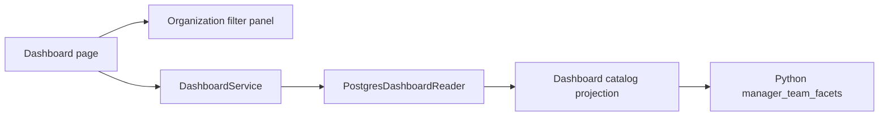

# Cascading organization filter panel

## Decision

The dashboard starts with a reusable organization filter panel. Services are framed horizontal multiselect buttons without a visible heading.
Division, Team, and Project managers frames start collapsed. Frame gaps are 8px
(half the standard gap), and collapsed frames are 24px tall (40% shorter). Buttons wrap so every available service is visible.
An ordinary click selects only that option (or clears it when it is the sole
selection). Ctrl-click toggles an option without clearing the other selections;
Command-click is also supported. Buttons display the Ctrl-click hint on hover.
A small CCv2 button component captures modifiers while Python applies selection
and cascading rules. Frame content has 8px vertical padding, half the original,
and dashboard top padding is reduced from 0.25rem to 0.05rem. Multiple values within a facet use OR; facets
combine with AND. No organization selection imposes no organization restriction.
The existing **In Progress** default and Clear all filters behavior are retained.

Project status and Resource pools use searchable checkbox dropdowns with Select
all and Clear actions. Selections apply immediately and the closed dropdown shows
a compact summary, without removable tags. Clearing a dropdown removes that
filter restriction. Chart pool filtering queues the canonical selection in the
component callback, before the filters render, and therefore updates the dropdown
checkboxes in one rerun. Advanced filters retain their existing UI.
Status, pools, Advanced filters, and Reset filters share one row, in that order.
The row sits 8px below Project managers, matching the organization frame gaps.
The collapsed matching-projects frame is also 24px tall. Reset filters restores
the default In Progress selection and clears the other filters.

The full dashboard shell reduces the gaps around invisible shell components from
16px to 3.2px and its top padding to 0.16px. Together these reduce the measured
space above Services from about 49px to about 10px; other pages keep their layout.

Choices come from currently readable projects, across statuses, not the current
status/pool/advanced filters. Services therefore remain visible when other
dashboard filters change. Division choices depend on selected services; Team
choices depend on services and divisions; managers depend on all three. A parent
change removes invalid downstream selections and resets the project page.

Project `function_id` identifies the manager. Employee names label the function
when available, falling back to the function title; duplicate names retain the
existing function-title/ID disambiguation. A manager's `team_function` memberships
and their `parent_team_id` ancestors provide service/division/team membership.
Stable hierarchy codes `service`, `division`, and `equipe` (also `team`) identify
these categories, independently of translated labels. Multiple membership paths
are unioned, and cycle detection bounds traversal. A missing category or manager
has the **Not assigned** option, represented internally by the empty string.
Unrelated private project organization labels are not exposed.

## Components (C3)

The panel takes an upstream-choice provider, label maps, a state-key prefix, and
a change callback so other pages can reuse its behavior without depending on
dashboard rendering. Business membership and filtering rules run in Python.
SQL reads existing rows in batches; no database functions or schema changes are
introduced. Existing catalog revision tracking invalidates team/member/name edits.

The same resulting project IDs feed the dashboard project list, budgets, issues,
and selected resource demand. Existing status-scoped competing resource demand
remains part of resource overcapacity calculations.

## Verification

Domain tests cover multiple memberships, incomplete paths, cycles and matching.
PostgreSQL tests cover authorized labels, employee-name fallback, parent changes,
missing mappings, and cache invalidation. Browser tests cover default status,
collapsed frames, Ctrl-click multiselect, deselection, downstream pruning, manager
selection and clearing the panel, alongside the existing dashboard browser suite.
