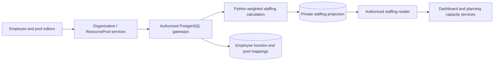

# Employee function assignments and Python staffing projections

Status: accepted through the employee multi-function implementation request.

## Membership and migration

`employee_function(employee_id, function_id, allocation_pct)` is the authoritative
membership relation. Migration 0055 maps every existing non-null employee/function
link at 100%, including retained deleted records. Employees without a function
remain unassigned. The old `employee.function_id` column remains a deprecated
migration/import field; current application reads never use it for membership.
Single-function Python creation DTOs remain supported and write the linking table.

An employee's shares across active functions cannot exceed 100%. Python validates
the entire set within the existing serializable write transaction. Deleted
functions are excluded from the total and calculations; retained links can still
be removed. The employee directory flags invalid totals introduced by restored
functions or external data changes and lists the contributing functions.

Team membership continues to use explicit `team_function` links. A 60% Engineer /
40% Analyst employee contributes 60% of their available FTE to a team containing
only the Engineer function. Different function shares add; repeated paths to the
same function use the highest team mapping percentage. Direct function mappings
override team paths for that function. A direct employee mapping overrides all
function paths within that pool. Employee calendar exceptions change availability
before the effective allocation share is applied. Cross-pool limits use these
same weighted, deduplicated percentages.

## Staffing privacy and Python calculation

The existing PostgreSQL `pool_staffing` interface now reads a private
`pool_staffing_projection` table. Python calculates and publishes this projection
in the same transaction as organization and shared pool writes. Project/task
assignment writes do not rebuild staffing. Migration 0055 initializes the
projection in its atomic Python migration hook; operator seed workflows publish
it after staffing changes too.

Ordinary readers receive totals and availability calendars only. Individual
contributions and raw membership records retain shared-administration access
requirements. No employee access privilege is widened. Existing cache revision
and current-permission checks remain in force. The old private SQL contribution
helper is no longer used by runtime staffing calculations.

External operator SQL changes to employee memberships, availability or pool
mappings must call `refresh_staffing(connection)` before committing. Application
menus and supported seed commands do this automatically. Publishing only changed
projection rows avoids unnecessary writes. The projection is derived data;
employee/function/team/pool records remain the source of truth.

## Editing and row actions

The employee profile uses grids for function shares and availability exceptions.
Exception-grid changes validate inclusive date overlap before an atomic save;
retained rows keep their exception identities. Team member selectors identify the
function and each employee's share explicitly.

Pool exception rows offer Delete for pool-owned exceptions and Edit employee for
employee-owned exceptions. Pool mapping removal requires a confirmation listing
the exact sources; removing a team mapping names the affected employees. Source
mappings are removed atomically and rechecked against cross-pool allocation rules.

## C4 level 3 — changed components

Regression coverage includes upgrade backfill, active-function limits, weighted
team/pool capacities, exceptions, source-mapping removal and staffing privacy.
