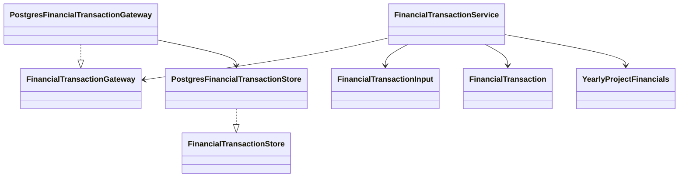

# Project financial transactions

This initial backend decision is extended by
[0062 — Unified project budget](0062-live-project-budget.md), which adds the
explicit `LIVE_BUDGET` type and the Portfolio budget editor.

## Decision

Add backend support for project commitments and actual spending, without changing
the user interface, existing shared budget snapshots or project budget fields.
The existing application uses native psycopg repositories, domain dataclasses,
typed ports and application services; no ORM or new dependency is introduced.

## C4 — Code



`create_financial_transaction_service(resources, access=...)` composes this path.
The service exposes `create`, `get`, `list`, `update`, `delete` and `yearly_totals`.
Create/update use the immutable `FinancialTransactionInput` DTO. Reads return
`FinancialTransaction`, including the generated identity and persisted euro value.
The service/domain calculate and validate conversions in Python. The repository
uses parameterized SQL, existing serializable write retries, signed actor binding
and project row-level security. There are no SQL calculation functions or UI forms.

Example for an already authorized service instance:

```python
from decimal import Decimal
from dataclasses import replace
from app.domain.financial_transactions import FinancialRecordType, FinancialTransactionInput

commitment = FinancialTransactionInput(
    project_id=5006, fiscal_year=2026, amount=Decimal('100000.00'),
    currency='EUR', exchange_rate=Decimal('1'),
    financial_record_type=FinancialRecordType.COMMITMENT,
    spending_type='ORDER', wbs='Not-yet-in-the-catalog',
)
source_id = service.create(commitment)
service.create(replace(commitment, amount=Decimal('25000.00'),
    financial_record_type=FinancialRecordType.ACTUAL, source_transaction_id=source_id))
report = service.yearly_totals([5006])
# 2026: total_commitment=100000.00, total_actual_spending=25000.00, in EUR.
```

## Accounting and input rules

- One `eppm.project_financial_transaction` table stores both stable codes,
  `COMMITMENT` and `ACTUAL`, using the existing text/check convention and a Python
  `StrEnum`. There is no lifecycle status.
- Base currency is EUR. Currency codes are normalized to three uppercase letters;
  there is no existing currency catalog or exchange-rate lookup to reuse.
- The exchange rate is EUR per unit of transaction currency, supplied explicitly.
  Amounts use `numeric(19,2)` with the existing finance amount limit; rates use
  positive `numeric(28,10)`. The service accepts finite `Decimal` values only,
  rejects excess input precision, and rounds conversion to cents using half-even,
  consistent with existing authoritative project budget arithmetic.
- Signed amounts are allowed for corrections/credits. No unspecified positivity
  requirement is inferred for amounts. Fiscal years range from 1 through 9999,
  independently of the optional accounting date.
- WBS is mandatory free text, without a WBS foreign key or catalog lookup.
  Spending type is mandatory nonempty text in Python; no database classification
  check, enum or conditional behavior restricts its possible values.
- The source ID is optional and may refer to any visible transaction; there is
  no additional source-type, same-project or lifecycle validation. Referential
  integrity applies. Linking an actual never updates the source amount.
- Project ownership and financial record type are immutable after creation.
  Metadata edits preserve the stored conversion. Explicit amount/rate corrections
  update that record's conversion only; later transactions/rates cannot change it.
- CRUD deletion is physical, as requested for this entity. Referenced sources are
  protected by `ON DELETE RESTRICT`, matching financial snapshot source references.
  Project deletion uses the existing owned-record `ON DELETE CASCADE` convention.
  A cross-project source reference can therefore block deletion of its project.

## Authorization

Per the user's explicit choice, writes require either `finance.edit` and read
access to the owning project, or `project.edit` on that project for the explicit
allowlist `COMMITMENT` and `ACTUAL`. This allowlist is maintained independently
of the record type enum in Python and in row policies: introducing another type
does not automatically grant project editors write access to it. Finance editors
with no project access cannot write. Reads and aggregates expose only readable projects. Linked
source visibility is checked in the same authorized transaction. Runtime SQL
privileges additionally prohibit changing project identity or record type.

## Reporting and rollout

`yearly_totals(project_ids=None)` returns `YearlyProjectFinancials` per readable
project/year, with `total_actual_spending` and `total_commitment` summed from
persisted `amount_base_currency`. Passing an empty collection selects none;
inaccessible project IDs are filtered out of reports. Missing years are omitted.
No open commitment subtraction, currency-rate refresh, new cache or dashboard
binding is added. Current dashboard budgets remain independent until a later UI
integration explicitly consumes this service.

Migration 0061 is additive and follows the identity, index, RLS and grant
conventions. Existing applied migrations are unchanged. Tests cover fresh/upgrade
migrations, native constraints, CRUD, reference protection, historical conversion,
exact yearly totals, concurrent actual creation and current permission checks.

## Validation and local rollout

On 2026-09-18, the focused finance/transaction/migration suite passed 112 tests.
The three new implementation modules (domain, service and repository) achieved
100% statement coverage. The separate migration foundation/Decimal validation run
passed all 102 checks, including the corrected upgrade fixture.

The verified backup `data/backups/financial-transactions-20260918-140113.dump`
was created before applying migration 0061 locally. Existing project and finance
table hashes were unchanged afterward. Schema compatibility and repeat migration
checks passed; the new transaction table starts empty. No interface was changed.
