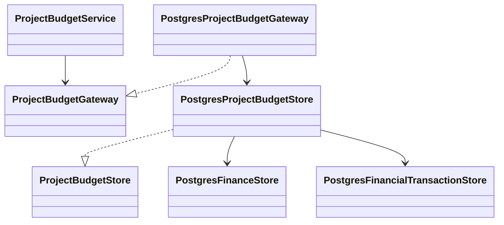

# Unified project budget and unversioned live amounts

## Decision

The Portfolio Overview Budget tab uses one table grouped by project WBS (OTP),
with Nature, Version and yearly euro amounts. The five rows are Budget - Approved,
Budget-Proposed, Budget-Live, Actual and Commitment. Commitment represents the
forecast requested for this view. The ten displayed years run from the previous
year through eight years after the current year; the workbook's 3031 typo is
interpreted as 2031.

Approved and Proposed use the latest non-canceled shared snapshot of each status,
including existing project WBS percentage allocation and exact cent rounding.
Those rows remain read-only. Existing shared Draft snapshots remain intact but
are no longer the source for this project's editable Budget-Live row.

`LIVE_BUDGET` is explicitly added to `project_financial_transaction`. A partial
unique index permits one record per project/WBS/fiscal year. Editing updates that
record in place; clearing removes it. Values are nonnegative and do not create
budget revisions. Project live amounts are already project-specific and are not
multiplied by the project's WBS share again.

Actual and Commitment show transaction totals in stored base currency. Editing
their totals appends an exact EUR delta adjustment with spending type
`MANUAL_ADJUSTMENT`, preserving original transactions and source references.
Neither row subtracts the other. Transaction-only WBS codes remain visible.

## Authorization and integrity

Business Administrators and scoped Project Editors can edit all three editable
rows. Server-side authorization is repeated in the same transaction as saving;
UI controls are not authoritative. A Finance Editor alone retains transaction
CRUD with project read access, but does not acquire project-table editing rights.
`LIVE_BUDGET` is explicitly included in the Project Editor transaction allowlist;
future financial record types remain denied by default. Database row policies
mirror this explicit allowlist. Existing project/read scopes remain enforced.

The complete table save uses a serializable transaction and a content revision
token to reject stale edits. Input validation, exact Decimal arithmetic and delta
calculations run in Python. No SQL calculation functions are added. The table's
revision token is a concurrency check, not a persisted budget revision.

Migration 0062 extends the transaction type constraint, adds the live-cell unique
index and updates write policies. Applied migration 0061 remains unchanged.
Live budget records are excluded from actual/commitment yearly reporting.

## Dashboard reporting

The financial chart retains the latest Approved and Proposed budget lines, naming
their snapshots in the legend without version numbers. Yearly stacked bars show
stored EUR Actual (`#C41049`) and Commitment (`#6D6E70`) totals for the same filtered,
authorized projects. Live budgets are excluded. Signed corrections can extend
below zero. Exact monetary aggregation and utilization ratios use Python Decimal;
chart coordinates are converted to floats only for rendering.
Financial axis values and tooltips display kEUR (thousands of euros). Axis labels
use at most one decimal, with rounded outer bounds and four equal intervals
(three intermediate grid lines). For example, 9,654 kEUR uses a 10,000 kEUR upper
bound and ticks at 0, 2,500, 5,000, 7,500 and 10,000 kEUR. Very small ranges expand
to keep all five labels distinct at one decimal. Shared
leading date padding leaves room for centered bars before the first year tick.
Resource titles appear horizontally above their charts, with year labels centered
between the Q2 and Q3 bars. All three charts use that same year-label position;
annual financial bars and points are centered on it together. Resource bars keep
their quarter-start positions, and synchronized hover guides retain the shared
date scale.

Two cards between Late projects and Active issues show Actual / Approved Budget
and (Actual + Commitment) / Approved Budget. Numerators and denominators use the
chart's displayed years (current year minus two through current year plus nine).
The approved denominator uses existing WBS allocation shares. Missing or zero
approved totals display N/A. Transaction changes participate in the authorized
dashboard revision so cached chart totals and ratios refresh after edits.

## Demo transaction seeding

The operator helper `seed_financial_transactions` previews or applies deterministic
targets from the latest non-canceled Approved snapshot and current project/WBS
allocation shares. It includes every project with allocated approved amounts,
regardless of status. Financial target calculations run in Python Decimal.

- Past years: actuals are 95–105% of approved; commitments total zero. One
  percentage is shared across the project's WBS codes and past years.
- Current year: actuals plus commitments are 80–100% of approved; actuals are
  20–80% of that combined spending. Both ratios are shared across project WBS codes.
- Future years: actuals total zero; commitments are 0–75% of approved, using one
  ratio per project/year across its WBS codes.

Values round to euro cents. Existing transactions and references are retained;
`DEMO_SEED` balancing entries bring totals to the targets. An identical rerun
creates no additional records. Applying locks the transaction and budget sources
inside the operator's transaction. No approved or live budgets are changed.

On 2026-09-18, seed `20260918` was applied locally after verified backup
`data/backups/financial-spending-seed-20260918-152926.dump`. It covered 12 projects
and 140 WBS/year allocations, adding 155 balancing entries and retaining all six
original transactions. All resulting totals and unchanged source data were
verified before commit and the totals were rechecked afterward.

## C4 — Code

`create_project_budget_service` composes this path. The CCv2 component sends
decimal text cells, never binary floating-point amounts. Save changes submits
all edits together; Cancel discards unsaved edits.

## Local rollout

On 2026-09-18, a verified backup was created at
`data/backups/live-project-budget-20260918-143931.dump` before migration 0062.
Project, shared finance and financial transaction table hashes remained unchanged.
Schema validation and a repeat migration succeeded. The local application was
restarted and its health endpoint returned `ok`.
