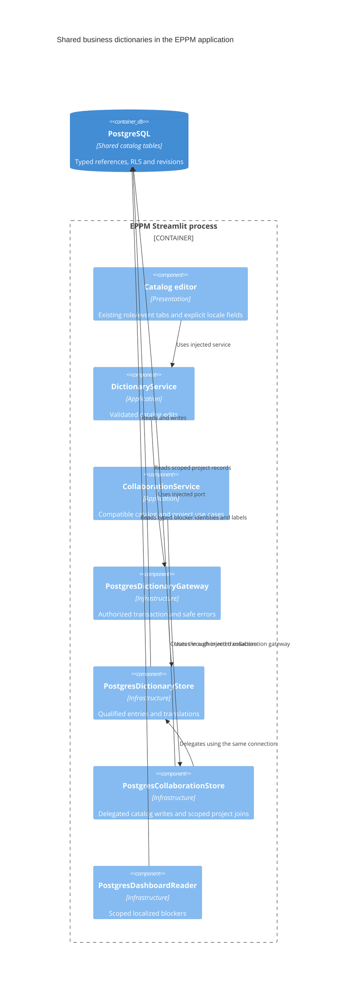

# Shared business dictionaries with qualified identities

Status: Accepted for the shared-business-dictionary increment.

Project roles and event types now share normalized dictionary entry and
translation storage. Identity is `(dictionary_code, id)`, preserving overlapping
legacy numeric IDs without remapping contacts or logs. Generated dictionary
discriminators and restrictive composite foreign keys enforce consumer typing.
Immutable opaque entry codes and the event-type `system_code` remain independent
of canonical names and translated labels. A common sequence allocates future IDs;
IDs are opaque and are not globally unique across migrated catalogs.

This extends [ADR 0010](0010-layered-project-collaboration.md) while retaining its
transaction, reference, project-scope and sensitive-contact-data guarantees.
Keeping four authoritative catalogs behind one editor would leave duplicate
storage; using one global ID key would require remapping existing references.
Shared normalized rows provide one translation editor while composite keys retain
the existing numeric contracts. Shared mutations retain `business.manage`,
whole-operation retries and catalog revision invalidation. Names save with their
English label; optional labels use canonical-name fallback when absent.

Other catalogs, workflow codes and custom-property security scopes remain outside
this increment. Packaged interface translations retain
[ADR 0012](0012-presentation-resources-and-locale-state.md), and priorities retain
[ADR 0063](0063-project-priority-and-financial-totals.md). Changing additional
catalog storage requires a separate decision. Migration 0069 and its matching
application release deploy together; existing migration history is not rewritten.

Additive migration 0070 completes the nonblank-locale write constraint while
preserving every historical locale row; existing compatible rows are validated.

## C4 level 3: implemented catalog components

