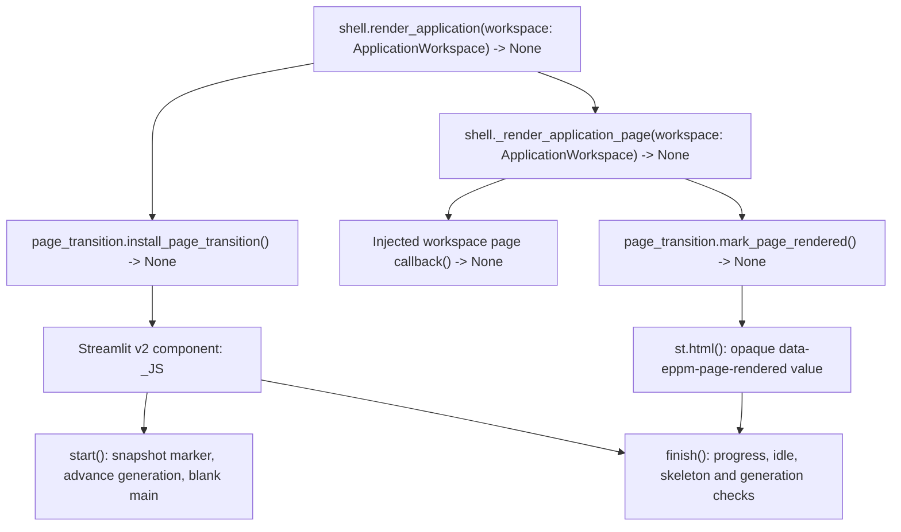

# Completed page navigation

Navigation immediately blanks the main workspace behind a loading indicator.
The completed destination is revealed after the app is idle, no skeleton remains,
and two animation frames have passed. A fresh render marker emitted after the
page renderer returns also proves progress when a fast run never commits its
intermediate browser running state. Unrelated DOM updates and the old marker
cannot release loading. A navigation generation prevents an earlier pending
reveal from clearing a later navigation. Existing observed fragment completion
continues to handle nested chart responses.

This is UI completion evidence only. The marker contains a random opaque value;
it carries no application data or authorization decision. Page access remains
controlled by the injected workspace and existing server-side checks.

## C4 level 4: relevant code and calls

The JavaScript component keeps `loading`, observed `ran`, queued animation
`frame`, navigation `generation` and the captured `previousRender` locally.
Its `rendered()` reader inspects the current marker; `begin(event)` handles
sidebar clicks, `keyboard(event)` handles keyboard navigation, and its mutation
observer invokes `finish()`. Navigation events also invoke `start()`. The returned
cleanup disconnects observers/listeners, cancels its frame and removes the overlay.

Regression checks cover coalesced state, unfinished visible frames, slow
navigation, full-rerun and fragment chart responses, stale reveals, and Settings
CRUD. The controlled browser case suppresses only the component's transient
state observation; the application/server rendering and assertions remain real.
