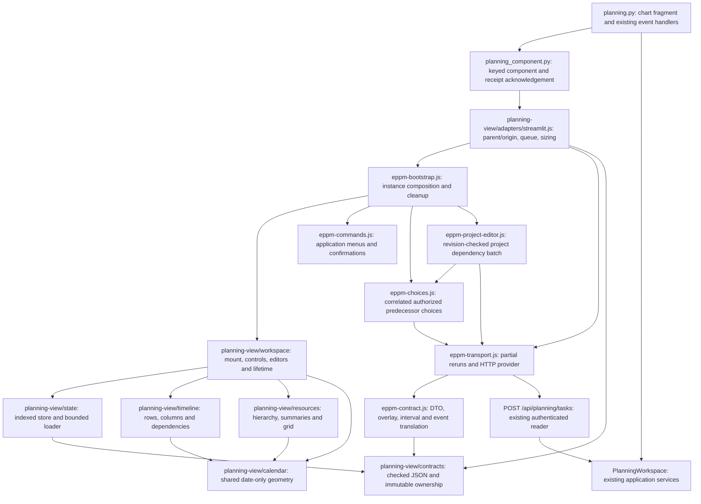

# Planning component integration

EPPM's planning page embeds the same browser implementation used by the plain-web
and independent Streamlit examples. The former monolithic `gantt/index.html` is
now a document loading `eppm-bootstrap.js`; it contains no renderer or inline
handlers. There is one active renderer, one mode handler and one main splitter
binding per mounted instance.

## C3: browser and presentation ownership

These are implemented modules and call relationships. The existing PostgreSQL
service/store C3 map remains in [the scheduling guide](postgresql-planning.md).
The portable module imports neither EPPM nor Streamlit; only the optional
Streamlit adapter speaks its transport protocol.

## EPPM transport

The Python adapter preserves the `interactive_gantt` declaration, widget key,
callback timing and established application event fields. It acknowledges a
received string nonce on the next render. The browser transport converts full
application DTOs into checked snapshots and partial reruns into patches. Its
public scope uses the selection/locale `view_scope`; the independent server
`scope_token` still correlates authenticated HTTP reads. A rebuilt server token
within the same selection therefore preserves applicable viewport state.

The shared bridge queues component events until receipt acknowledgement, then
advances the single Streamlit component-value channel. EPPM's codec translates
generic dates/progress/task intentions into the existing Python handlers.
Task saves and immediate edits commit before the fragment produces its patch.
Safe failures return a correlated rejection, preserving the editor draft.
Alternative task/form requests retain the plan revision captured when the editor
opened. Authoritative data updates settle previews; the browser does not persist
or activate plans.

Lazy schedule reads use the same-origin endpoint, cookies, server scope/revision,
nonce and per-project source tokens. The injected controller coalesces visible
projects before overscan, requests at most 25 projects, and retains at most 100.
EPPM's transport keeps this bounded identity list and host comparison metadata,
without another expanding current-task cache. It releases raw task replacements
after mapping them. Stale/aborted responses
are ignored. A 403 or 409 requests one authorized refresh for that source
revision. Other failures retain data and expose the shared explicit retry control.
When no direct task endpoint is supplied, EPPM uses the generic bridge's queued
load events and its existing Python `load_project_tasks` callback. The callback
echoes the request revision into the presentation patch; its nonce correlates the
read, and stale source/revision patches cannot overwrite a newer view. The server
still authorizes the requested projects and enforces its existing 25/100 bounds.

Predecessor choice reads are separate from schedule hydration. The generic
editor receives a cancellable reader; EPPM routes current choices through the
existing authorized `load_dependency_tasks` handler and alternative choices
through the supplied comparison context. Unavailable endpoints are never filled
from invented task metadata or an unrestricted schedule fetch.

## Application commands and editors

EPPM supplies declarative project/task/resource menus. Record capabilities and
edit mode are rechecked on invocation; the server reauthorizes every operation.
Navigation, CSV, tags, pool assignments, project logs/details, baseline capture
and alternative creation/activation retain their Python handlers and dialogs.
The adapter supplies delivered scenario names, task progress, descriptions,
tags and pool assignments for plain-text task/project hover cards. Count titles
identify their current or comparison scenario. Former baseline tasks retain
purple names, paired current bars use 70% of their ordinary height, and row
height remains unchanged. The edit-mode pencil is decorative and keeps the
checkbox's accessible name unchanged.
Cancelled confirmations emit no request and leave the command menu usable.
Resource commands retain pool/group identity, inclusive dates and allocation
scope. Alternative demand rows remain comparison data and do not emit current
allocation selections.
Their details/allocation commands remain visibly disabled; allocation filters
remain available through nested pointer and keyboard menus. Task assignment
uses the person icon. Menus are clamped to the viewport and child panels can
open on either side.

The shared task editor owns task fields and incoming dependency controls. It
supports editing and creating tasks, preserves drafts across unrelated reruns,
and checks capabilities again on Save. Alternative frozen task rows address the
alternative; current and baseline bars remain read-only during comparison.
Dependency inspection opens the successor task editor or EPPM's project panel.
Project-scoped predecessor reads coalesce by scope, revision and project while
each caller retains independent cancellation. Failed reads preserve the selected
predecessor and draft, show a safe retry message, and prevent incomplete saves.
Creation patches expand their project without moving the retained viewport.

The project dependency panel is application-owned because its server contract is
an atomic revision-checked batch with explicit upserts/deletions. It contains no
step fields. Failed saves retain rows and the original revision; Reload explicitly
discards the draft and reads current dependencies. Closing/disposal cancels choice
callbacks and ignores late correlated responses.

The shared calendar keeps timeline/resource scale and horizontal scroll aligned.
EPPM selects a 234–495 px overall timeline panel (including its 56 px header),
retaining the previous size limits. Rows remain 41.4 px and resource rows 23.8 px.
Main and individual frozen columns resize within the instance. Baseline and
alternative lanes, new-scenario colors, milestones, diagnostic counts, progress,
description/link visibility and expansion controls share this one renderer.
EPPM selects concise capacity tooltips; demand remains available in accessible
cell descriptions. Only deviating capacity badges change color. Availability
and excess retain green/red status text with FTE units.
Resource scope captions retain the translated capacity/total/filtered labels.
Comparison captions and branch indicators avoid repeating pool names.

Messages crossing the adapter, bridge and store share internally branded,
deeply frozen validated copies. Arbitrary caller-frozen objects are validated
and copied normally. This removes repeated ownership transfers without trusting
mutable host data; public validation still returns independent copies. JSON
copying is iterative, preserves aliases, rejects cycles/non-JSON values, and
handles an own `__proto__` key without changing the result's prototype.

## Source and verification boundaries

Direct endpoint linking is explicitly enabled by EPPM's adapter. A completed
gesture emits one dependency creation intention; `eppm-contract.js` maps it to
`create_dependency`, preserving both endpoint source tokens and successor
ownership. Python validates identities, zero lag, type, and source tokens before
the application service appends. The callback deduplicates reruns by nonce and
refreshes authoritative chart data; failures return through the existing safe
adapter error path. Existing links and dates are preserved.

Comparison creation uses `alternative_action` with operation
`create_dependency` and the captured successor plan revision. It appends to the
selected alternative's authoritative content and reuses normal reference and
permission validation. The current schedule and baseline stay unchanged.
Accepted links remain accessible through dependency inspection and the existing
successor task or project dependency editor for later type/signed-lag changes.

See [package assembly](planning-component-packaging.md) for deterministic browser,
wheel, source-distribution and Docker resources. EPPM's small host modules/styles
are also included in root wheels and source distributions; generated shared
resources remain ignored and are checked against their source manifest.

`tests/test_eppm_planning_adapter.cjs` checks DTO/event/HTTP translation without
private renderer globals. `tests/test_eppm_planning_browser.py` mounts the actual
bootstrap through Streamlit messages. Native PostgreSQL scenario and project
dependency tests exercise the same bootstrap with real services. AppTests retain
single-rerun edits, filters and revoked-access checks. Independent module/browser
and installed-consumer tests cover the reusable boundary. Final acceptance,
coverage and repeated benchmark evidence belong to the OpenSpec verification
record; targeted checks alone do not establish that gate.
