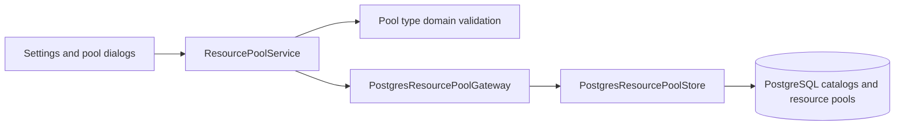

# Pool types

Each resource pool has a non-null `pool_type_id`, referencing `pool_type`.
Migration 0039 seeds Human (ID 1) and Car (ID 2), both roots, and assigns all
existing pools to Human. New pools default to Human and can select another type.
Pool type names have optional translations in `pool_type_translation`.

Settings → Organization Structure → Pool Types follows Employees. Its table
shows ID, localized name, and parent name, with filtering, sorting, and
right-click Add/Edit/Delete. The editor maintains optional parent links.
Application validation and PostgreSQL constraints reject cycles and missing
parents. Foreign keys prevent deleting types referenced by pools or child types.
Shared-management authorization protects catalog writes in both layers.

## C3 — Components

