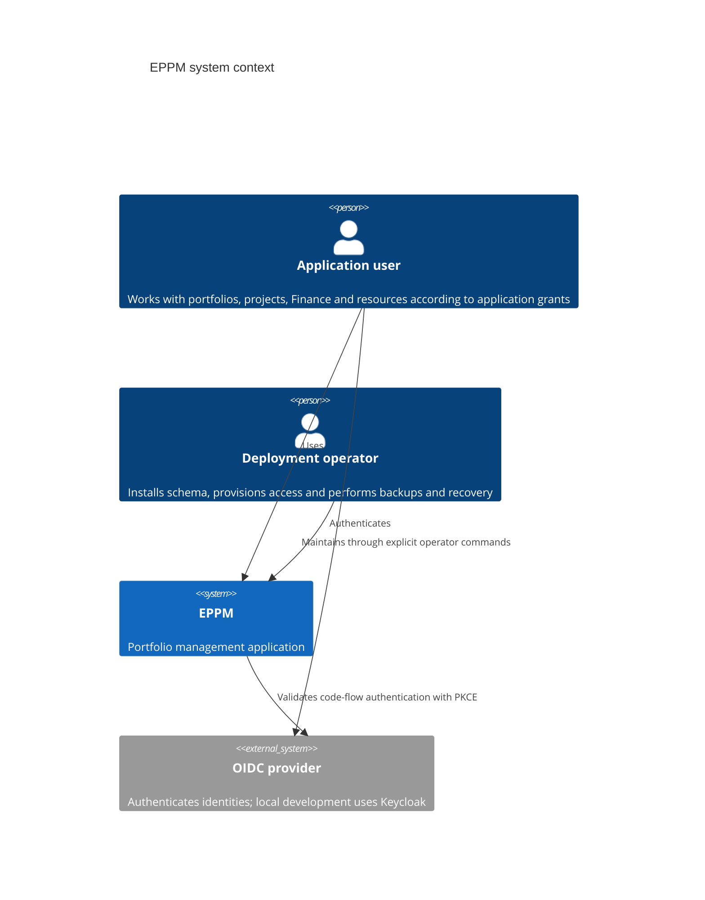
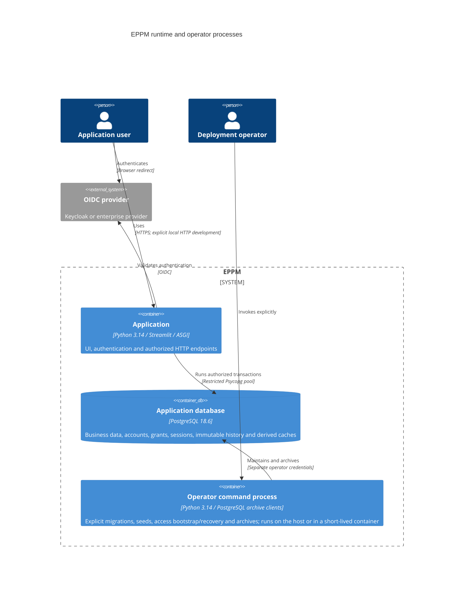
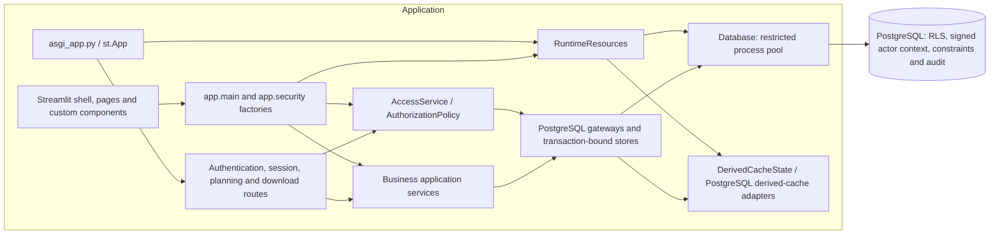
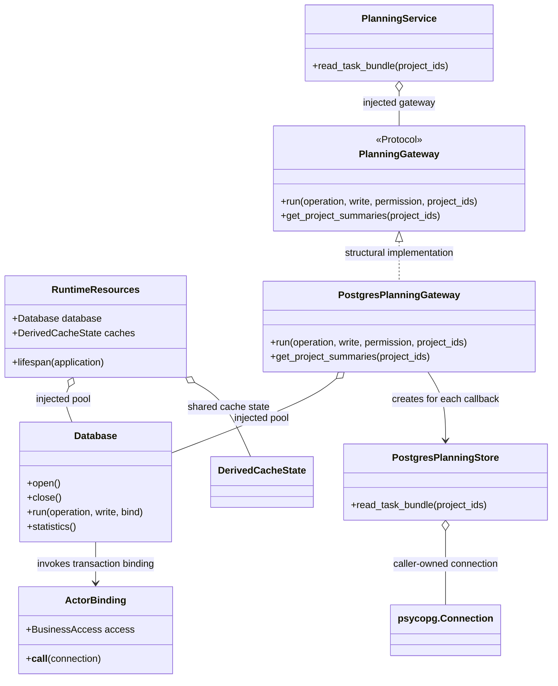
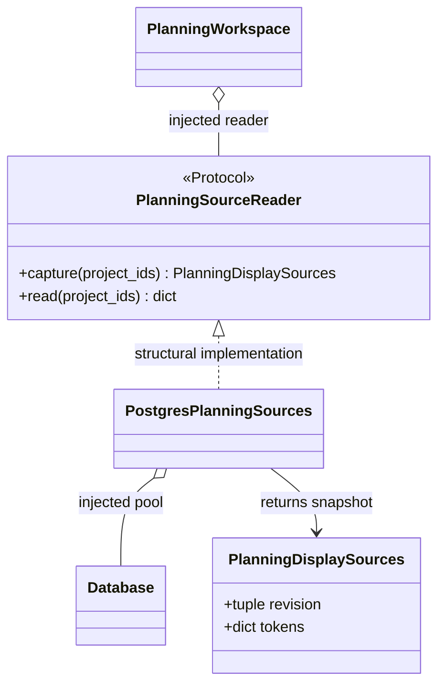

# PostgreSQL architecture

This describes the migration branch's implemented runtime. Regression/coverage,
load and deployed recovery evidence is tracked separately in
[migration evidence](postgresql-migration-evidence.md).
[ADR 0024](../decisions/0024-postgresql-runtime.md) supersedes the SQLite storage
decisions. Existing business rules, optional hierarchy types and Finance editing
controls are retained. Planning revisions and stale-form protection are separate
work, not features of this migration.

## C1 — System context

Provider authentication establishes identity. Application accounts, grants and
current session state determine permissions; provider profile fields do not grant
business or administration access.

## C2 — Containers

The application never receives the operator URL. PostgreSQL has separate durable
volume storage. Native archives and retained old SQLite files are filesystem
artifacts outside the active runtime; SQLite data and accounts are not imported.

## C3 — Runtime components

The launcher owns pool startup/shutdown through `RuntimeResources.lifespan`.
Startup checks schema compatibility and runtime privileges without migrating or
seeding. Entry-point factories inject the same pool/cache resources and each
request's `BusinessAccess`. UI code calls services rather than acquiring storage.

Complete read callbacks use repeatable-read snapshots; writers use serializable
transactions. The transaction runner retries only complete callbacks after SQLSTATE
`40001` or `40P01`, rebinding the actor and checking current permissions each time.
Unknown commit outcomes and unrelated errors are not automatically replayed.
Database row policies and guards also enforce access for direct runtime SQL.

Derived cache publication checks current scope and source fingerprints. Cache
records are not financial or business truth: approved Finance and audit records
remain immutable, while authoritative monetary values use decimal/numeric storage
and exact form transport.

`PostgresPortfolioReader.revision` reads two compact fingerprints from
`eppm.portfolio_cache_revision()`: current actor/session/catalog/security/scope,
and the complete visible project and pool generations. Whole-view invalidation
uses the existing owner-revision triggers instead of expanding dependency and
demand graphs. Per-project and per-pool calculation fingerprints still include
their scoped dependencies. Every display-cache lookup reauthorizes its caller.

## C4 — Planning code example

`create_planning_service` in `app/main.py` constructs this service/gateway pair.
`run_business` in `app/infrastructure/postgresql/business.py` supplies the complete
callback and `ActorBinding` to `Database.run`. Binding signs the actual backend
and transaction context; a store borrows that connection and never commits it.
The store returns application records defined in `app/application/ports/planning.py`.
The service does not import PostgreSQL or UI packages.

The planning workspace also receives a `PlanningSourceReader` for bounded task
delivery. It captures initial chart revision/fingerprint data before chart reads;
HTTP delivery compares the selected sources before and after reading task data.
The composition root injects `PostgresPlanningSources`. Its native source query
expands only the selected projects and assigned pools while preserving current
actor, scope and shared-source checks.

See the [runtime guide](postgresql-runtime.md), [backup guide](postgresql-backups.md)
and [diagnostic tools](postgresql-benchmarks.md) for operational commands. Source
and test import guards prevent the archived SQLite adapters from re-entering the
application, tools or active tests.
