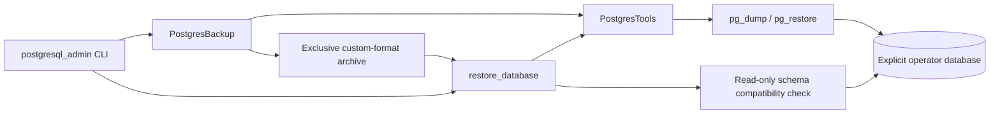

# PostgreSQL backup and restore

`PostgresBackup` creates custom-format PostgreSQL archives for explicit operator
commands and [native seed/reset maintenance](postgresql-seeding.md). It runs installed `pg_dump`
and `pg_restore` clients with an explicit operator connection. Use PostgreSQL 18
clients compatible with the pinned 18.6 server.

Connection options are mapped through libpq's supported environment variables.
Client argument lists contain no credentials; inherited libpq connection
defaults are cleared. Commands have a finite timeout, never prompt for a
password and are not retried. Client diagnostics are translated into safe
operator errors without printing provider output or connection strings.

## Archive creation

The dump includes ownership, grants, row policies, immutable finance records,
access history and the request-binding key. Keep the archive directory in
operator-controlled secret-bearing storage. Files are created exclusively with
mode `0600`; the default operator location is the ignored `.local/backups`.

`pg_dump` supplies a consistent source snapshot. The file is flushed and synced,
then its format is checked with `pg_restore --list`. Publication uses an
exclusive hard link, so an existing archive cannot be replaced by a path race.
A failed attempt retains an `.incomplete` file and aborts its caller. The format
check is not a substitute for a verified restoration of the archive's contents.

```powershell
.venv/Scripts/python.exe -m scripts.postgresql_admin --env-file .local/postgresql.env --backup-directory .local/backups backup
```

These commands use `DATABASE_OPERATOR_URL` unless `--url-variable` names another
explicit operator connection. The selected URL must resolve from the client
process's network, and both PostgreSQL clients must be on that process's PATH.

## Restoration

Create a separate empty database with the required deployment roles available.
Set its operator URL in an explicit environment variable, then run:

```powershell
.venv/Scripts/python.exe -m scripts.postgresql_admin --env-file .local/postgresql.env --url-variable DATABASE_RESTORE_OPERATOR_URL --archive .local/backups/example.dump restore
```

Restoration rejects populated targets and the `postgres`/template databases.
It neither creates nor clears the target. A database-specific operator lock
serializes these restore attempts. `pg_restore --single-transaction
--exit-on-error` retains ownership and policies, and any restore conflict or
corrupt input aborts the transaction. After restoration, the migration ledger
must match this application package. The restored binding key must match the
application's separately supplied `DATABASE_CONTEXT_KEY`.

## C3 — Components



## Validation

The real PostgreSQL tests dump synthetic authorized data and restore it into a
fresh random database. Exact project and approved-plan values of
`9007199254740993.01` euros survive unchanged. Restored runtime credentials still
see only their authorized projects, and approved-plan mutations are rejected.
The new database incarnation changes display tokens even though the source
revision rows and request-binding key were restored.

A truncated archive leaves no application schema after rollback. Populated
targets retain their rows. Additional checks cover client failures/timeouts,
secret-safe errors, filesystem failures, exclusive names and full operator CLI
backup/restore dispatch. All generated restore databases are cleaned up without
touching the application database or existing volumes.

The combined backup, operator, lifecycle and layer run passed **26 tests in
6.97 seconds**, exit code **0**, covering **91/91 backup statements** and
**31/31 lifecycle statements (100%)**. Windows validation used the existing
PostgreSQL test container's actual clients through an injected test transport;
normal operator execution uses installed clients directly.

```powershell
$env:POSTGRES_TEST_CLIENT_CONTAINER = 'eppm_demo-postgres-1'
.venv/Scripts/python.exe -m dotenv -f .local/postgresql.env run -- .venv/Scripts/python.exe -m pytest -q --tb=short -p no:cacheprovider tests/postgresql/test_backups.py tests/postgresql/test_operator_foundation.py tests/postgresql/test_runtime_resources.py tests/test_layer_boundaries.py --cov=app.infrastructure.postgresql.backup --cov=app.runtime --cov-report=term-missing --cov-report=json:.local/postgresql-backup-coverage.json --cov-fail-under=95
```

Log: `.local/postgresql-backup-native.log`. This staged run verifies the archive
primitive and isolated recovery. Subsequent seed/reset and native deployment
results are recorded in [migration evidence](postgresql-migration-evidence.md).

The representative deployed recovery test now also passes: **one test in 163.16
seconds**, including disposable Compose setup and cleanup. It seeds 10,001
projects with 73,929 tasks, logs in through real Keycloak, grants scoped access,
and saves an immutable approved Finance plan through the restricted runtime.
With the app stopped, it records every application table's count/content hash and
every sequence. A PostgreSQL restart and a native archive restored into a newly
created database reproduce that complete snapshot exactly.

The application is then recreated against the restored database with the same
session and actor-binding configuration. Existing sessions retain their scoped
download access; the planning browser renders the retained project and task.
After both derived cache tables are cleared, the deployed application rebuilds
them and normal service calculations reproduce the original values. Approved
Finance and audit mutations are still rejected. The final business/account/grant/
audit hashes and all sequences remain unchanged, as does the source database's
stable data. Only session/OIDC activity and replaceable caches are excluded from
comparisons after browser use.

```powershell
$env:EPPM_RUN_OIDC_E2E = '1'
$env:EPPM_E2E_APP_IMAGE = 'eppm-demo:postgresql-acceptance'
.venv/Scripts/python.exe -m pytest -q tests/postgresql/test_deployed_recovery.py --tb=short -p no:cacheprovider
```

The fixture creates and removes only its unique Compose project and volumes.
It never changes the ordinary application's database or existing volumes. The
[recorded recovery result](postgresql-deployed-recovery-results.json) includes
counts and proof checks; credentials and archives remain in ignored local test
storage. This completes representative restart/recovery acceptance. The separate
authenticated 50-user performance comparison is still outstanding.
