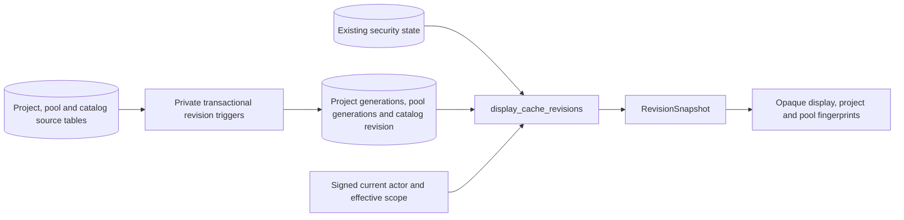

# PostgreSQL cache revision foundations

Migration `0016_cache_revisions.sql` adds project and pool cache revisions plus a
separate shared-catalog revision. The existing security revision remains separate.
These are active derived-data invalidation records; they are not planning history,
task version columns or stale-form checks.

## Write ownership and transaction behavior

Project-owned changes update only their affected project revision rows, including
both owners of an assignment move. Pool definitions, mappings and tags update
pool configuration revisions. Organization, schema and shared reference catalogs
update the catalog revision. Source rows and revision increments commit or roll
back together. All existing display source tables have explicit trigger coverage;
session activity, authentication housekeeping, audit entries and derived-data
tables are excluded.

A project allocation does not update a shared pool counter. Instead, the pool's
fingerprint includes the revisions of its visible consuming projects. This avoids
serializing unrelated project editors on a popular pool or a global counter and
keeps hidden demand edits out of a restricted reader's fingerprint.

Revision tables and invalidation helpers are private to the database owner.
Ordinary runtime callers cannot read or overwrite counters or invoke the helpers.
Business guards and RLS remain authoritative for source mutations. Each project
and pool revision record has a UUID generation, so deleting and recreating an
entity with the same numeric ID cannot revive a previous cache key.

## Scope and source fingerprints

The `display_cache_revisions()` metadata read authorizes the
current signed actor, resolves effective project membership, and reads revisions
in the caller's snapshot. Its dependency and pool-source sets are aggregated in
batches. Missing lifecycle, catalog, security or required entity revision records
fail closed instead of yielding a potentially reusable default key.

Migration `0023_revision_query_plans.sql` keeps custom query planning inside this
function. Effective scope arrays range from a few IDs to the whole portfolio;
the generic plan chosen after repeated calls caused excessive index probes for
large scopes. The setting is local to function execution and the caller's planner
setting is restored on return. The function body, permissions, source membership
and fingerprint encoding remain unchanged.

On a separate synthetic graph of 10,001 projects and 70,007 tasks, the original
warm generic plan used 526,582 buffer accesses. The revised function held steady
at 42,977 accesses before and after repeated calls, with 82.960/79.571 ms execution
times. A regression compares actual database work instead of asserting a planner
setting or a host-dependent latency target. Upgrade validation preserves the
existing ledger checksums, function body, owner and privileges. See
[the recorded diagnosis](benchmarks/revision-query-plan-results.json); these
database measurements do not establish browser-load acceptance.

`RevisionSnapshot` provides complete display, project and pool fingerprints:

- The access portion includes database epoch/OID, actor/session identity,
  effective membership, shared-catalog revision and security revision.
- Project fingerprints include their own source revision and the base revisions
  of visible predecessor projects. Endpoint filtering happens before references
  enter metadata; cycles require no recursive hashing or revision propagation.
- Pool fingerprints include configuration revisions and only visible projects
  currently consuming that pool. Demand references disappearing or moving pools
  change this membership even when the last assignment is removed.

The database OID distinguishes a new database even when a restored database epoch
was copied. Normal application reads expose only opaque SHA-256 tokens; raw actor,
session and database identifiers remain internal. Tokens are comparison values,
not authorization. Every lookup must still read current trusted authorization.
Scope changes driven by project properties are detected even without an access
grant mutation; permission changes with unchanged read membership change the
separate security revision.

### Bounded task-delivery fingerprints

Migration `0025_planning_task_sources.sql` adds an authorized source-key projection
for batches of at most 25 projects. Migration `0026_task_pool_sources.sql` refines
the pool inputs to match the delivered fields. Task-level allocations include the
full pool fingerprint and its visible competing consumers; project-level links
include pool configuration revisions for their labels. Changes to shared task
capacity cannot bypass a refresh, while another project's demand does not
invalidate a plain project-level link. Hidden dependencies and hidden demand
remain outside a restricted reader's fingerprints. Catalogs, security, effective
membership and database/actor/session identity remain part of every key.

`PostgresPlanningSources.capture` returns the chart revision and per-project task
keys from one snapshot, before chart data is read. It implements the application
`PlanningSourceReader` protocol and returns `PlanningDisplaySources`. Task/pool
ownership is read in that same repeatable-read snapshot. The chart
sends its opaque keys only for requested projects; edit patches send only affected
keys. `PostgresPlanningSources.read` uses the bounded native function and current
READ authorization. Task delivery compares sources both before and after its
data reads. Unrelated edits can leave the requested keys valid; a relevant edit
still returns HTTP 409 and revoked access returns 403. Requests without the new
optional source map retain the original global-revision checks.

These keys are display freshness checks. They add no planning-history table,
edit-version column or stale-form behavior. No applied SQL migration changed.

On the synthetic 10,001-project graph, repeated selected reads used 1,668 buffer
accesses before and 1,662 after adding 5,000 unrelated tasks/dependencies, taking
18.104 and 20.248 ms respectively. Native query work is separate from browser
responsiveness acceptance. The broader source/HTTP/UI/upgrade/foundation run
passed 185 checks in 119.11 seconds, with 66/66 source-reader and task-transport
statements covered. Subsequent component patch validation is recorded in the
[migration evidence](postgresql-migration-evidence.md).

## C3: components



## Verification and pending integration

Real PostgreSQL tests exercise scope/actor/session separation, private helper and
table privileges, transactional rollback, missing metadata, visible versus hidden
predecessors, cycles, generation reuse, copied epochs in a new database, property
membership changes and consistent reads during concurrent writes. A dedicated
lock test holds another project revision, a pool revision and the shared catalog
revision while an independent project edit succeeds with a 200 ms lock timeout.

The broader revision/planning/capacity/resource/integrity/security/foundation run
passed **196 checks in 75.82 seconds** and identified the schema inventory update
for the three new revision tables. After updating the explicit inventory and
batching metadata sources, the final revision/integrity suite passed **46 checks
in 15.23 seconds**. The native revision adapter has **51/51 statements covered
(100%)**. These checks establish the revision foundation; they do not yet prove
cache publication or final application performance.

The final cross-subsystem PostgreSQL suite passed **528 tests in 189.53 seconds**,
including all native business ports, authentication, authorization, migration and
transaction checks. Log: `.local/postgresql-revisions-all-native.log`. An additional
assignment-move regression verifies both pool memberships and old/new project
revisions without writing either pool counter.

```powershell
.venv/Scripts/python.exe -m dotenv -f .local/postgresql.env run -- .venv/Scripts/python.exe -m pytest -q --tb=short -p no:cacheprovider tests/postgresql/test_revisions.py tests/postgresql/test_integrity.py --cov=app.infrastructure.postgresql.revisions --cov-report=term-missing --cov-report=json:.local/postgresql-revisions-coverage.json --cov-fail-under=95
```

Logs: `.local/postgresql-revisions-native.log`,
`.local/postgresql-revisions-native-expanded.log` and
`.local/postgresql-revisions-native-final.log`. Coverage:
`.local/postgresql-revisions-coverage.json`.

[Native capacity/planning caches](postgresql-derived-caches.md) now use these
fingerprints for current reads and guarded publication. The digest serialization
matches PostgreSQL JSONB array formatting, verified against both cache kinds and
multiple scopes. Runtime composition, portfolio queries, operator tools and exact
project money inputs now use the native adapters. Full application coverage,
50-user browser and representative deployed recovery acceptance remain required.
