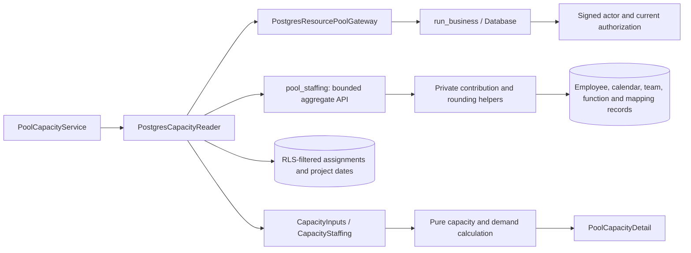

# PostgreSQL capacity inputs and staffing privacy

`PostgresCapacityReader` reads requested pool definitions, staffing aggregates,
visible assignments and relevant project date bounds in one repeatable-read
snapshot. It uses the existing authorized resource gateway and safe resource
errors. Query batches are independent of the number of requested pools; unrelated
project schedules and raw employee/calendar records are not hydrated.

## Aggregate boundary

Migration `0015_pool_staffing.sql` adds the bounded `pool_staffing(bigint[])`
function. It requires signed, current business-read permission and returns only
requested existing pools. All business readers receive assigned capacity, whether
resources are assigned, and aggregate daily availability. Only current shared
administrators receive individual contribution records. Employee contacts, codes,
calendar reasons and exception identities are never returned by this API.

The existing employee/calendar RLS policies remain unchanged. The function uses
two private helpers with runtime and PUBLIC execution revoked. Its search path
is fixed, table references are qualified, and no request creates schema objects
or changes database roles. The runtime's public-function allowlist explicitly
includes only the bounded staffing API. Direct helper calls remain denied even
for a business administrator using the ordinary runtime connection.

The domain's `CapacityStaffing` record lets the pure demand calculation consume
these aggregates without using visible person details to infer capacity. This
preserves the important distinction between an assigned resource with zero
allocation and a pool with no assigned resources: the former still overrides a
defined theoretical capacity. Explicit domain snapshots retain their pure
staffing calculation for behavior parity and the staged legacy adapter.

## Preserved calculations

The native aggregate preserves employee deduplication, vacant-function fallback,
maximum team allocation, direct function overrides followed by direct employee
overrides, and the historical implicit-team rule. That rule counts explicit
members plus manager/leader entries before deciding whether to include the
manager's reporting functions; duplicate manager/leader entries still affect
that decision. Contribution ordering and calendar-delta accumulation ordering
match the existing implementation.

Capacity remains nonmonetary binary64 arithmetic. Reordering the existing
percentage divisions or casting an intermediate float to ordinary NUMERIC can
change a half-millifte result. The private rounding helper decodes the finite
binary64 value before three-decimal ties-to-even rounding, preserving the
existing Python result. This helper is not used for authoritative euro amounts.

Employee calendar overrides remain inclusive and sparse, with the existing
9,125-day expansion cap per exception. Defined, assigned and effective capacity
retain their separate meanings. Demand still uses scoped project/task assignment
deduplication and the existing independent custom/task/project/today date fallback
for each endpoint. Overload intervals and warnings use the same pure calculation.

Staffing details are checked against current shared permission again before the
calculation returns. Revision/scope validation around cache reuse and publication
is implemented by the [native derived caches](postgresql-derived-caches.md).

## C3: components



## Validation and remaining work

The existing capacity, timeline, cache-race and layer suite passed **37 tests in
4.38 seconds**. Native tests compare complete results with an independent pure
domain calculation built from synthetic setup records. Checks cover scoped
demand, raw-data privacy, absent actors, helper privileges, permission revocation,
concurrent snapshot reads, 15 randomized staffing configurations, the calendar
cap, explicit calculation dates and safe outages. Binary rounding parity covers
**5,004 values**, including midpoint neighbors, subnormals and large values.

The broader run passed **137 checks in 48.96 seconds** and identified the expected
public-function allowlist update for the new staffing API. After that explicit
update, the complete capacity/integrity suite passed **40 checks in 20.32 seconds**.
The native reader and pure capacity/input modules have **167/167 statements
covered (100%)**. Private-helper execution remains denied; the new API also
rejects unbound actors. This is subsystem evidence, not final application or
50-user browser acceptance.

```powershell
.venv/Scripts/python.exe -m pytest -q --tb=short -p no:cacheprovider tests/test_layered_pool_capacity.py tests/test_capacity_timeline.py tests/test_pool_capacity_cache.py tests/test_scoped_capacity_races.py tests/test_layer_boundaries.py
.venv/Scripts/python.exe -m dotenv -f .local/postgresql.env run -- .venv/Scripts/python.exe -m pytest -q --tb=short -p no:cacheprovider tests/postgresql/test_pool_capacity.py tests/postgresql/test_integrity.py --cov=app.infrastructure.postgresql.pool_capacity --cov=app.domain.resources.capacity --cov=app.domain.resources.inputs --cov-report=term-missing --cov-report=json:.local/postgresql-capacity-coverage.json --cov-fail-under=95
```

Logs: `.local/postgresql-capacity-legacy.log`,
`.local/postgresql-capacity-native-expanded.log` and
`.local/postgresql-capacity-native-final.log`. Coverage:
`.local/postgresql-capacity-coverage.json`.

This ports capacity inputs and calculations. [Native derived
caches](postgresql-derived-caches.md) now add private storage, current scoped
tokens, bounded process memory and guarded publication. Portfolio queries,
runtime/operator composition and project money forms are ported. Full application
coverage, the 50-user browser benchmark and representative deployed
backup/restore/restart acceptance remain required.
