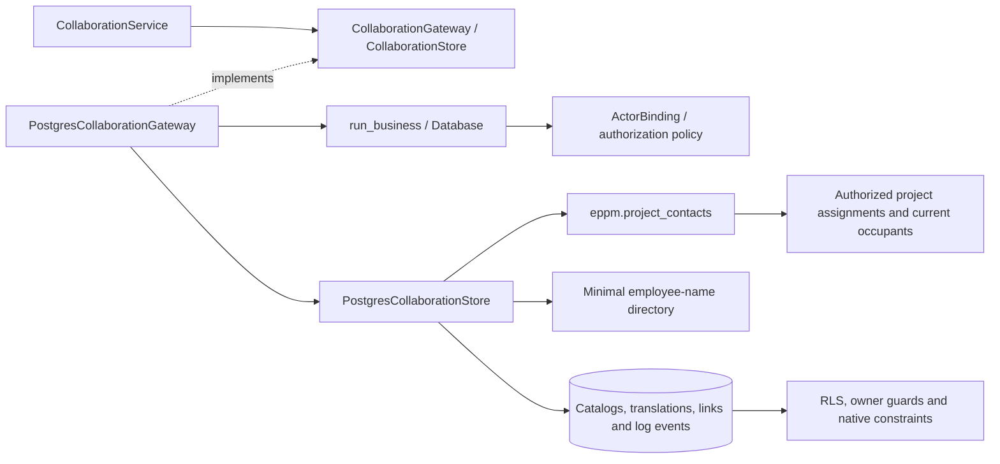

# PostgreSQL project collaboration

Collaboration services now use complete callbacks through
`PostgresCollaborationGateway`. Native operations cover useful links, translated
role and event-type catalogs, function selectors, project contacts and log events.
The common runner binds the actor and rechecks authorization for every attempt.
Reads share a repeatable-read snapshot; writes run at serializable isolation and
replay only after a definite serialization or deadlock rollback.

## Contact privacy

`0011_project_contacts.sql` adds `eppm.project_contacts(bigint)`, a stable,
security-definer read function. It first materializes assignments belonging to
the requested project, filtered through the bound actor's `project.read`
permission. Only functions referenced by those assignments participate in the
employee aggregation. The result contains contact, role and function identities,
function name, occupant names, mobile numbers and landlines. It exposes no email,
employee identity, occupation, employee code or other employee fields.

The function has a fixed safe search path, uses qualified relation names and
revokes public execution. The runtime role can execute it, but an unbound caller
is rejected, and an actor without access to the requested project receives no
rows. Supplying a hidden or nonexistent project ID cannot fetch unrelated phone
details. A subsequent transaction sees changed assignments and current grants.

General `function_choices` use the existing minimal employee-name directory and
return only function identity/name and occupant names. They never fetch phone
fields. Shared-administration `list_functions` uses the employee table under its
existing management-only row policies. No employee read policy is broadened.

Contacts retain repeated-role behavior, unique `(project, role, function)`
assignments and current-occupant resolution. Multiple occupants use stable
surname/given-name/employee-ID ordering for their names and phone lists. Vacant
functions fall back to the function name with empty phone strings. Reassignment
changes only the function, preserving role and project ownership.

## Catalogs, links and events

- Catalog identifiers are selected from an internal allowlist. Canonical names
  and English labels save atomically; other translations remain intact. Reads
  use localized labels with canonical-name fallback. Native uniqueness and
  foreign keys protect duplicate names and in-use entries. Renaming a blocking
  event type retains its existing system identity.
- Useful links have no fixed slot limit. URL/alias validation remains in the
  domain service, and mutations qualify records by both project and link ID.
- Contact, link and event mutations retain project ownership. Permanent native
  guards require edit permission independently of UI controls. Hidden records
  stay absent, including log events whose scope code is `global`.
- Events preserve all existing status/scope codes and bounded newest-first
  paging. Deadlines persist as native dates and return ISO strings. Created and
  updated timestamps persist as `timestamptz` and return the existing UTC
  `YYYY-MM-DD HH24:MI:SS` text contract, independent of session locale/time zone.
  Event updates preserve the original creation timestamp.

## C3: components



The application composes the native collaboration gateway through the restricted
PostgreSQL runtime. The temporary SQLite callback bridge is retained only in the
historical archive; there is no runtime fallback or SQLite data import.

## Validation

Existing collaboration, modal, scoped UI and layer regressions passed **95 checks
in 24.79 seconds**. Existing useful-link and project UI checks passed **17 checks
in 4.53 seconds**. Logs: `.local/postgresql-collaboration-legacy.log` and
`.local/postgresql-collaboration-links.log`.

Native checks use fresh PostgreSQL databases, restricted runtime connections and
real actor grants. They cover catalog/translation rollback, reference protection,
occupant ordering and reassignment, phone boundaries including direct SQL calls,
minimal selectors, project-qualified edits, unlimited links, all event states,
stable date/time output, bounded pages, safe failures and consistent snapshots.
A concurrent rename test observes whole-callback replay and verifies that the
canonical name and English translation match after both edits finish.

```powershell
.venv/Scripts/python.exe -m dotenv -f .local/postgresql.env run -- .venv/Scripts/python.exe -m pytest -q --tb=short -p no:cacheprovider tests/postgresql/test_collaboration.py tests/postgresql/test_business_security.py tests/postgresql/test_integrity.py tests/postgresql/test_authorization.py tests/postgresql/test_foundation.py --cov=app.infrastructure.postgresql.collaboration --cov=app.application.services.collaboration --cov-report=term-missing --cov-report=json:.local/postgresql-collaboration-coverage.json
```

Output: `.local/postgresql-collaboration-native.log`; coverage:
`.local/postgresql-collaboration-coverage.json`. Results are recorded in
[migration evidence](postgresql-migration-evidence.md). Runtime, repository, cache
and tool ports are implemented. Full regression/coverage, browser performance and
representative deployed recovery remain acceptance gates.
