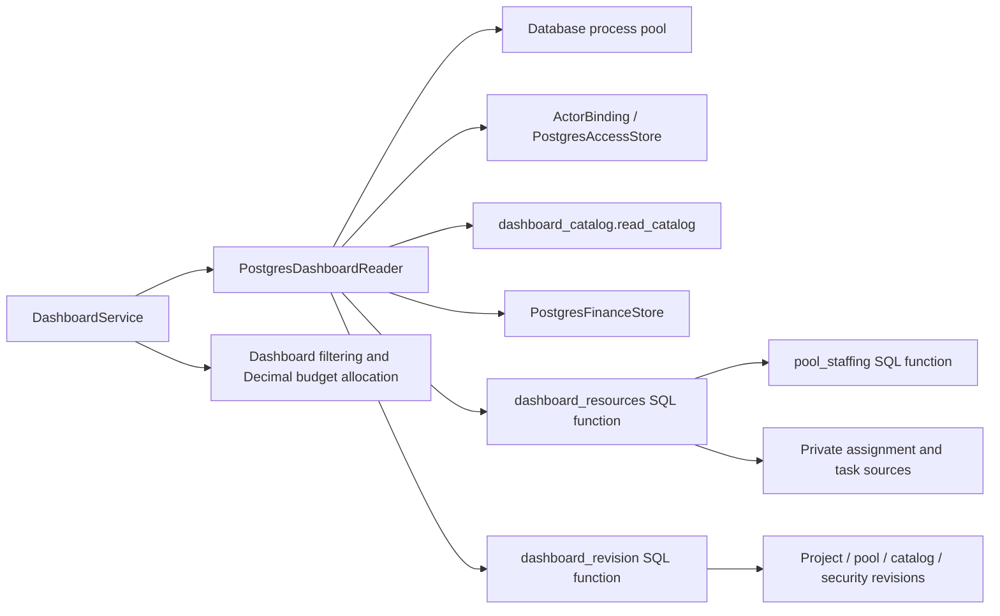

# PostgreSQL dashboard reads

`PostgresDashboardReader` implements the existing dashboard port using the
restricted process pool. Each read binds the actual actor and checks current
session and project scope in a repeatable-read transaction. An active user with
no business grants retains the existing empty dashboard; explicit hidden,
missing or malformed project IDs are denied. Deployment actors cannot call the
runtime adapter.

## Catalog and budget behavior

The catalog batches active project fields, applicable typed properties, ordered
list values, tags and minimal organization labels. Reference labels returned to
the application belong to currently visible facets. Existing duplicate-name
suffixes, explicit team membership and cycle/depth-guarded senior ancestry are
preserved. Native dates become ISO strings and numeric properties become exact
text at this established dashboard boundary.

Reports read the requested latest sealed, uncanceled Approved, Proposed or Draft
plan alongside authorized WBS shares and active blockers. Allocation stays in
Decimal euros and retains rounding for each project/WBS share. Issue lists use
the stable blocking-point code and translated labels; hidden project issues do
not enter counts or lists.

## Private resource aggregation

Migration `0018_dashboard_reads.sql` adds two narrowly granted, fixed-search-path
functions. Neither changes runtime table privileges or row policies.

`dashboard_resources` reauthorizes requested IDs inside PostgreSQL. It selects
pools used by positive assignments on those projects, then includes all
competing demand for those pools inside its privileged aggregate boundary. The
application receives only 80 quarterly capacity/shortfall values and authorized
consumer IDs for drill-through. Hidden assignments, project names, employee
details and calendar reasons do not cross this boundary.

Demand uses interval boundaries: per-project demand is the greater of its
project-level and summed task allocations, then projects are added. Native
staffing supplies calendar-aware effective capacity. Binary64 summation order,
three-place rounding, inclusive dates, partial-date fallback and the existing
25-year expansion cap retain the domain calculation's behavior. Shortages count
only selected-project consuming days. Peaks across pools are concurrent daily
totals; separate pool peaks are never added. A quarter fully covered by calendar
overrides does not invent an unmodified baseline day.

`dashboard_revision` hashes database incarnation, actor/session, current scope,
catalog/security revisions, relevant pool revisions, visible and competing
project revisions, and latest finance statuses. A hidden competing demand edit
invalidates the opaque result; unrelated hidden project/pool edits do not.
Missing required revision metadata fails closed. Session activity does not
invalidate the dashboard, and dashboard reads do not write business revisions.
The application service adds the current date for undated-demand invalidation.

## C3 — Components



## Validation

Real PostgreSQL tests compare the aggregate output with independent pure-domain
calculations over synthetic setup records, including 20 randomized overlapping
workloads, quarter boundaries, custom/undated periods, the long-period cap,
concurrent capacity peaks and full-quarter calendar overrides. Security checks
cover no-grant dashboards, direct SQL calls, invalid signatures, revoked grants
and sessions, minimal labels, missing revision rows and safe storage failures.
A concurrent writer test verifies one consistent read snapshot.

The initial aggregate/integrity run passed **54 tests in 31.26 seconds** with
**134/136 native adapter statements covered (98.53%)**. The full native suite plus
existing dashboard and layer regressions passed **638 tests in 258.60 seconds**.
Dashboard adapter/service/domain coverage is **275/277 statements (99.28%)**;
the native adapters cover **135/136 statements (99.26%)**. See the
[migration evidence](postgresql-migration-evidence.md).

```powershell
.venv/Scripts/python.exe -m dotenv -f .local/postgresql.env run -- .venv/Scripts/python.exe -m pytest -q --tb=short -p no:cacheprovider tests/postgresql tests/test_dashboard.py tests/test_dashboard_ui.py tests/test_layer_boundaries.py --cov=app.infrastructure.postgresql.dashboard --cov=app.infrastructure.postgresql.dashboard_catalog --cov=app.application.services.dashboard --cov=app.domain.dashboard --cov-report=term-missing --cov-report=json:.local/postgresql-dashboard-coverage.json --cov-fail-under=95
```

Logs: `.local/postgresql-dashboard-expanded.log` and
`.local/postgresql-dashboard-all-native.log`. These are subsystem correctness
checks; final application coverage, authenticated browser load and recovery
acceptance remain pending.

## Remaining migration work

The native business read/write ports are now staged for runtime integration.
Composition, authentication lifecycle, process cache injection, operator/seed
and benchmark tools, exact project money inputs and legacy archival still need
the PostgreSQL-only cutover. No final load-performance claim is made here.
