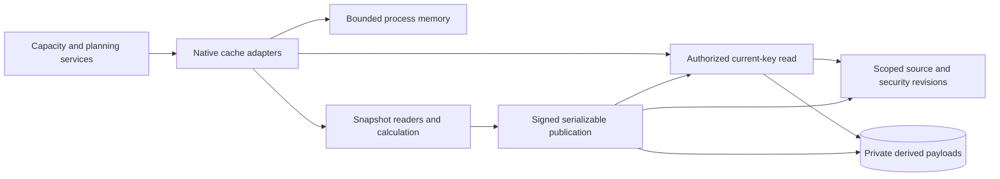

# PostgreSQL capacity and planning caches

Migration `0017_derived_caches.sql` adds private capacity and planning payload
tables. Each actor/session/entity has at most one persisted row, replaced when
its source token, effective day or payload format changes. Entity and session
foreign keys remove orphaned cache entries. Cache writes never update business
source revisions.

## Current reads and guarded publication

`read_derived_cache` generates current keys inside the database from the signed
actor, effective project membership, database identity and source/security
revisions. Its keys match the Python `RevisionSnapshot` fingerprints. Callers
select entities; an old token cannot select an old payload. Known process-memory
tokens only suppress payload transfer when they match the current database keys.
Every hit therefore performs current authorization in a repeatable-read snapshot.

On a miss, the server calculates outside cache locks and transactions. Capacity
inputs and planning header aggregates are read in their own consistent snapshots.
Publication runs separately in a serializable transaction. It validates all
submitted keys together against current database keys and rejects the entire
batch if any source, membership or security fingerprint changed. Up to three
complete calculations are allowed; repeated changes produce a safe retry message.
A fresh authorized read follows publication before results are returned.

Publication requires a server HMAC proof bound to the current transaction and
backend. The proof signs the SHA-256 hash of the frozen body, allowing large
details without enlarging the proof-document limit. A known serialization
rollback replays the entire publication callback with a new proof. Process memory
receives the same frozen payload as PostgreSQL, even if a calculator later mutates
its dictionaries. Late insert failures roll back the complete batch. Ordinary
runtime connections cannot read/write cache tables or invoke private key helpers.

Capacity assignments are restricted to visible projects. Individual staffing
contributions require current shared-administration permission on both database
and memory hits. Planning warning flags are calculated only from visible
dependencies and retain the existing four link rules. Opaque keys are comparison
values, not access grants.

## Process memory and service integration

`DerivedCacheState` keeps immutable serialized entries with a default limit of
128 entries and 32 MiB. Its LRU lock protects only short snapshots and updates;
database I/O and calculations run outside it. Summary reads retain existing full
details, and callers receive independent decoded objects. The effective capacity
day and format participate in memory and persisted lookup. Planning headers have
no day-dependent values and use a fixed cache day.

`PostgresCapacityCache` implements the existing capacity-cache port.
`PostgresPlanningGateway.get_project_summaries` owns summary caching, so the public
planning service no longer requires all summary reads to use a writer. The legacy
gateway retains its existing transaction behavior until runtime archival. Final
composition must inject one `DerivedCacheState` per process into native gateways;
the PostgreSQL runtime cutover remains a separate unfinished milestone.

## C3: components



## Verification and remaining work

Real PostgreSQL checks cover database/Python key parity, cold/persisted/memory
hits, subsets and ordering, day/format changes, independent caller objects, memory
bounds, lock-free concurrent calculations, actor/session isolation, hidden
dependencies and staffing privacy. Tests change source data and grants during
calculation, revoke warm sessions, replay serialization failures, reject forged
proofs and stale tokens, roll back late batch failures, and remove cache owners.

The affected native/existing suite passed **184 tests in 61.15 seconds**. The
expanded cache/planning/service/layer suite passed **164 tests in 53.75 seconds**,
with **456/458 statements covered (99.56%)** across the planning service and
native planning/cache adapters. The native adapters have **308/308 statements
covered (100%)**. Coverage includes unchanged publication bytes, large payloads,
safe decoding/storage failures and warm access revocation.

The full native PostgreSQL suite passed **570 tests in 220.64 seconds** with all
17 migrations installed. This includes the existing business, access, OIDC,
integrity and transaction tests alongside the new cache checks.

```powershell
.venv/Scripts/python.exe -m dotenv -f .local/postgresql.env run -- .venv/Scripts/python.exe -m pytest -q --tb=short -p no:cacheprovider tests/postgresql/test_derived_cache.py tests/postgresql/test_planning.py tests/test_layered_planning.py tests/test_layered_planning_reads.py tests/test_planning_read_projections.py tests/test_layered_pool_capacity.py tests/test_pool_capacity_cache.py tests/test_layer_boundaries.py --cov=app.infrastructure.postgresql.derived_cache --cov=app.infrastructure.postgresql.capacity_cache --cov=app.infrastructure.postgresql.planning --cov=app.application.services.planning --cov-report=term-missing --cov-report=json:.local/postgresql-derived-cache-coverage.json --cov-fail-under=95
.venv/Scripts/python.exe -m dotenv -f .local/postgresql.env run -- .venv/Scripts/python.exe -m pytest -q --tb=short -p no:cacheprovider tests/postgresql
```

Logs: `.local/postgresql-derived-cache-validation.log` and
`.local/postgresql-derived-cache-all-native.log`. Coverage:
`.local/postgresql-derived-cache-coverage.json`.

[Portfolio reads](postgresql-portfolio.md) are now ported. Dashboard reads and
final composition/operator/seed/benchmark cutover remain.
The migration also requires project monetary-input conversion, SQLite runtime
archival, final application coverage, the 50-user browser measurements and
backup/restore/restart acceptance. These cache tests do not establish browser
performance or completion of the overall migration.
