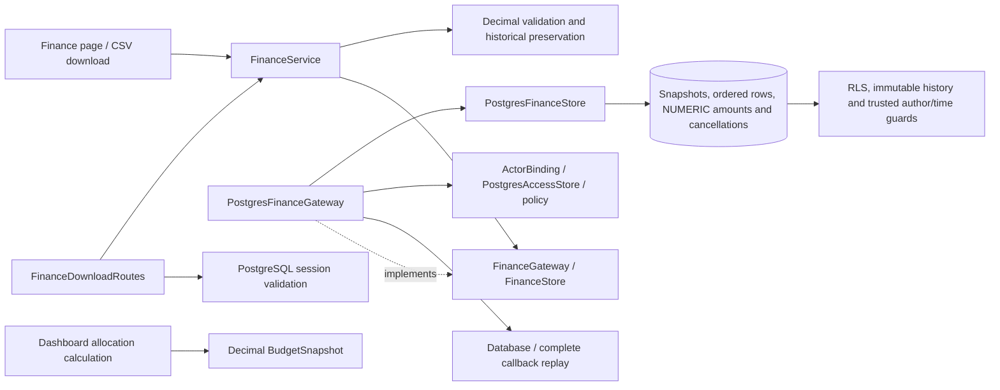

# PostgreSQL finance plans and Decimal euros

`FinanceService` now uses complete callbacks through `PostgresFinanceGateway`.
Each attempt validates the bound active account and session. All active users
can view/export shared finance history independently of project grants; writing
and import validation require the global finance capability. Finance-only users
gain no project visibility or mutation rights. Native guards enforce the same
boundaries and replace submitted audit identities/times with trusted context.

## Monetary and presentation contracts

Finance rows carry Decimal euros from input parsing through services, PostgreSQL
NUMERIC persistence, history preservation and dashboard allocations. Blank cells
remain absent; zero remains explicit. CSV and browser fields retain plain decimal
text with two places. No float intermediate is used for authoritative amounts,
totals, saved plans or exports.

The existing input maximum remains EUR 92,233,720,368,547,758.07. Migration
`0013_finance_amount_limit.sql` preserves that limit alongside the native
nonnegative, finite-number and exact-cent checks. Dashboard allocation still
rounds half up once per project/WBS/year to a cent and then sums those amounts.
A deliberately sized local Decimal context protects calculations from an
unrelated caller's low precision. The Vega chart converts final display
coordinates to float; tables and exports retain exact decimal text.

The legacy SQLite adapter is retained only in the historical archive. Separate
project-budget forms now transport exact decimal strings; their native/browser
validation is recorded in the [runtime guide](postgresql-runtime.md#exact-project-money-forms).

## History, atomicity and replay

Native snapshots preserve the numbered Draft/Proposed/Approved/Canceled workflow.
A complete save inserts metadata, ordered WBS rows and sparse absolute-year
amounts, then seals the snapshot in the same serializable transaction. Rows and
amounts are written in batches; loading a snapshot uses two queries regardless
of row count. Versions, selected rows, capability and WBS labels share one
repeatable-read snapshot.

Saving from an older or canceled source remains allowed. Historical amounts are
copied from the selected source, including zero and removed codes. Cancellation
appends one immutable record without changing plan contents or original status;
readers derive the effective canceled status. Failed amount inserts, sealing or
audit inserts roll back completely.

Nested grid values are copied before callbacks. Each retry rechecks access,
calendar year, source history and the next plan number. Actual concurrent tests
observe replay for empty and populated histories, yielding consecutive committed
numbers. Concurrent cancellation commits one audit record; the second request
revalidates as already canceled. No extra writer lock or counter is introduced.
Only serialization/deadlock rollbacks are replayed, never unique violations or
uncertain commits. Connection errors ask users to check saved versions before
resubmitting instead of falsely promising rollback.

## C3: components



## Validation

- Existing finance/dashboard domain, persistence, Streamlit and layer checks:
  **79 passed in 8.46 seconds**; `.local/postgresql-finance-legacy.log`.
- Initial native finance checks: **20 passed in 7.46 seconds**;
  `.local/postgresql-finance-native.log`.
- Broader native finance, authenticated HTTP downloads, integrity, business
  security, transaction foundation and financial domain checks: **186 passed in
  40.24 seconds**. Finance domain, service and native adapter: **246/246
  statements covered (100%)**; `.local/postgresql-finance-regressions.log` and
  `.local/postgresql-finance-coverage.json`.
- Real finance/dashboard browser workflows: **8 passed in 31.61 seconds**, with
  directly captured pytest **exit code 0**. Checks include actual chart values
  for different WBS shares, editing, saves, imports, cancellation, exit edit mode,
  navigation, large grids and history. Logs:
  `.local/postgresql-finance-browser-verified.log` and
  `.local/postgresql-finance-browser-exit.txt`. Playwright emits shutdown-task
  warnings; an earlier shell-redirection run reported an error despite eight
  passing tests, so the follow-up captured process status directly. Browser
  tests used the then-staged SQLite composition. Those original tests are now
  archived and their native browser ports are recorded in the current
  [migration evidence](postgresql-migration-evidence.md). Native storage and
  sessions are exercised by the PostgreSQL integration/HTTP suite.

```powershell
.venv/Scripts/python.exe -m dotenv -f .local/postgresql.env run -- .venv/Scripts/python.exe -m pytest -q --tb=short -p no:cacheprovider tests/postgresql/test_finance.py tests/postgresql/test_finance_http.py tests/postgresql/test_integrity.py tests/postgresql/test_business_security.py tests/postgresql/test_foundation.py tests/test_finance.py tests/test_dashboard.py --cov=app.infrastructure.postgresql.finance --cov=app.application.services.finance --cov=app.domain.finance --cov-report=term-missing --cov-report=json:.local/postgresql-finance-coverage.json
```

Native checks also cover exact maximum amounts under low Decimal precision,
direct database amount bounds, sealed-history tampering, old-source saves,
consistent reads, copied inputs after rollback, revocation before retried
binding, safe errors and account checks on every authenticated download.
Runtime composition, all business repositories/caches, exact project money inputs
and tools are ported. Full regression/coverage, authenticated responsiveness and
representative deployed recovery remain acceptance gates.
