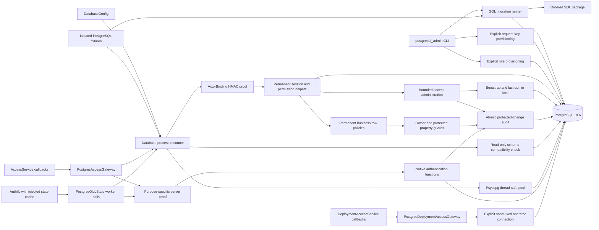

# PostgreSQL foundation operations

This documents the additive migration stage. The application still uses SQLite
until all PostgreSQL repositories and authentication storage are ready. Existing
SQLite and Keycloak files/volumes are retained. Do not deploy an incomplete
cutover by pointing the current application at PostgreSQL.

## Local isolated PostgreSQL setup

Use the project Python 3.14 environment with the pinned requirements installed:

```powershell
.venv/Scripts/python.exe -m scripts.configure_postgresql
docker compose --env-file .local/postgresql.env -f docker-compose.postgresql.yml -f docker-compose.postgresql-test.yml up -d --wait postgres
.venv/Scripts/python.exe -m scripts.postgresql_admin --env-file .local/postgresql.env --url-variable POSTGRES_TEST_ADMIN_URL provision
.venv/Scripts/python.exe -m scripts.postgresql_admin --env-file .local/postgresql.env --url-variable POSTGRES_TEST_ADMIN_URL migrate
.venv/Scripts/python.exe -m scripts.postgresql_admin --env-file .local/postgresql.env --url-variable POSTGRES_TEST_ADMIN_URL configure-security
.venv/Scripts/python.exe -m dotenv -f .local/postgresql.env run -- .venv/Scripts/python.exe -m pytest -q -p no:cacheprovider tests/postgresql
```

The generator exclusively creates `.local/postgresql.env` and refuses overwrite.
It generates separate operator and runtime passwords and a 256-bit
`DATABASE_CONTEXT_KEY` without printing them. Existing configuration created
before actor binding needs that additional deployment-managed key. The
`configure-security` operator command installs its exact value after migration;
it never generates a replacement implicitly. Key rotation takes effect on
subsequent transaction snapshots and requires coordinated server configuration.
The operator URL is supplied explicitly to commands; runtime configuration never
falls back to it. The test overlay exposes PostgreSQL only on loopback port 15432;
omit that overlay for internal-network-only deployment.

The official PostgreSQL image creates the initial operator role for cluster
administration. `provision` explicitly creates `eppm_runtime` (nonlogin group)
and `eppm_app` (restricted login), without changing existing passwords. Runtime
pool startup rejects database owners, elevated roles and schema creators,
including privileges reachable through non-inherited `SET ROLE` membership.
`migrate` applies an entire pending ordered SQL package atomically with checksum
verification and a transaction advisory lock. `check` reads compatibility only.

Tests create databases named `eppm_test_<random UUID>` using explicit setup
credentials. Their pooled queries run as the separate nonowner runtime login.
Cleanup targets only the random database each fixture created. It never resets
an environment-selected database or deletes a Docker volume.

## C3 — Implemented foundation components



`Database.run` supplies repeatable-read read-only snapshots or serializable
read-write callbacks. It repeats trusted actor binding and the entire callback
only for definite serialization/deadlock rollbacks, at most three attempts.
Connection loss, statement timeouts and uncertain commits are not replayed.
Commit/rollback finishes before pool return; reset discards session-level changes
and temporary relations before a different actor borrows the connection.
`TransactionRunner` is the database-independent application port for subsequent
gateway integration. Application composition and ASGI lifecycle integration are
not yet switched in this additive milestone.

Native administration functions enforce the access-management capability,
configured MFA and recent authentication before registration, status changes,
granting or revocation. Each operation includes mandatory audit and security
revision changes in its caller-owned transaction. A narrowly scoped advisory
lock and serializable replay preserve the last active administrator. Read
policies expose each account's own profile/grants, with administration-only
access to other accounts and audit. Separate scope-configuration functions
expose eligible categorical references and bounded project labels without
granting portfolio reads.

`operator_appoint_admin` is executable only with separate operator credentials.
It verifies a prior OIDC identity, performs bootstrap once, and requires explicit
operator/correlation/reason data for recovery. Its caller must own a serializable
transaction. `PostgresDeploymentAccessGateway` supplies separate, short-lived
operator connections, verifies the schema and replays the complete service
callback only after a definite rollback. Operator CLI wiring remains pending.

## Authentication and callback contracts

`AccessGateway.run` receives a complete operation and optional trusted actor.
Every retry creates a fresh store and binds the actor against the new snapshot.
Security store mutations include their audit and continuity checks as one
operation; the service does not append a second audit event. Cookie and
correlation generation happen outside replayable callbacks. Verified token
expiry and current authorization are checked again inside each attempt.

Before a session exists, `ServerRequestSigner` binds one exact request to its
purpose, PostgreSQL backend and transaction start. Only the server owns the
deployment signing key. The native functions verify that proof before storing
or consuming OIDC state, looking up a cookie hash, or persisting a verified
identity and rotating its session. A proof cannot be replayed on a different
connection/transaction or used as actor context. Runtime SQL has no direct
access to the identity, session, OIDC-state or private-key tables.

`create_oidc_client` accepts an explicit async state-cache dependency.
`PostgresOidcState` moves synchronous database work onto worker threads and
consumes state with `DELETE RETURNING` in a serializable transaction. It preserves
the opaque Authlib string exactly, hashes request keys and caps lifetime at ten
minutes. Retries preserve the original storage deadline and recheck consumption
expiry. Concurrent callbacks can receive a verifier only once.

Bound activity and logout affect only the current browser session, preserve
provider authentication time and do not advance the global security revision.
Logout's audit and revocation commit or roll back together. Concurrent first
logins for one issuer/subject resolve to a single account without duplicate
session audit after retry. Native error diagnostics remain behind a safe access
adapter boundary.

The domain policy can resolve a scope through a separate server-signed operation
only for a persisted grant belonging to the bound actor or an access
administrator. Invalid/dangling references return a typed miss so the same
read snapshot can still evaluate other grants. Public SQL permission helpers
and business RLS continue to hide project IDs from finance-only users.

The launcher now uses the access callback contract but still composes the
existing SQLite repositories explicitly. PostgreSQL authentication is exercised
through native service and Authlib HTTP integration tests; production composition
switches when the remaining business repositories are ready.

The [organization repository](postgresql-organization.md) now uses the same
callback runner and actor binding for native functions, teams, employees,
calendar exceptions and optional hierarchy types. Its service integration and
minimal name directory are implemented and tested; application composition
remains staged until the remaining repositories are ported.
